# Contents

- [1. Executive Summary](#1-executive-summary)
- [2. Project Architecture](#2-project-architecture)
- [3. Business Objectives](#3-business-objectives)
- [4. Dataset Overview](#4-dataset-overview)
- [5. Analytical Framework](#5-analytical-framework)
  - [6. Layer 1. Lifecycle Transition Analytics](#6-layer-1-lifecycle-transition-analytics)
	- [6.1 Business Objective](#61-business-objective)
	- [6.2 Analytical Approach](#62-analytical-approach)
	- [6.3 Lifecycle Transition Framework](#63-lifecycle-transition-framework)
	- [6.4 Customer Migration Dynamics](#64-customer-migration-dynamics)
	- [6.5 Revenue Transition Analysis](#65-revenue-transition-analysis)
  	- [6.6 Revenue Driver Framework](#66-revenue-driver-framework)
    - [6.7 Retained Customer Economics](#67-retained-customer-economics)
    - [6.8 Key Findings & Business Implications](#68-key-findings--business-implications)
  - [7. Layer 2. Cohort Retention & Customer Value Dynamics](#7-layer-2-cohort-retention--customer-value-dynamics)
  	- [7.1 Business Objective](#71-business-objective)
    - [7.2 Analytical Approach](#72-analytical-approach)
    - [7.3 Cohort Retention Analysis](#73-cohort-retention-analysis)
    - [7.4 Retention Decay Analysis](#74-retention-decay-analysis)
    - [7.5 Revenue Retention Analysis](#75-revenue-retention-analysis)
    - [7.6 Customer Value Evolution (RPRU)](#76-customer-value-evolution-rpru)
    - [7.7 Retention vs Monetization Dynamics](#77-retention-vs-monetization-dynamics)
    - [7.8 Cohort LTV Dynamics](#78-cohort-ltv-dynamics)
    - [7.9 Cohort Variability Analysis](#79-cohort-variability-analysis)
    - [7.10 Key Findings & Business Implications](#710-key-findings--business-implications)
  - [8. Layer 3. Predictive Customer Analytics](#8-layer-3-predictive-customer-analytics)
  	- [8.1 Business Objective](#81-business-objective)
   	- [8.2 Analytical Approach](#82-analytical-approach)
  	- [8.3 Feature Engineering](#83-feature-engineering)
    - [8.4 Model Development](#84-model-development)
    - [8.5 Model Performance](#85-model-performance)
    - [8.6 SHAP Analysis](#86-shap-analysis)
    - [8.7 Risk Segmentation](#87-risk-segmentation)
    - [8.8 Customer Value & Risk Matrix](#88-customer-value--risk-matrix)
    - [8.9 Recovery Modeling & Retention Prioritization](#89-recovery-modeling--retention-prioritization)
    - [8.10 Retention Prioritization Score](#810-retention-prioritization-score)
    - [8.11 Saveability Matrix](#811-saveability-matrix)
    - [8.12 Key Findings & Business Implications](#812-key-findings--business-implications)
  - [9. Layer 4. Lifecycle KPI Framework & Customer Health Monitoring](#9-layer-4-lifecycle-kpi-framework--customer-health-monitoring)
  	- [9.1 Business Objective](#91-business-objective)
   	- [9.2 Framework Architecture](#92-framework-architecture)
    - [9.3 KPI Dashboard](#93-kpi-dashboard)
    - [9.4 Lifecycle Stability Analysis](#94-lifecycle-stability-analysis)
    - [9.5 Lifecycle KPI Trends](#95-lifecycle-kpi-trends)
    - [9.6 Revenue Concentration](#96-revenue-concentration)
    - [9.7 Revenue-at-Risk](#97-revenue-at-risk)
    - [9.8 Retention Prioritization](#98-retention-prioritization)
    - [9.9 Retention Strategy Matrix](#99-retention-strategy-matrix)
    - [9.10 Key Findings & Business Implications](#910-key-findings--business-implications)
- [10. Executive Metrics Overview](#10-executive-metrics-overview)
- [11. Integrated Business Insights](#11-integrated-business-insights)
- [12. Strategic Recommendations](#12-strategic-recommendations)
- [13. Limitations & Future Work](#13-limitations--future-work)
- [14. Technical Stack](#14-technical-stack)

  
<b>[6. Layer 1. Lifecycle Transition Analytics](#6-layer-1-lifecycle-transition-analytics)</b>

  - Data Preparation & Segmentation Logic
  - Transition Matrix Construction
  - Key Insights: Churn vs. Retention Drivers

  
<b>Layer 2. Cohort Retention & Value Dynamics</b>

  - Retention Curve Analysis
  - Monetization Trends (RPRU)
  - Inter-cohort Comparison

---

# 1. Executive Summary

Текст раздела...

# 2. Project Architecture

Текст раздела...

# 6. Layer 1. Lifecycle Transition Analytics

## 6.1 Business Objective

### Бизнес-контекст

Статический анализ клиентской базы позволяет понять текущее распределение пользователей по сегментам, однако практически не отвечает на вопрос о том, как именно формируется рост или снижение бизнеса во времени.  
Для аптечной сети критически важно понимать не только текущее состояние клиентского портфеля, но и механизмы его изменения:
-	каким образом клиенты переходят между стадиями жизненного цикла; 
-	какие сегменты демонстрируют наиболее устойчивое поведение; 
-	где возникают основные потери клиентов; 
-	какие изменения пользовательского поведения приводят к росту или снижению выручки. 
Особую важность представляет анализ переходов между lifecycle-состояниями, поскольку именно они позволяют выявлять ранние признаки деградации клиентской базы задолго до фактического оттока.

### Цель анализа

Цель данного раздела — построить систему Lifecycle Transition Analytics, позволяющую количественно оценить динамику клиентской базы и связанные с ней денежные потоки.  
В рамках анализа необходимо:
-	исследовать миграцию клиентов между lifecycle-сегментами; 
-	оценить устойчивость различных состояний жизненного цикла; 
-	выявить основные сценарии деградации и удержания клиентов; 
-	определить ключевые источники роста и потери выручки; 
-	проанализировать вклад retention, reactivation, expansion, contraction и churn в изменение финансовых результатов бизнеса. 

### Ключевые бизнес-вопросы

Анализ направлен на получение ответов на следующие вопросы:  
-	Насколько устойчивы различные lifecycle-состояния? 
-	Какие переходы между сегментами происходят наиболее часто? 
-	Какие стадии жизненного цикла обладают наибольшим риском деградации? 
-	Через какие механизмы формируется churn? 
-	Какие клиентские переходы генерируют наибольший рост выручки? 
-	Какие сегменты являются основными источниками revenue loss? 
-	Что оказывает большее влияние на финансовую динамику бизнеса: привлечение новых клиентов или развитие существующей клиентской базы? 

## 6.2 Analytical Approach

Для анализа был разработан snapshot-based lifecycle framework, позволяющий отслеживать эволюцию клиентской базы во времени.  
Для каждого клиента рассчитывались поведенческие характеристики на основе транзакционной истории:  
*-	Recency;*   
*-	Frequency;*   
*-	Monetary;*   
*-	Customer Tenure.*  

На основе этих показателей пользователи классифицировались по пяти стадиям жизненного цикла:  
*-	New*  
*-	Active*  
*-	Loyal*  
*-	At Risk*  
*-	Churn*  

Для оценки динамики клиентского поведения были сформированы шесть последовательных lifecycle snapshots, каждый из которых отражал состояние клиентской базы на соответствующий момент времени.
Далее для каждой пары последовательных snapshots строились transition matrices, описывающие перемещение клиентов между lifecycle-состояниями.  
На основе полученных матриц была сформирована агрегированная модель переходов, позволяющая анализировать:
-	устойчивость сегментов; 
-	миграцию клиентов; 
-	сценарии деградации; 
-	churn dynamics; 
-	процессы формирования и потери клиентской ценности. 
Дополнительно для каждого перехода рассчитывались связанные изменения выручки, что позволило объединить behavioral analytics и revenue analytics в рамках единой lifecycle-модели.

## 6.3 Lifecycle Transition Framework
### Цель анализа

Первым этапом исследования является анализ переходов между lifecycle-состояниями.
В отличие от классической сегментации клиентов, рассматривающей сегменты как статические группы пользователей, данный подход позволяет исследовать клиентскую базу как динамическую систему, внутри которой пользователи постоянно изменяют свое поведение и перемещаются между различными стадиями жизненного цикла.
Основная задача данного этапа — определить, насколько устойчивы различные lifecycle-сегменты и какие сценарии миграции формируют долгосрочную структуру клиентской базы.

### Построение Transition Framework

Для анализа динамики клиентского поведения были сформированы шесть последовательных lifecycle snapshots.  
На основе последовательных пар snapshots были построены пять transition matrices:

    Snapshot 1 → Snapshot 2
    Snapshot 2 → Snapshot 3
    Snapshot 3 → Snapshot 4
    Snapshot 4 → Snapshot 5
    Snapshot 5 → Snapshot 6

Каждая матрица отражает вероятность перехода клиентов между lifecycle-состояниями в течение наблюдаемого периода.
Для получения устойчивой оценки поведенческих закономерностей все матрицы были агрегированы в единую Lifecycle Transition Matrix.

### Figure 1. Evolution of Lifecycle Transition Matrices
[Вставить рисунок 1]
Коллаж из пяти transition matrices.
Подпись:
Матрицы переходов между lifecycle-состояниями для последовательных временных периодов.

### Figure 2. Агрегированная матрица переходов между lifecycle-состояниями за весь период наблюдения.

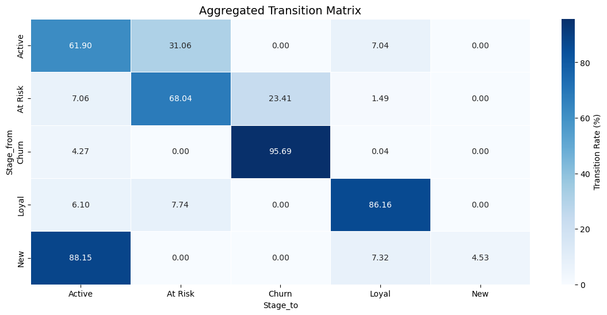

### Ключевые результаты

Анализ агрегированной матрицы переходов выявил существенные различия в устойчивости различных lifecycle-сегментов.
Наиболее стабильным состоянием среди активной клиентской базы оказался сегмент Loyal. Большинство клиентов, достигших данной стадии, сохраняют высокий уровень вовлеченности и продолжают совершать покупки в последующих периодах.
Сегмент Churn также характеризуется высокой стабильностью, однако уже в негативном смысле: подавляющее большинство клиентов, перешедших в состояние оттока, не возвращаются к активному потреблению.
Сегмент Active выступает ключевой точкой формирования будущей динамики клиентской базы. Несмотря на высокую долю клиентов, сохраняющих статус Active, вероятность перехода в состояние At Risk существенно превышает вероятность перехода в сегмент Loyal.
Сегмент At Risk выполняет роль промежуточного состояния между активным потреблением и окончательным оттоком. Для клиентов данной группы вероятность дальнейшей деградации оказывается выше вероятности возврата к стабильной активности.
Для новых клиентов наблюдается высокий уровень первичной активации: большинство пользователей успешно переходят в сегмент Active после первой покупки. Однако лишь небольшая часть сразу формирует устойчивое лояльное поведение.

### Бизнес-интерпретация

Полученные результаты показывают, что отток клиентов является не разовым событием, а постепенным процессом поведенческой деградации.

    Наиболее типичный сценарий развития негативной динамики:
    Active  →  At Risk  →  Churn

Таким образом, признаки будущего оттока начинают проявляться задолго до того момента, когда клиент фактически прекращает взаимодействие с компанией.
Одновременно анализ показывает, что сегмент Loyal является основным источником долгосрочной устойчивости клиентской базы. После формирования регулярного покупательского поведения вероятность дальнейшего удержания клиента существенно возрастает.
Это позволяет рассматривать lifecycle transitions как ранние индикаторы будущего состояния клиентского портфеля.

### Стратегические выводы

С точки зрения управления удержанием особое внимание следует уделять трем переходам:

    • Active → At Risk  
    Основной источник формирования будущего оттока.

    • At Risk → Churn  
    Критический этап окончательной потери клиента.

    • Active → Loyal  
    Наиболее важный путь формирования долгосрочной клиентской ценности.

Полученные результаты указывают на необходимость смещения retention-активностей в более ранние стадии жизненного цикла, когда изменения поведения еще являются обратимыми.

### Вывод по разделу

Переходы между lifecycle-состояниями формируют устойчивую и предсказуемую структуру поведения клиентской базы.
Большая часть клиентов перемещается между ограниченным набором типовых состояний, причем основные потери клиентов происходят через постепенную деградацию в сегменте At Risk, а основная клиентская ценность концентрируется в сегменте Loyal.
Следовательно, мониторинг lifecycle transitions может использоваться как инструмент раннего выявления рисков и как основа для построения проактивной retention-стратегии.

## 6.4 Customer Migration Dynamics

### Цель анализа

После оценки вероятностей переходов между lifecycle-состояниями необходимо понять не только вероятность миграции клиентов, но и масштаб этих перемещений.
Если Transition Matrix отвечает на вопрос:
Насколько вероятен тот или иной переход?
то анализ клиентских потоков отвечает на вопрос:
Какое количество клиентов реально перемещается между состояниями жизненного цикла?
Это позволяет выявить наиболее значимые маршруты миграции внутри клиентской базы и определить сегменты, формирующие основные потоки удержания и потери клиентов.

### Методология
Для каждой пары последовательных snapshots были рассчитаны фактические переходы клиентов между lifecycle-состояниями.
Полученные переходы были агрегированы за весь период наблюдения и визуализированы с помощью Sankey Diagram, отражающей движение клиентов между состояниями жизненного цикла.

### Figure 3. Агрегированные потоки клиентов между lifecycle-состояниями за весь период наблюдения.  

### Ключевые результаты
Анализ клиентских потоков показал, что большая часть пользователей перемещается между ограниченным набором состояний жизненного цикла.

    Наиболее крупные потоки формируются внутри сегментов:
    • Active → Active
    • Loyal → Loyal
    • At Risk → At Risk

что подтверждает наличие устойчивых поведенческих режимов внутри клиентской базы.

    Среди межсегментных переходов наибольший объем клиентов приходится на:
    • New → Active
    • Active → At Risk
    • At Risk → Churn

что отражает типичный жизненный цикл клиента после первой покупки.

### Бизнес-интерпретация

Клиентская база развивается по достаточно предсказуемой траектории.

    Основной сценарий роста выглядит следующим образом:
    New  →  Active  →  Loyal

    Основной сценарий деградации:
    Active  →  At Risk  →  Churn

Это свидетельствует о том, что формирование оттока происходит постепенно и может быть обнаружено на ранних этапах ухудшения поведения.

### Стратегические выводы

Сегмент At Risk выступает ключевой зоной формирования будущего churn.
Одновременно переход Active → Loyal является основным механизмом формирования долгосрочной клиентской ценности.
Следовательно, управление миграцией клиентов между lifecycle-состояниями должно стать одним из центральных элементов retention-стратегии компании.

## 6.5 Revenue Transition Analysis
### Цель анализа

После анализа клиентских потоков возникает следующий вопрос:
Как перемещение клиентов между lifecycle-состояниями влияет на выручку компании?
Даже одинаковые по количеству клиентские переходы могут иметь принципиально разное финансовое значение.
Поэтому следующим этапом проводится анализ денежных потоков между lifecycle-состояниями.

### Методология
Для каждого перехода между lifecycle-состояниями была рассчитана совокупная выручка клиентов и изменение выручки относительно предыдущего периода.
На основе этих данных построены:  
-	Revenue Transition Matrix;   
-	Revenue Change Matrix;   
-	Top Positive & Negative Revenue Drivers.   

### Figure 4. Совокупная выручка, связанная с переходами между lifecycle-состояниями.

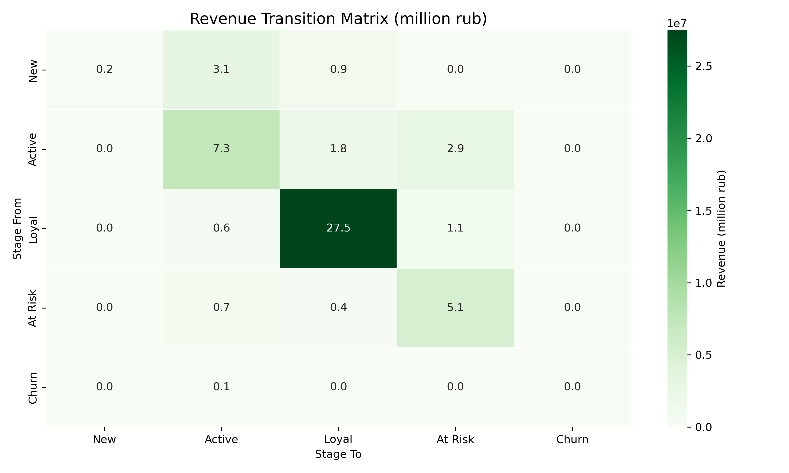

### Figure 5. Изменение выручки для различных lifecycle transitions.

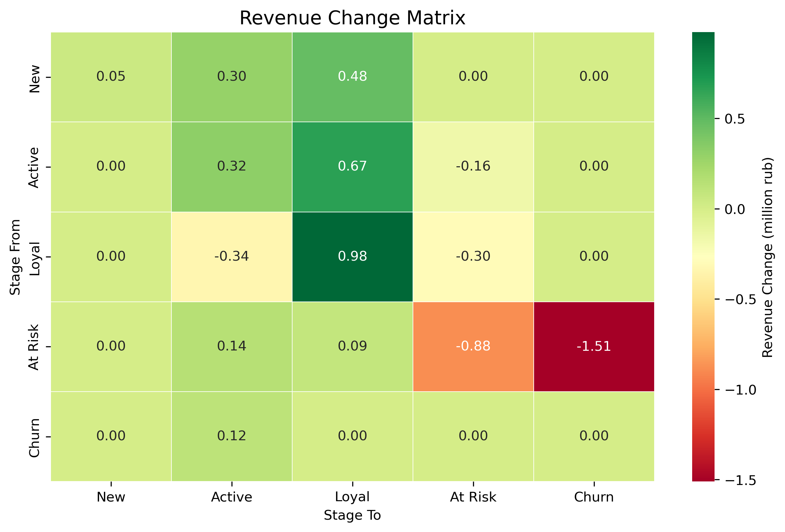

### Figure 6. Наиболее значимые источники роста и потери выручки

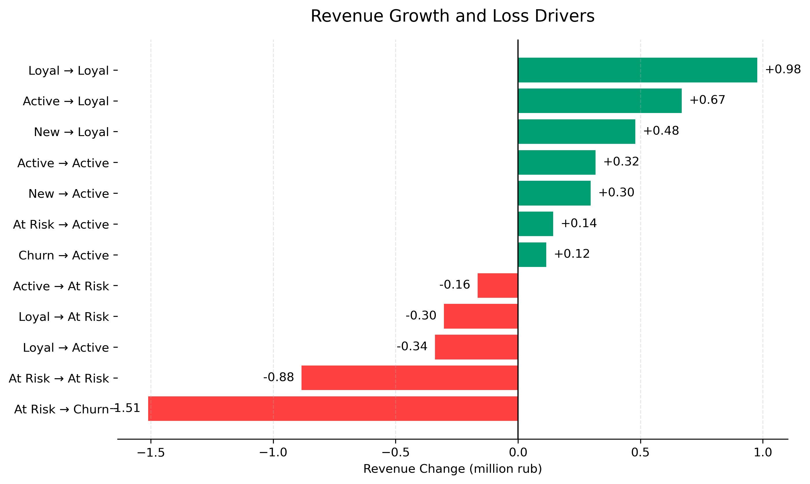

### Ключевые результаты
Анализ показал, что основная часть выручки концентрируется внутри удержанной клиентской базы.

    Наиболее значимый положительный вклад формируют переходы:
    • Loyal → Loyal
    • Active → Active
    • Active → Loyal

    Наиболее существенные потери выручки связаны с переходами:
    • At Risk → Churn
    • Loyal → At Risk
    • Active → At Risk
    
Полученные результаты показывают, что деградация поведения клиентов оказывает значительное влияние на финансовые результаты компании еще до фактического оттока.

### Бизнес-интерпретация
Потери бизнеса формируются не только за счет churn.
Значительная часть revenue loss возникает на промежуточных стадиях ухудшения клиентского поведения.
Таким образом, снижение активности существующих клиентов представляет не меньшую угрозу, чем непосредственная потеря пользователей.

### Стратегические выводы
Наиболее эффективными точками воздействия являются переходы, сопровождающиеся ранними признаками деградации покупательского поведения.
Предотвращение переходов в сегмент At Risk потенциально позволяет сохранить значительно больший объем выручки, чем реакция на уже состоявшийся churn.

## 6.6 Revenue Driver Framework
### Цель анализа
После анализа revenue transitions возникает необходимость определить механизмы, через которые формируется изменение общей выручки бизнеса.
Для этого была построена модель классификации revenue drivers, позволяющая разделить рост и снижение выручки на отдельные поведенческие компоненты.

### Driver Classification Model

Все изменения выручки были распределены по пяти категориям:  
- *Acquisition* - Выручка от новых клиентов.   
- *Reactivation* - Выручка от ранее потерянных клиентов, вернувшихся к покупкам.  
- *Expansion* - Рост выручки внутри существующей клиентской базы.  
- *Contraction* - Снижение выручки среди удержанных клиентов.  
- *Churn* - Потери выручки вследствие прекращения активности клиентов.  

### Figure 7. Структура изменения выручки по поведенческим драйверам.

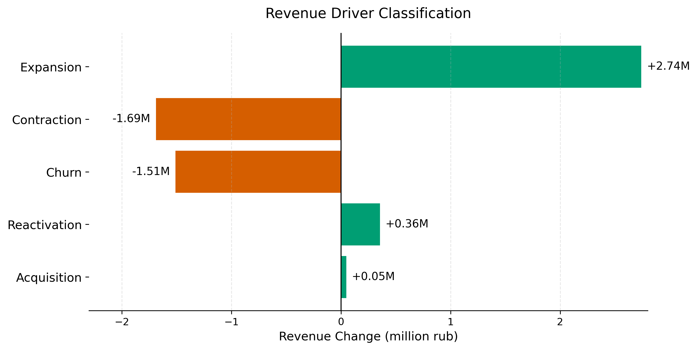

### Revenue Growth Decomposition
После определения основных драйверов изменения выручки необходимо оценить их совокупный вклад в итоговую динамику бизнеса. Для этого используется модель Revenue Growth Decomposition, которая позволяет разложить изменение выручки на ключевые компоненты роста бизнеса и количественно оценить влияние каждого из них на итоговый финансовый результат.

### Figure 8. Декомпозиция изменения выручки по основным поведенческим драйверам.

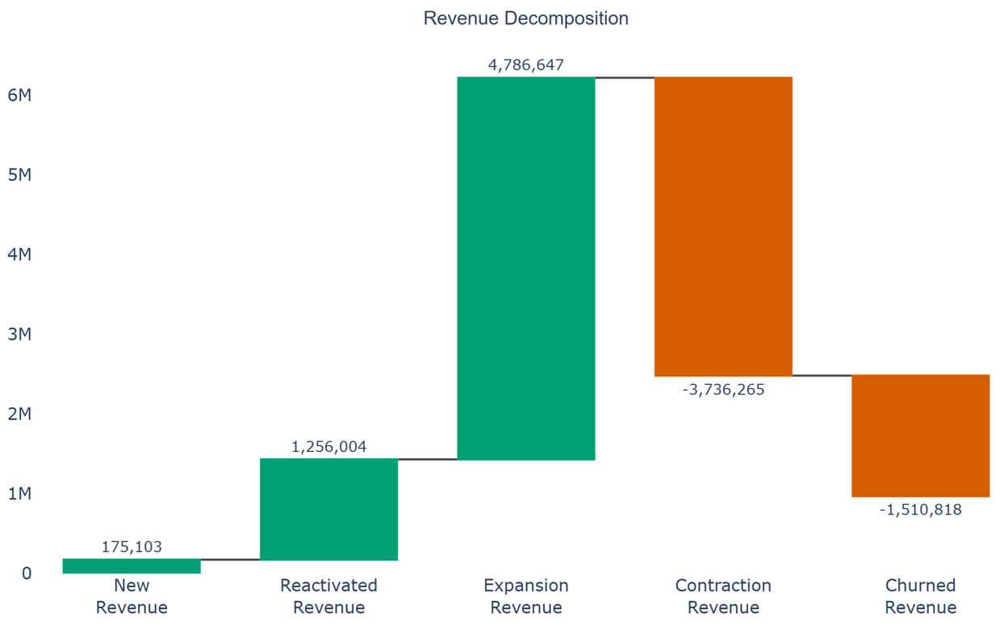

Interactive version: [Open Plotly chart](visualizations/revenue_decomposition.html)

### Ключевые результаты

Анализ показал, что изменение выручки формируется одновременно несколькими механизмами.
Рост бизнеса обеспечивается за счет:
-	привлечения новых клиентов; 
-	реактивации ранее потерянных пользователей; 
-	расширения потребления существующей клиентской базы.

Одновременно существенное влияние оказывают:
-	снижение активности удержанных клиентов; 
-	прямые потери вследствие churn.

Особенно важно, что значительная часть финансовой динамики формируется внутри уже существующей клиентской базы, а не исключительно за счет привлечения новых пользователей.

### Бизнес-интерпретация

Полученные результаты показывают, что долгосрочный рост бизнеса зависит не только от acquisition, но и от способности компании увеличивать ценность существующих клиентов.
Фактически retention и customer development оказываются не менее важными драйверами роста, чем привлечение новой аудитории.

### Стратегические выводы
Revenue Driver Framework позволяет перейти от анализа отдельных lifecycle-переходов к пониманию фундаментальных механизмов формирования финансового результата.
С точки зрения управления ростом бизнеса особое внимание следует уделять:
-	развитию существующей клиентской базы; 
-	снижению contraction среди удержанных клиентов; 
-	реактивации клиентов с высоким потенциалом возврата; 
-	предотвращению переходов в churn. 

### Вывод по разделу

Проведенный анализ показал, что динамика выручки является прямым следствием изменений клиентского поведения.
Рост бизнеса формируется через acquisition, reactivation и expansion, тогда как основные потери возникают вследствие contraction и churn.
Построенный Revenue Driver Framework обеспечивает прозрачную связь между изменением поведения клиентов и финансовыми результатами компании, создавая основу для принятия retention-ориентированных управленческих решений.

## 6.7 Retained Customer Economics
### Цель анализа

Предыдущие этапы исследования показали, каким образом клиенты перемещаются между lifecycle-состояниями и как эти переходы влияют на общую динамику выручки.
Однако изменение финансовых результатов бизнеса определяется не только удержанием клиентов как таковым.
Даже среди клиентов, которые остаются активными, могут происходить существенные изменения покупательского поведения:
-	часть пользователей увеличивает объем потребления; 
-	часть пользователей снижает интенсивность покупок; 
-	часть клиентов сохраняет относительно стабильный уровень потребления. 

Поэтому следующим этапом анализа проводится исследование экономики удержанной клиентской базы.
Основная задача данного этапа — определить, формируют ли удержанные клиенты дополнительный рост выручки или, наоборот, становятся источником постепенной деградации бизнеса.

### Методология

Для клиентов, сохранивших активность между последовательными периодами наблюдения, были рассчитаны изменения выручки относительно предыдущего периода.
Все удержанные клиенты были классифицированы по трем типам поведения:  
- *Expansion* - Рост выручки относительно предыдущего периода.  
- *Stable* - Сохранение сопоставимого уровня потребления.  
- *Contraction* - Снижение выручки относительно предыдущего периода.

Такой подход позволяет оценить качество удержания клиентской базы, а не только факт ее сохранения.

### Figure 9. Совокупный вклад роста и снижения потребления внутри удержанной клиентской базы.

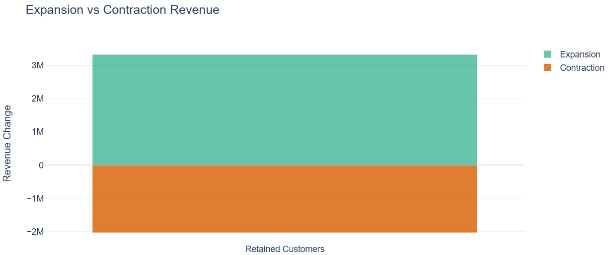 

### Ключевые результаты

Анализ показал, что удержание клиентов не является однородным процессом.
Даже внутри сохраненной клиентской базы наблюдаются существенные различия в динамике потребления.
Часть удержанных пользователей демонстрирует устойчивый рост покупательской активности и формирует положительный вклад в изменение выручки компании.
Одновременно значительная доля клиентов остается активной формально, однако постепенно сокращает объем потребления, генерируя скрытые потери выручки.
Таким образом, удержание клиента само по себе не гарантирует сохранение его экономической ценности.

### Бизнес-интерпретация

Полученные результаты показывают, что традиционные показатели retention отражают лишь количественную сторону удержания.
Фактическая экономическая эффективность retention зависит от качества удержанной клиентской базы.
Компания может демонстрировать высокие показатели удержания пользователей и одновременно сталкиваться с ухудшением финансовых результатов вследствие постепенного снижения активности существующих клиентов.
Поэтому анализ retained customer economics позволяет выявлять риски, которые остаются незаметными при использовании только классических retention-метрик.

### Стратегические выводы

Наибольшую ценность для бизнеса представляет не просто удержание клиентов, а увеличение их долгосрочной потребительской активности.  
С точки зрения управления клиентской базой особое внимание следует уделять:
-	стимулированию expansion среди активных клиентов; 
-	раннему выявлению contraction-поведения; 
-	разработке программ развития клиентской ценности; 
-	контролю скрытых потерь выручки внутри удержанной базы. 

### Вывод по разделу
Анализ retained customer economics показал, что значительная часть финансовой динамики бизнеса формируется внутри уже удержанной клиентской базы.
Следовательно, управление ростом бизнеса требует не только предотвращения churn, но и систематического развития покупательской активности существующих клиентов.

## 6.8 Key Findings & Business Implications
### Executive Summary of Findings

Проведенный анализ показал, что динамика клиентской базы формируется через ограниченное количество устойчивых поведенческих сценариев.
Lifecycle-переходы демонстрируют высокую степень предсказуемости, что позволяет использовать их в качестве ранних индикаторов будущих изменений retention и revenue dynamics.

**Finding 1. Customer Churn Is a Gradual Process**  
Основная часть клиентских потерь формируется не одномоментно, а через последовательную деградацию поведения.
Наиболее характерный сценарий выглядит следующим образом:

    Active 
      ↓
    At Risk
      ↓
    Churn
    
Это означает, что признаки будущего оттока возникают значительно раньше фактической потери клиента.

**Finding 2. Loyal Customers Form the Core of Business Stability**  
Сегмент Loyal демонстрирует максимальную устойчивость среди активных lifecycle-состояний.
Клиенты, достигшие данной стадии, обладают значительно более высокой вероятностью дальнейшего удержания и формируют основу долгосрочной клиентской ценности.

**Finding 3. Revenue Loss Emerges Before Churn**  
Финансовые потери начинают формироваться задолго до окончательного ухода клиента.
Переходы в сегмент At Risk сопровождаются заметным ухудшением потребительского поведения и снижением объема покупок.
В результате существенная часть revenue loss возникает еще до фактического перехода клиентов в состояние Churn.

**Finding 4. Existing Customers Drive a Significant Share of Revenue Dynamics**  
Изменение выручки определяется не только привлечением новых пользователей.
Существенную роль играют процессы expansion и contraction внутри существующей клиентской базы.
Это означает, что развитие отношений с текущими клиентами оказывает не меньшее влияние на финансовые результаты, чем acquisition.

**Finding 5. Lifecycle Transitions Can Be Used as Leading Indicators**  
Высокая устойчивость transition patterns позволяет использовать lifecycle-переходы в качестве инструмента раннего прогнозирования изменений клиентской базы.
Мониторинг переходов между lifecycle-состояниями способен выявлять ухудшение customer health существенно раньше традиционных показателей churn.

### Business Implications

Полученные результаты формируют несколько важных управленческих выводов.

**Retention Strategy**  
Фокус удержания должен смещаться в сторону раннего выявления клиентов, демонстрирующих признаки перехода из Active в At Risk.

**Revenue Protection**  
Для минимизации потерь выручки необходимо контролировать не только churn, но и процессы постепенной деградации покупательской активности внутри удержанной базы.

**Customer Development**  
Рост бизнеса зависит не только от acquisition, но и от способности компании развивать существующих клиентов и стимулировать expansion-поведение.

**CRM Prioritization**  
Lifecycle-состояния могут использоваться как основа для приоритизации CRM-активностей и персонализированных retention-механик.

## Итог раздела

В рамках данного этапа была построена система Lifecycle Transition Analytics, объединяющая анализ клиентской миграции, денежных потоков и драйверов изменения выручки.
Проведенное исследование показало, что изменение финансовых результатов бизнеса является прямым следствием изменений клиентского поведения и может быть объяснено через ограниченный набор lifecycle-переходов и revenue drivers.
Полученные результаты формируют основу для следующего этапа исследования — анализа долгосрочного удержания и формирования customer value на уровне когорт пользователей.

# 7. Layer 2. Cohort Retention & Customer Value Dynamics

## 7.1 Business Objective

### Бизнес-контекст

Для большинства компаний привлечение новых клиентов является дорогостоящим процессом, поэтому долгосрочная устойчивость бизнеса во многом определяется способностью удерживать существующую клиентскую базу и увеличивать ценность клиентов после первой покупки. Однако традиционные показатели продаж позволяют оценить лишь текущие финансовые результаты и практически не отвечают на вопрос о том, как развивается поведение клиентов после привлечения.  

Для аптечной сети особенно важно понимать:  
-	насколько быстро пользователи прекращают совершать повторные покупки;   
-	существуют ли устойчивые модели долгосрочного потребления;   
-	как меняется покупательская активность по мере взросления клиентов;   
-	каким образом формируется долгосрочная клиентская ценность;   
-	какие когорты демонстрируют наиболее устойчивое поведение.

Для решения этих задач необходим переход от анализа отдельных транзакций к когортному подходу, позволяющему отслеживать жизненный цикл клиентов с момента первой покупки и анализировать их поведение во времени.  
  
### Цель анализа

Цель данного раздела — исследовать долгосрочную динамику удержания клиентов и формирования customer value на уровне когорт пользователей.   
В рамках анализа необходимо:  
-	оценить скорость снижения клиентской активности после первой покупки;  
-	определить критические этапы жизненного цикла, на которых происходит максимальный отток;   
-	исследовать устойчивость удержания различных когорт;   
-	проанализировать изменение выручки удержанных клиентов во времени;   
-	оценить динамику customer value после привлечения;   
-	определить степень различий между когортами и устойчивость выявленных закономерностей.   

### Ключевые бизнес-вопросы

Анализ направлен на получение ответов на следующие вопросы:  
-	Как быстро снижается активность клиентов после первой покупки?   
-	На каких этапах жизненного цикла происходит основной отток?   
-	Формируется ли устойчивое повторное покупательское поведение?   
-	Насколько отличаются показатели удержания между различными когортами?   
-	Как изменяется выручка удержанных клиентов во времени?    
-	Растет или снижается ценность клиента по мере увеличения его жизненного цикла?  
-	Насколько стабильны наблюдаемые закономерности между различными поколениями клиентов?   

### Бизнес-ценность  

В отличие от классического retention-анализа данный подход позволяет исследовать не только факт удержания клиентов, но и процесс формирования долгосрочной клиентской ценности.   
Полученные результаты создают основу для:  
-	оценки качества привлечения клиентов;   
-	понимания экономики жизненного цикла пользователя;   
-	разработки retention-стратегий;   
-	оптимизации CRM-коммуникаций;   
-	повышения эффективности маркетинговых инвестиций;   
-	последующего построения прогнозных моделей customer lifetime value и churn.   

## 7.2 Analytical Approach

### Общая концепция анализа

Для исследования долгосрочной динамики клиентского поведения был реализован cohort-based analytical framework, позволяющий отслеживать эволюцию клиентской базы с момента первой покупки. В отличие от lifecycle-анализа предыдущего раздела, где основным объектом исследования являлись переходы между состояниями жизненного цикла, данный раздел фокусируется на поведении клиентских когорт и изменении их ценности во времени. Каждая когорта представляет собой группу пользователей, совершивших первую покупку в одном и том же календарном периоде. Такой подход позволяет сравнивать клиентов на одинаковых стадиях жизненного цикла независимо от даты их привлечения.  

### Формирование когорт

Для каждого клиента были определены:  
-	дата первой покупки;   
-	месяц привлечения;   
-	номер периода относительно первой покупки (cohort age).

На основе этих признаков пользователи были объединены в когорты по месяцу первого взаимодействия с компанией. Для каждого последующего месяца жизненного цикла рассчитывались показатели активности и монетизации пользователей.  

### Аналитический Framework

Исследование построено вокруг пяти взаимосвязанных аналитических блоков.

**1. Cohort Retention Analysis**  

На первом этапе анализируется динамика удержания клиентов. Для каждой когорты рассчитывается доля пользователей, сохранивших активность через определенное количество месяцев после первой покупки.  
Данный блок позволяет определить:  
-	скорость первоначального оттока;   
-	устойчивость удержания;   
-	точки стабилизации поведения клиентов;  
-	различия между когортами.   

**2. Retention Decay Analysis**  

Следующим этапом исследуется скорость ухудшения удержания во времени. Помимо абсолютных значений retention дополнительно рассчитывается динамика изменения показателей между соседними периодами жизненного цикла.  
Это позволяет определить:    
-	когда происходит наиболее интенсивная потеря клиентов;   
-	насколько быстро замедляется отток;   
-	существует ли стабильное ядро удержанных пользователей.   

**3. Revenue Retention Dynamics**   

После анализа удержания пользователей исследуется динамика выручки. Для каждой когорты рассчитывается уровень revenue retention относительно периода первой покупки.   
Это позволяет определить:  
-	как изменяется финансовая ценность удержанной базы;   
-	совпадают ли динамика пользователей и динамика выручки;   
-	сохраняется ли экономическая ценность клиентов по мере старения когорт.   

**4. Customer Value Evolution** 

Финальным этапом является исследование изменения customer value среди удержанных клиентов. Для этого рассчитывается показатель *Revenue per Retained User (RPRU)*, отражающий среднюю выручку на одного удержанного пользователя.    
Данный показатель позволяет оценить:  
-	качество удержания клиентской базы;   
-	изменение покупательской активности;   
-	долгосрочную динамику клиентской ценности;   
-	потенциал формирования устойчивой пользовательской экономики.   

**5. Cohort Variability Analysis**

После анализа удержания и монетизации необходимо оценить устойчивость выявленных закономерностей между различными когортами пользователей.  
Даже если средние показатели retention и revenue демонстрируют определенную тенденцию, важно понять:    
-	насколько различаются отдельные когорты;   
-	являются ли наблюдаемые закономерности стабильными;   
-	не обусловлены ли результаты поведением нескольких крупных когорт.  

Для этого дополнительно анализируются:  
-	cohort dispersion;   
-	confidence bands;   
-	behavioral heterogeneity.

Данный этап позволяет отделить структурные закономерности клиентского поведения от случайных колебаний отдельных когорт.

### Проверка устойчивости результатов

Для минимизации влияния статистического шума и эффекта незрелых когорт дополнительно применялись процедуры контроля надежности результатов.
В частности использовались:
-	mature cohort filtering; 
-	cohort variability analysis; 
-	стандартное отклонение; 
-	доверительные интервалы.

Данные подходы позволяют убедиться, что выявленные закономерности отражают устойчивые особенности клиентского поведения, а не случайные колебания отдельных когорт.

### Логика исследования

Исследование построено как последовательный анализ жизненного цикла клиента — от удержания пользователей после первой покупки до формирования долгосрочной клиентской ценности.

      Cohort Formation
              ↓
      Retention Analysis
              ↓
      Retention Decay Analysis
              ↓
      Revenue Retention Analysis
              ↓
      Customer Value Evolution
              ↓
      Cohort Variability Assessment
              ↓
      Long-Term Customer Value Framework

Такой подход позволяет последовательно перейти от оценки удержания клиентов к пониманию механизмов формирования долгосрочной ценности клиентской базы и устойчивости выявленных закономерностей между когортами.

## 7.3 Cohort Retention Analysis

### Business Question

Как изменяется удержание клиентов после первой покупки и существует ли устойчивая база пользователей, формирующая долгосрочную ценность бизнеса?

### Methodology 

Для каждого клиента был определен месяц первой покупки (cohort month), после чего пользователи были объединены в месячные когорты. Для каждой когорты рассчитывалась доля клиентов, совершивших хотя бы одну покупку в последующие месяцы жизненного цикла.  
Анализ выполнялся на двух уровнях:  
-	по отдельным когортам;   
-	в агрегированном виде по всем когортам.
 
Это позволило оценить как общую retention-модель бизнеса, так и различия между поколениями клиентов.

### Figure 10. User Retention Dynamics

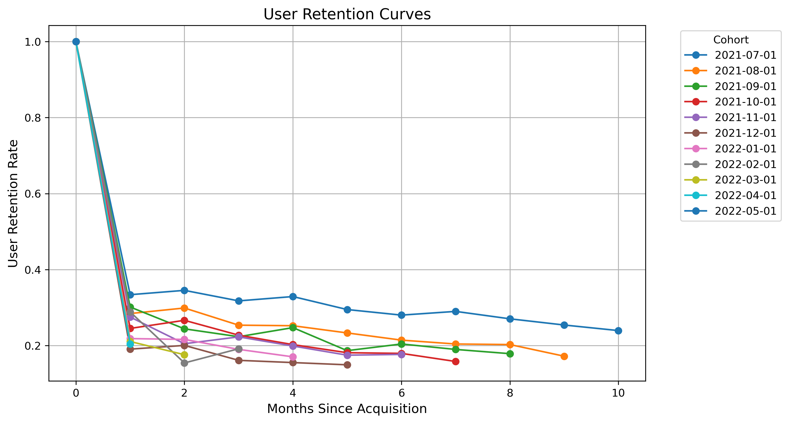

### Findings
Анализ retention-кривых выявил выраженный ранний отток клиентов практически во всех когортах. Средний User Retention снижается со 100% до примерно 19–34% уже после первого месяца жизненного цикла. После первоначального падения скорость оттока существенно замедляется, а уровень удержания стабилизируется в диапазоне 15–30% на горизонте 6–10 месяцев. Несмотря на различия между отдельными когортами, форма retention-кривых остается стабильной:

    Резкий ранний churn  →  Замедление оттока  →  Формирование устойчивого ядра клиентов

Это указывает на наличие типичной lifecycle-модели поведения покупателей внутри аптечной сети.

### Business Interpretation

Основная потеря клиентской базы происходит практически сразу после первой покупки. Значительная часть пользователей остается в категории transactional customers и не переходит к регулярному потреблению. При этом пользователи, сохранившие активность после первых месяцев жизненного цикла, демонстрируют существенно более высокий уровень долгосрочного удержания. Фактически именно прохождение раннего post-acquisition периода определяет вероятность формирования долгосрочной клиентской ценности.

### Figure 11. Cohort Retention Heatmap

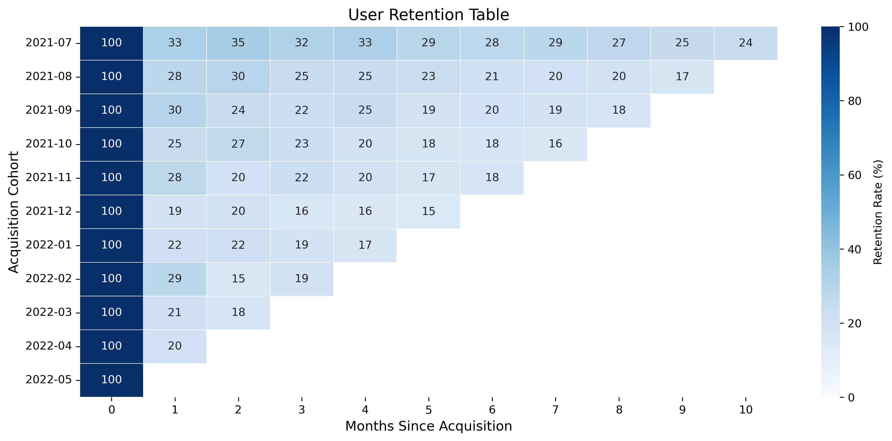

### Findings

Retention Heatmap подтверждает результаты агрегированного анализа.  
Практически все когорты демонстрируют схожий паттерн поведения:  
-	максимальный churn происходит в первые месяцы жизни;   
-	затем retention выходит на устойчивое плато;   
-	существенных структурных изменений между когортами не наблюдается.

При этом отдельные периоды привлечения демонстрируют более сильное удержание, что может свидетельствовать о различиях в качестве acquisition-трафика либо сезонных особенностях клиентского поведения.

### Key Insight

Ключевой проблемой retention-модели является не долгосрочное удержание клиентов, а низкая конверсия новых покупателей в repeat customers.

### Figure 12. Cohort Retention Curves

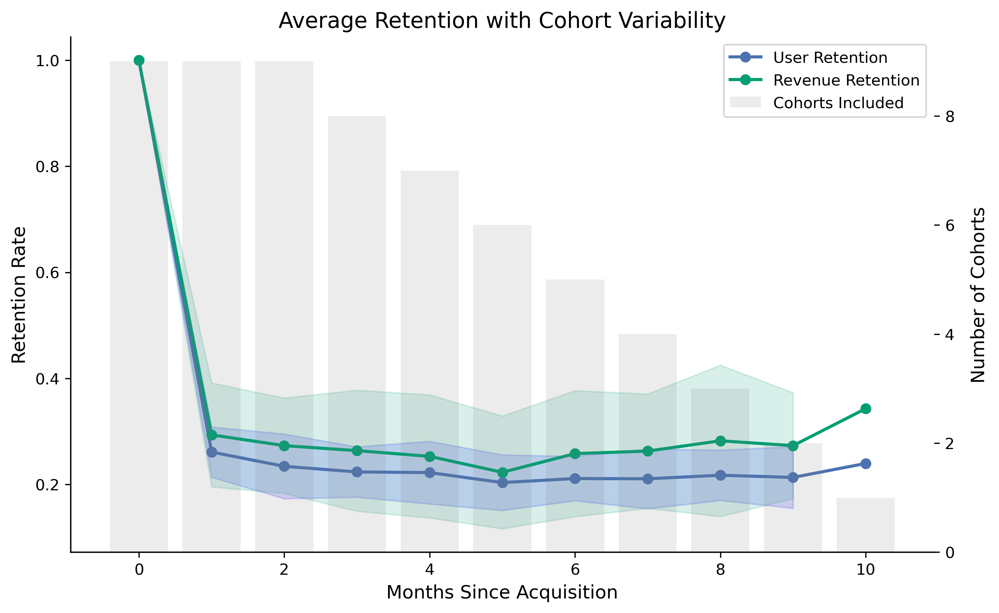

### Findings

Средняя retention-кривая позволяет более наглядно увидеть структуру жизненного цикла клиента.  
Фактически жизненный цикл разделяется на две отдельные фазы:  

    • Phase 1: Early Churn   
      Month 0 → Month 1–2   
      Основная потеря пользователей  

    • Phase 2: Retention Core
      Month 2+  
      Относительно стабильное удержание  

После прохождения критического периода вероятность дальнейшего удержания существенно возрастает.

### Business Implications
Полученные результаты показывают, что основной потенциал роста клиентской базы находится в улучшении раннего удержания. Даже небольшое увеличение вероятности второй покупки способно существенно увеличить размер долгосрочного активного сегмента клиентов.

## 7.4 Retention Decay Analysis
### Business Question

В какие моменты жизненного цикла компания теряет наибольшую долю клиентов и насколько быстро замедляется процесс оттока?

### Methodology

Для оценки скорости ухудшения удержания были рассчитаны две взаимодополняющие метрики:  

- *Absolute Retention Decay*    
Абсолютное изменение retention между соседними месяцами жизненного цикла.  

- *Relative Retention Decay*  
Относительное изменение retention относительно предыдущего периода.  

Использование обеих метрик позволяет оценить не только величину потерь клиентов, но и скорость деградации retention-модели.

### Absolute Retention Decay

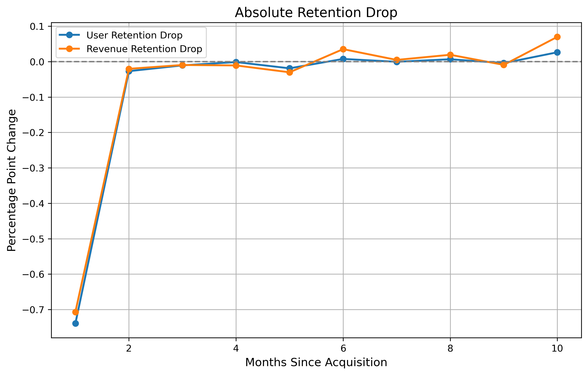

## Findings

Наиболее существенное снижение retention наблюдается между первым и вторым месяцем жизни клиента.  
Средняя потеря составляет:  
-	около 74 процентных пунктов по User Retention;    
-	около 71 процентного пункта по Revenue Retention.

После данного периода абсолютные изменения резко сокращаются и в большинстве случаев составляют лишь несколько процентных пунктов.

## Interpretation

Практически весь будущий объем клиентской базы определяется в течение первых недель после первой покупки.
После прохождения этого этапа система теряет клиентов значительно медленнее.

### Figure 13. Relative Retention Decay

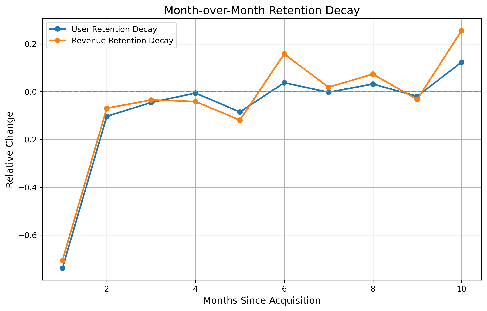

## Findings   

Относительная скорость снижения retention также демонстрирует выраженное замедление после первых месяцев жизненного цикла. После периода интенсивного churn обе метрики начинают приближаться к стабильным значениям. Это свидетельствует о переходе клиентской базы из режима активной деградации в режим относительно устойчивого поведения.

### Lifecycle Stabilization Point

Для выявления момента формирования устойчивого клиентского ядра дополнительно была рассчитана точка стабилизации жизненного цикла (Lifecycle Stabilization Point). В рамках данного исследования точкой стабилизации считается первый месяц, после которого абсолютное снижение User Retention остается ниже 5 процентных пунктов на протяжении как минимум двух последовательных периодов. Такой критерий позволяет отделить фазу быстрого первоначального оттока от этапа относительно стабильного поведения удержанных клиентов и определить момент перехода к более устойчивой структуре клиентской базы.

### Figure 14. Stabilization Point: Retention and Decay Dynamics

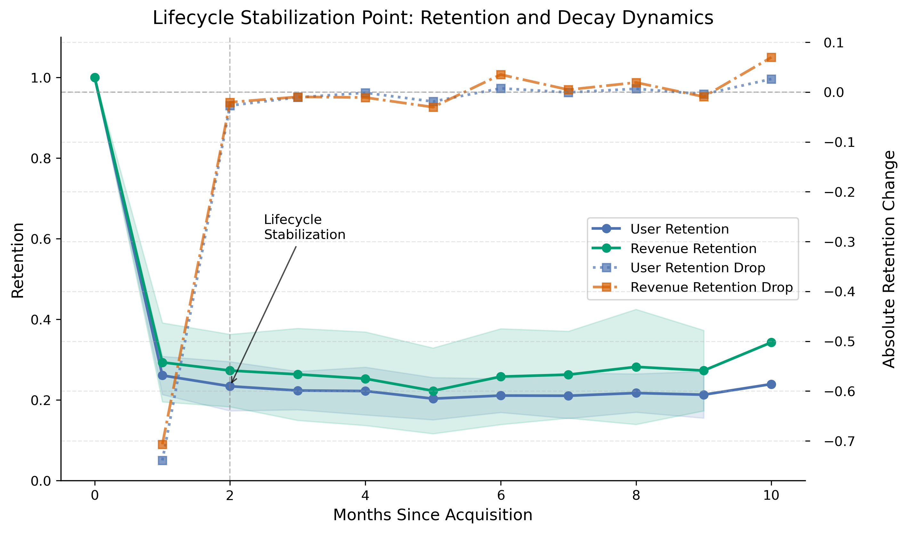

Полученная визуализация позволяет одновременно оценить как уровень удержания клиентов и выручки, так и скорость их изменения на различных этапах жизненного цикла. Для более детального анализа динамики стабилизации ниже представлены агрегированные значения retention и показателей снижения retention по месяцам жизненного цикла.

### Figure 15. Stabilization Summary

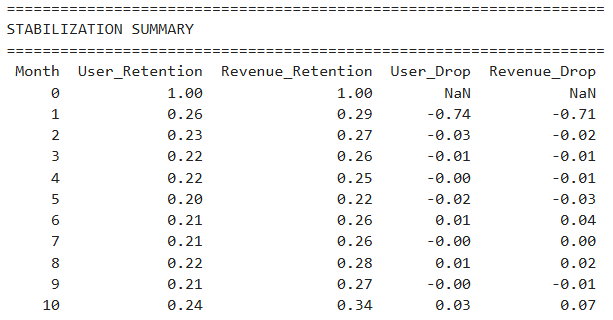

### Findings

Сопоставление абсолютного и относительного retention decay показывает наличие четкой точки стабилизации после первых месяцев жизненного цикла.
После этой точки:  
-	скорость оттока резко падает;   
-	размер клиентской базы становится более предсказуемым;   
-	начинают формироваться долгосрочные repeat customers.   

### Core Finding

Retention-модель бизнеса имеет ярко выраженную двухфазную структуру:

    Acquisition  →  Aggressive Early Churn  →  Retention Stabilization  →  Long-Term Customer Base

Большая часть будущего LTV определяется не качеством удержания зрелых клиентов, а способностью провести пользователя через фазу раннего churn.

### Business Implications

Результаты показывают, что наиболее существенная потеря клиентов происходит в первые месяцы после первой покупки, когда скорость снижения User Retention достигает максимальных значений. По мере развития жизненного цикла величина ежемесячных потерь постепенно уменьшается, что свидетельствует о формировании более устойчивой клиентской базы. После прохождения точки стабилизации дальнейшее снижение retention становится значительно менее выраженным, а поведение оставшихся клиентов приобретает более предсказуемый характер. При этом Revenue Retention стабилизируется на более высоком уровне, чем User Retention, что указывает на сохранение экономически наиболее ценной части клиентской базы. Данный результат подтверждает, что долгосрочная выручка компании формируется преимущественно за счет относительно небольшого ядра наиболее лояльных и регулярно покупающих клиентов. Выявленная точка стабилизации выступает важным элементом customer lifecycle model и служит естественным связующим звеном к дальнейшему анализу монетизации удержанных клиентов, динамики RPRU и формирования долгосрочного Customer Lifetime Value.

### Strategic Implications

Наибольший потенциальный эффект для бизнеса способны обеспечить инициативы, направленные на:  
-	увеличение вероятности второй покупки;   
-	ускорение формирования покупательской привычки;   
-	персонализированное сопровождение новых клиентов;   
-	CRM-механики в первые 30–60 дней после привлечения.  

Даже небольшое снижение churn на данном этапе способно оказать непропорционально сильное влияние на:  
-	размер активной клиентской базы;   
-	cumulative revenue;   
-	customer lifetime value;   
-	окупаемость привлечения клиентов.  

## 7.5 Revenue Retention Analysis
### Business Question

Сохраняется ли выручка клиентских когорт с той же скоростью, что и пользовательская база, или удержанные клиенты со временем концентрируют все большую долю дохода компании?

### Methodology

После анализа пользовательского удержания была исследована динамика выручки когорт. Для каждой acquisition-когорты рассчитывался показатель Revenue Retention, отражающий долю выручки относительно первого месяца жизненного цикла клиента. Метрика позволяет оценить не просто сохранение пользователей, а сохранение экономической ценности клиентской базы во времени.  
Анализ выполнялся:    
-	на уровне отдельных когорт;   
-	на уровне агрегированной динамики;    
-	в сравнении с User Retention.   

### Figure 16. Revenue Retention Dynamics Across Cohorts (График динамики Revenue Retention по всем когортам.)

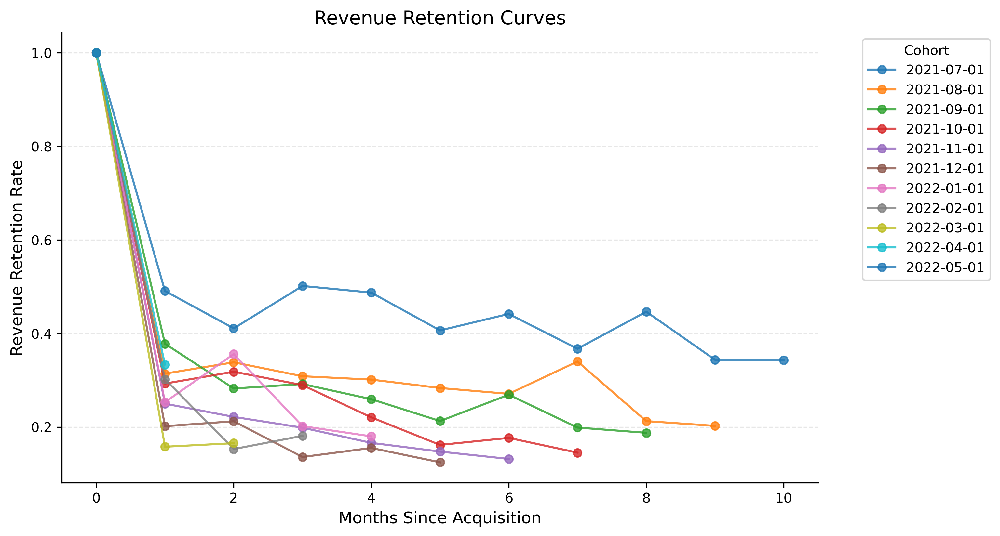

### Findings 

Анализ показал, что выручка снижается существенно медленнее, чем количество клиентов. Несмотря на выраженный churn в первые месяцы жизненного цикла, большинство когорт сохраняют от 20% до 45% первоначальной выручки даже на поздних этапах наблюдения.

Форма кривых Revenue Retention во многом повторяет User Retention:

      Резкое снижение  →  Замедление падения  →  Стабилизация

Однако уровень удержания выручки остается заметно выше уровня удержания пользователей практически на всем горизонте анализа.

### Business Interpretation

Полученные результаты показывают, что продукт теряет пользователей быстрее, чем экономическую ценность клиентской базы.
По мере развития жизненного цикла в системе остается все более концентрированная группа клиентов, формирующая непропорционально большую долю выручки.

Иными словами:
бизнес теряет количество клиентов быстрее, чем качество оставшейся аудитории.

### Figure 17. Revenue Retention Matrix

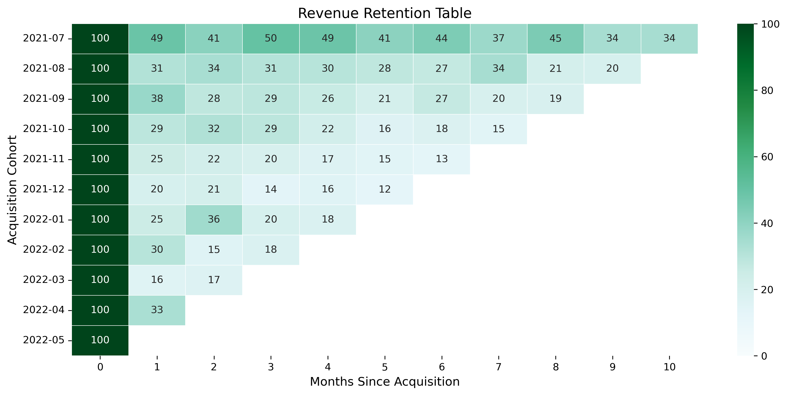

### Findings

Тепловая карта Revenue Retention подтверждает наличие устойчивого паттерна практически во всех когортах. Даже после значительного сокращения пользовательской базы зрелые когорты продолжают удерживать существенную часть первоначальной выручки. При этом различия между когортами постепенно увеличиваются по мере роста cohort age, что указывает на возрастающую роль качества привлеченных клиентов в формировании долгосрочной выручки.

### Key Insight

Revenue Retention систематически превосходит User Retention. Это означает, что удержанные пользователи обладают более высокой экономической ценностью по сравнению со средним клиентом исходной когорты.

### Figure 18. Revenue Retention vs User Retention

### Findings

Сравнение двух retention-кривых выявило устойчивое расхождение между динамикой пользователей и динамикой выручки. К моменту, когда значительная часть клиентской базы уже покидает продукт, удержанная аудитория продолжает генерировать непропорционально высокую долю первоначальной выручки. Наблюдаемая дивергенция становится особенно заметной после прохождения периода интенсивного раннего churn.

### Core Finding

Ключевое ограничение бизнеса находится не в способности монетизировать удержанных пользователей. Ключевое ограничение находится в количестве клиентов, которым удается дойти до стадии долгосрочного удержания.

### Business Implications

Результаты показывают, что внутри клиентской базы уже существует устойчивое ядро пользователей с высокой экономической ценностью. Следовательно, основной резерв роста заключается не в дополнительной оптимизации монетизации существующих loyal customers, а в увеличении числа клиентов, которые достигают стадии повторного потребления.

### Transition to Next Analysis
На данном этапе возникает следующий вопрос. Если выручка удерживается лучше, чем пользователи, то за счет какого механизма это происходит? Для ответа необходимо исследовать изменение средней ценности удержанного клиента во времени.

## 7.6 Customer Value Evolution (RPRU)
### Business Question

Как изменяется экономическая ценность удержанных клиентов по мере развития их жизненного цикла и происходит ли рост customer value среди пользователей, остающихся в системе?

### Methodology

Для оценки качества удержанной аудитории рассчитывался показатель *Revenue per Retained User (RPRU)*. Метрика отражает среднюю выручку на одного активного пользователя внутри каждой когорты на каждом этапе жизненного цикла. Использование RPRU позволяет отделить изменения количества пользователей от изменений их экономической ценности.

### Figure 18. Revenue per Retained User Dynamics

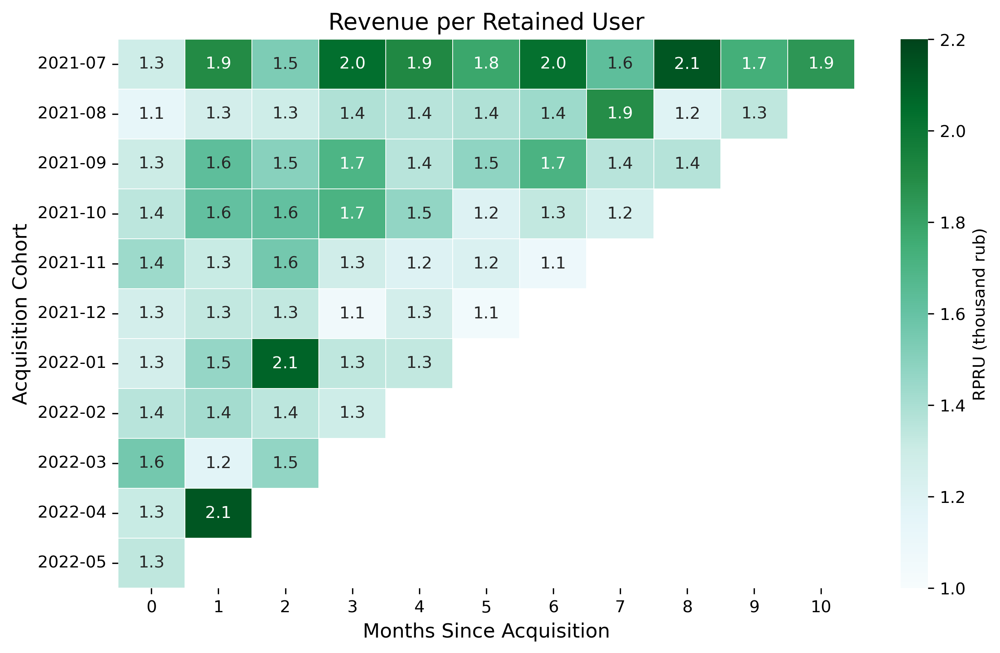

### Findings

В отличие от retention-показателей, средняя выручка на удержанного пользователя не демонстрирует снижения. Для большинства когорт RPRU остается стабильным либо постепенно увеличивается на протяжении жизненного цикла. Наиболее зрелые когорты достигают значений, превышающих уровень первого месяца на 20–40%. В отдельных случаях рост превышает 40%.

### Business Interpretation

Retention decay сопровождается естественной селекцией клиентской базы. Продукт постепенно теряет низкововлеченных пользователей и сохраняет клиентов с более высокой покупательской активностью. В результате средняя ценность одного retained customer со временем увеличивается.

### Figure 19. Relative Growth of Customer Value
(индекс относительно Month 0 = 100%)

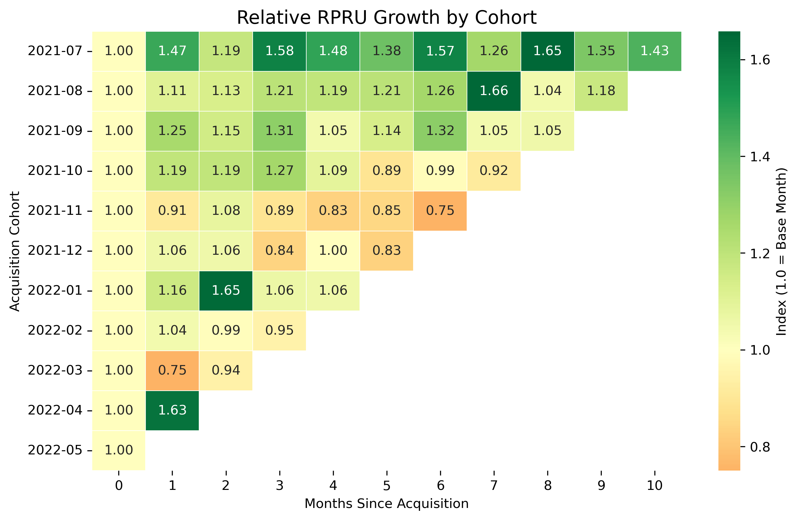

## Findings

Нормализованный анализ показывает устойчивый рост customer value практически во всех зрелых когортах. После прохождения периода интенсивного churn средний retained user начинает приносить существенно больше выручки по сравнению с моментом первоначального привлечения. Для ряда когорт рост достигает 20–65%.

## Interpretation

Долгосрочное удержание связано не только с сохранением клиентов. Оно связано с ростом качества оставшейся аудитории. По мере развития жизненного цикла в продукте концентрируются пользователи с более высокой частотой покупок, большим средним чеком и более устойчивыми потребительскими привычками.

### Figure 20. Average Monetization Growth

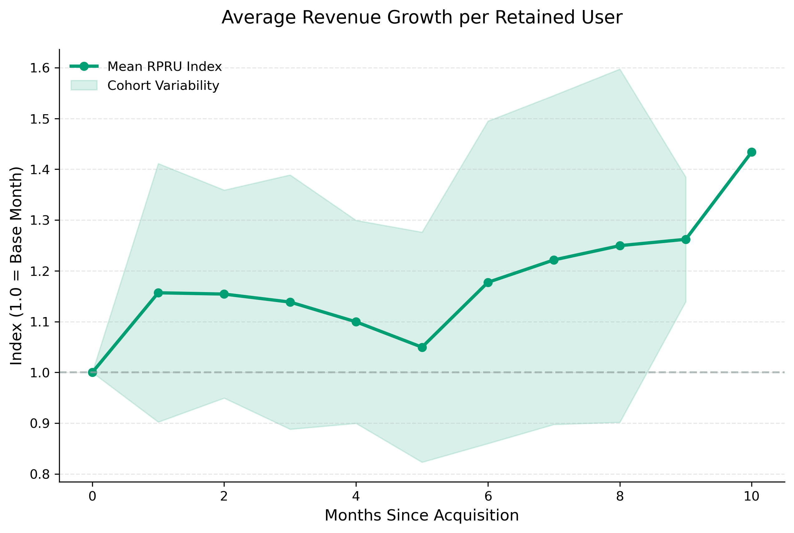

## Findings

В среднем по всем когортам RPRU начинает превышать уровень первого месяца уже после раннего периода жизненного цикла. Рост монетизации сохраняется на протяжении всего наблюдаемого горизонта. Даже после значительного сокращения клиентской базы средняя выручка на одного retained customer продолжает демонстрировать положительную динамику.

### Core Finding

Продукт уже умеет эффективно монетизировать удержанных пользователей. Основная проблема заключается не в низкой ценности retained customers. Основная проблема заключается в том, что до стадии высокой customer value доходит слишком небольшая доля первоначально привлеченных клиентов.

### Business Implications

Полученные результаты указывают на наличие сформированного сегмента клиентов, обладающих высокой долгосрочной ценностью. Именно эта группа становится основным источником Revenue Retention и будущего LTV. Следовательно, наиболее перспективным направлением развития является увеличение доли пользователей, переходящих в данный сегмент.

## 7.7 Retention vs Monetization Dynamics

### Business Question

Что оказывает большее влияние на долгосрочную ценность клиента и рост выручки компании:
-	удержание пользователей; 
-	рост монетизации удержанной аудитории? 

### Methodology

Для ответа на данный вопрос были объединены результаты предыдущих этапов анализа:
-	User Retention;   
-	Revenue Retention;   
-	Revenue per Retained User (RPRU).  
 
Сопоставление этих метрик позволяет разделить два независимых механизма формирования выручки:

- Retention Effect  
Изменение количества активных пользователей.

- Monetization Effect  
Изменение средней выручки на одного удержанного клиента.

Такой подход позволяет определить, какой из факторов оказывает наибольшее влияние на долгосрочную экономику клиентской базы.

### Retention vs Revenue Dynamics

### Findings

Сравнение retention и revenue retention (Figure 18) выявило устойчивое расхождение между динамикой клиентской базы и динамикой выручки. После первого месяца жизненного цикла пользовательская база сокращается примерно до 26% первоначального размера, тогда как Revenue Retention остается существенно выше и сохраняет значительную часть исходной выручки. Это означает, что потери пользователей не приводят к пропорциональному снижению финансовой ценности клиентской базы. По мере развития жизненного цикла происходит концентрация выручки среди меньшего количества клиентов.

### Figure 21. Retention vs Customer Value

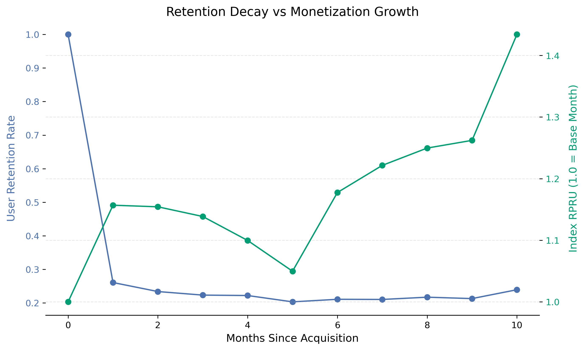

### Findings

Анализ показывает, что по мере сокращения клиентской базы средняя ценность удержанных пользователей систематически растет.
После прохождения периода интенсивного churn Revenue per Retained User превышает уровень первого месяца и продолжает увеличиваться на протяжении жизненного цикла. Для зрелых когорт рост RPRU достигает 20–40%, а в отдельных случаях превышает 40%.  
Таким образом, система одновременно демонстрирует:  
-	сокращение количества клиентов;   
-	рост ценности оставшейся аудитории.  

### Interpretation

Наблюдаемая динамика свидетельствует о механизме естественной селекции клиентской базы. Низкововлеченные пользователи покидают продукт на ранних стадиях жизненного цикла, тогда как наиболее активные покупатели продолжают взаимодействовать с компанией и увеличивают свой вклад в выручку. В результате продукт постепенно концентрирует все большую долю дохода внутри сегмента лояльных клиентов.

### Growth Constraint Analysis
### Findings

Несмотря на устойчивый рост RPRU, увеличение ценности удержанных клиентов не компенсирует масштаб первоначального churn. Средний рост монетизации на одного retained user составляет порядка 15–40%. Одновременно клиентская база сокращается более чем на 70% уже в первые месяцы жизненного цикла.
Это означает, что потери клиентов значительно превосходят выигрыш от роста монетизации удержанной аудитории.

### Core Insight

Главным ограничителем роста бизнеса является не монетизация удержанных клиентов. Главным ограничителем роста является способность компании переводить новых покупателей в сегмент повторного потребления.

### Business Implications

Полученные результаты показывают, что продукт уже обладает эффективной моделью монетизации удержанных пользователей. Основной резерв роста находится в расширении сегмента клиентов, достигающих стадии высокой customer value.  
Следовательно, наиболее перспективными направлениями развития являются:  
-	улучшение раннего retention;   
-	увеличение вероятности второй покупки;   
-	ускорение формирования покупательской привычки;   
-	развитие программ повторного вовлечения новых клиентов.   

## 7.8 Cohort LTV Dynamics

### Business Question

Как совокупное влияние удержания и монетизации формирует долгосрочную ценность клиента и каким образом развивается LTV различных когорт во времени?

### Methodology
Для каждой acquisition-когорты был рассчитан накопленный Customer Lifetime Value (LTV). Метрика отражает совокупную выручку, генерируемую клиентом с момента первой покупки на протяжении жизненного цикла.  
Дополнительно анализировались:
-	темпы накопления LTV; 
-	различия между когортами; 
-	точки замедления роста ценности клиента. 

### Figure 22. Cohort LTV Matrix

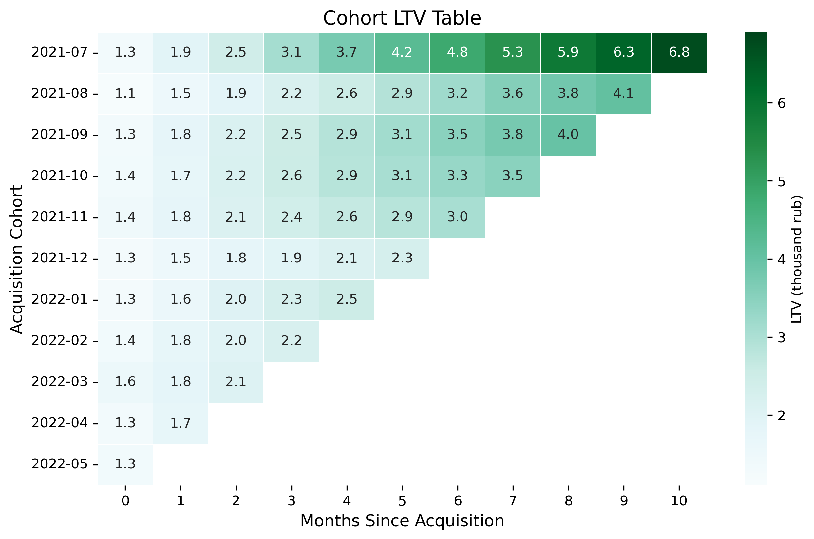

### Findings

Когортный анализ показывает устойчивый рост накопленной ценности клиента практически во всех когортах. Наиболее зрелые когорты достигают LTV на уровне 6.3–6.8 тыс. денежных единиц к 10–11 месяцу жизненного цикла. Несмотря на существенный churn, накопленная выручка продолжает увеличиваться на протяжении всего наблюдаемого горизонта.

### Figure 23. Cohort LTV Curves

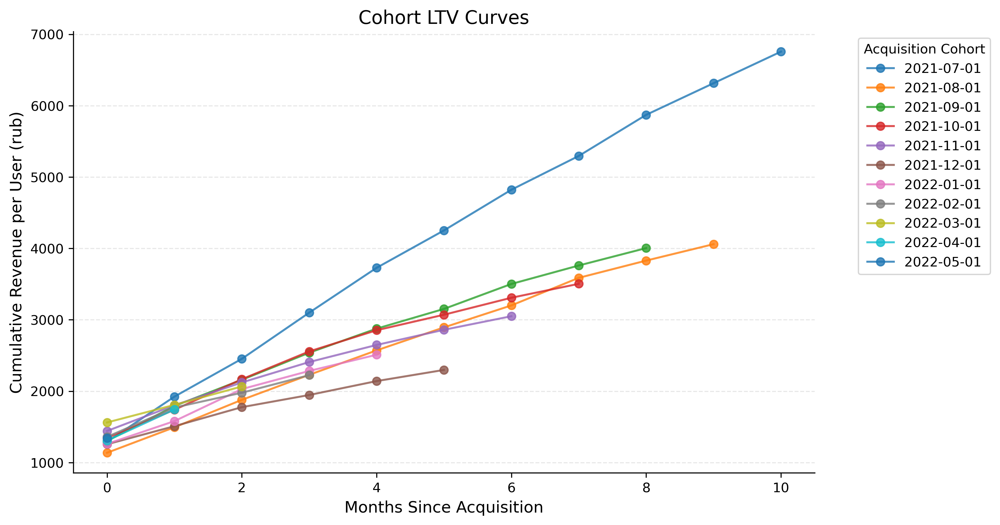

### Findings

LTV-кривые демонстрируют две характерные фазы. Первая фаза характеризуется быстрым накоплением клиентской ценности.
Наиболее интенсивный рост LTV происходит в первые 3–5 месяцев после первой покупки. После этого рост сохраняется, однако его скорость постепенно снижается.

### Interpretation

Полученные результаты показывают, что большая часть долгосрочной ценности клиента формируется в раннем lifecycle-периоде.  
Именно в этот момент одновременно происходят два ключевых процесса:  
-	основной churn; 
-	формирование будущих лояльных клиентов.

Поэтому любые изменения поведения пользователей в первые месяцы жизненного цикла оказывают непропорционально сильное влияние на итоговый LTV.

### LTV Accumulation Analysis
### Figure 24. Агрегированная средняя кривая.
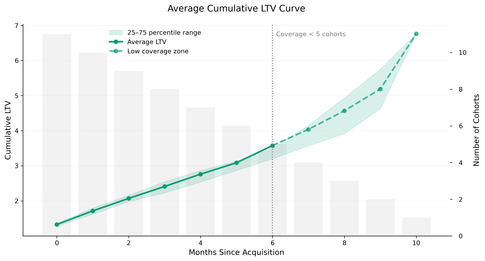

### Findings

Средняя LTV-кривая показывает, что основная часть накопленной ценности формируется в течение первых месяцев жизненного цикла клиента. После шестого месяца каждая дополнительная единица времени приносит все меньший прирост совокупной выручки. Это свидетельствует о постепенном насыщении экономического потенциала большинства клиентов.

### Core Insight

Даже при относительно низком уровне удержания продукт способен генерировать значительную долгосрочную ценность благодаря устойчивой монетизации retained-аудитории. Однако итоговый LTV определяется прежде всего тем, сколько пользователей смогут пройти через ранний период интенсивного churn.

### Business Implications

Полученные результаты позволяют сделать стратегически важный вывод. Рост долгосрочной выручки компании зависит не столько от дальнейшего повышения spending intensity существующих loyal customers, сколько от увеличения числа клиентов, достигающих стадий жизненного цикла с высокой customer value.
Каждый дополнительный процент retention в первые месяцы жизненного цикла оказывает существенно большее влияние на итоговый LTV, чем аналогичное улучшение удержания на поздних этапах.

## 7.9 Cohort Variability Analysis

### Business Question

Насколько выявленные закономерности retention и монетизации являются устойчивыми для всей клиентской базы, а не результатом поведения отдельных когорт?

### Почему этот анализ важен

До этого момента мы анализировали средние retention-кривые, revenue retention и динамику customer value. Однако средние значения могут скрывать существенные различия между когортами.  
Для принятия бизнес-решений важно понимать:  
-	являются ли выявленные закономерности структурными;   
-	насколько различаются отдельные acquisition cohorts;   
-	сохраняются ли выводы при анализе разных периодов привлечения клиентов;  
-	не формируется ли средний результат за счет нескольких крупных когорт.  

### Analytical Approach

Для оценки устойчивости результатов дополнительно исследуется межкогортная вариативность поведения.
Анализ включает три уровня проверки:

#### Cohort Dispersion  
Оценка разброса retention между когортами на различных стадиях жизненного цикла.  
Позволяет определить:
-	насколько похожи разные когорты; 
-	увеличивается ли неоднородность поведения со временем; 
-	существуют ли когорты с аномально высоким или низким удержанием. 

#### Confidence Bands  
Для средних retention curves рассчитываются доверительные интервалы.  
Это позволяет оценить:  
-	статистическую устойчивость наблюдаемых закономерностей;   
-	степень неопределенности на поздних lifecycle-этапах;   
-	надежность интерпретации retention plateau.   

#### Behavioral Heterogeneity  
Дополнительно анализируется изменение вариативности:
-	User Retention;    
-	Revenue Retention;   
-	Revenue per Retained User.
  
Цель анализа — определить, становится ли клиентская база более или менее однородной по мере развития жизненного цикла.

### Figure 25. Monetization Variability Across Cohorts

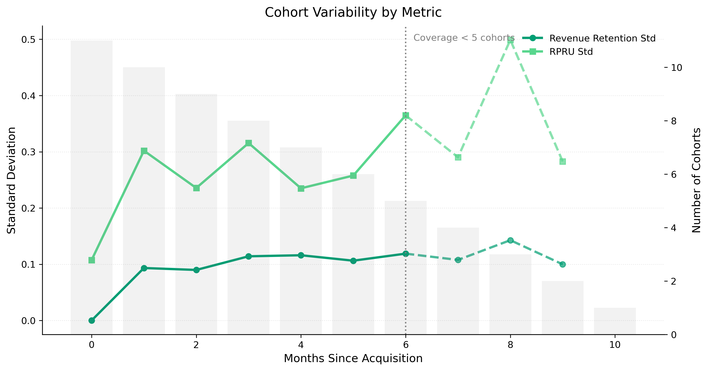

### Findings

Анализ межкогортной вариативности показал, что паттерны удержания клиентов остаются удивительно устойчивыми между различными когортами приобретения.

Практически все когорты демонстрируют одинаковую структуру жизненного цикла:  
- резкое снижение активности после первой покупки;  
- быстрое замедление скорости оттока;  
- формирование retention плато на последующих этапах жизненного цикла.  

Наиболее низкий уровень вариативности наблюдается именно в пользовательском удержании. Стандартное отклонение User Retention на протяжении большинства периода остается в диапазоне 4–6 п.п., что свидетельствует о высокой воспроизводимости retention-паттернов между когортами. В отличие от пользовательского удержания, метрики монетизации демонстрируют существенно более высокий уровень разброса. Для Revenue Retention стандартное отклонение достигает 10–14 п.п., а для Revenue per Retained User вариативность оказывается еще выше и в отдельных периодах превышает 0.45–0.50. 

Это означает, что различия между когортами формируются не столько за счет различий в вероятности повторных покупок, сколько за счет различий в интенсивности потребления удержанных клиентов. Дополнительно наблюдается рост неопределенности на поздних стадиях жизненного цикла. Однако оценки после шестого месяца следует интерпретировать с осторожностью, поскольку в расчете участвует менее пяти зрелых когорт, что увеличивает чувствительность результатов к поведению отдельных групп клиентов.

В целом результаты подтверждают, что выявленные ранее закономерности retention являются структурной характеристикой клиентской базы, тогда как долгосрочная экономика клиентов существенно сильнее зависит от качества удержанной аудитории.

### Business Interpretation

Полученные результаты подтверждают высокую устойчивость ключевых выводов всего когортного анализа.

Независимо от месяца привлечения клиентов наблюдаются одни и те же фундаментальные закономерности:
- высокий ранний churn после первой покупки;  
- постепенное замедление скорости оттока;  
- формирование стабильного retention plateau;  
- рост экономической ценности удержанных клиентов.  

Особенно важным является тот факт, что вариативность User Retention остается низкой практически на всем горизонте наблюдения. Это позволяет рассматривать ранний churn как системную особенность клиентской базы, а не как результат поведения отдельных когорт. В то же время основные различия между когортами проявляются в метриках монетизации. Revenue Retention и Revenue per Retained User демонстрируют существенно больший разброс, что указывает на различия в составе удержанной аудитории и доле высокоценных клиентов внутри отдельных когорт. 

Иными словами, когорты теряют клиентов примерно одинаково, но удержанные пользователи обладают разной экономической ценностью. При интерпретации поздних lifecycle-периодов необходимо учитывать снижение статистической устойчивости оценок. После шестого месяца количество зрелых когорт становится ограниченным, поэтому наблюдаемая вариативность частично отражает эффект малой выборки.

### Strategic Implications

Полученные результаты имеют несколько важных практических следствий для бизнеса.

1. Высокий ранний churn является структурной характеристикой всей клиентской базы. Поскольку данный паттерн воспроизводится практически во всех когортах, приоритетом retention-стратегии должны стать мероприятия, направленные на удержание клиентов в первые месяцы после первой покупки.

2. Рост customer value среди retained users наблюдается во всех зрелых когортах, что подтверждает экономическую целесообразность инвестиций в удержание пользователей с высоким потенциалом долгосрочной ценности.

3. Основным источником различий между когортами становится не удержание как таковое, а монетизация удержанных клиентов. Это означает, что наряду с задачами retention бизнесу необходимо развивать механизмы повышения глубины потребления и расширения клиентской ценности внутри удержанной аудитории.

4. Долгосрочная выручка компании становится все более зависимой от относительно небольшой группы наиболее ценных клиентов. По мере созревания когорт влияние high-value customers на агрегированные показатели возрастает, что делает их удержание одним из ключевых факторов устойчивости бизнеса.

Таким образом, результаты анализа подтверждают, что управление customer value является не менее важным направлением развития, чем управление удержанием клиентов, а максимальный бизнес-эффект достигается при одновременной работе над обеими задачами.

## 7.10 Key Findings & Business Implications
### Executive Summary

Когортный анализ показал, что долгосрочная экономика клиентской базы определяется не столько масштабом привлечения пользователей, сколько способностью компании переводить новых покупателей в сегмент повторных клиентов. Несмотря на значительный ранний churn, удержанные пользователи демонстрируют устойчивый рост customer value и формируют непропорционально большую долю долгосрочной выручки. Таким образом, основным ограничением роста бизнеса является не монетизация существующих клиентов, а эффективность раннего удержания после первой покупки.

### Key Findings

**1. Основной churn происходит сразу после первой покупки**   
User Retention снижается примерно до 26% уже в течение первых месяцев жизненного цикла.
Именно этот период формирует основную потерю будущего LTV.

**2. После initial churn формируется стабильное ядро клиентов**   
После первых месяцев скорость оттока резко снижается.
Оставшиеся пользователи демонстрируют признаки устойчивого повторного покупательского поведения.

**3. Revenue Retention устойчивее User Retention**  
Выручка сокращается медленнее, чем клиентская база.
Это означает, что удержанные пользователи обладают более высокой экономической ценностью.

**4. Customer Value растет по мере развития жизненного цикла**  
Revenue per Retained User систематически увеличивается относительно acquisition period.
На поздних этапах жизненного цикла retained customers генерируют значительно больший revenue contribution.

**5. LTV формируется преимущественно в первые месяцы жизненного цикла**    
Наиболее значимая часть будущей ценности клиента определяется в период максимального churn.
Каждое улучшение раннего retention оказывает накопительный эффект на долгосрочную выручку.

### Business Implications
Полученные результаты свидетельствуют о наличии двухфазной структуры жизненного цикла клиентов. Первая фаза характеризуется интенсивным оттоком новых покупателей и определяет размер будущей клиентской базы. Вторая фаза связана с развитием удержанных пользователей, которые постепенно увеличивают свою ценность для бизнеса. В результате долгосрочный рост выручки определяется не столько способностью компании привлекать новых клиентов, сколько эффективностью перевода новых покупателей в сегмент регулярных пользователей.

### Strategic Recommendations

**Приоритет 1. Оптимизация Early Retention**  
Максимальный бизнес-эффект ожидается от снижения churn в первые 30–60 дней после первой покупки.

**Приоритет 2. Ускорение повторных покупок**   
Необходимо развивать механики, ускоряющие вторую и третью покупку клиента.

**Приоритет 3. Развитие ценных клиентов**   
Следует выявить факторы, связанные с ростом RPRU и долгосрочного LTV.

**Приоритет 4. Мониторинг качества когорт**  
Рекомендуется регулярно отслеживать качество новых когорт через retention, revenue retention и cohort LTV.

## Section Conclusion

Когортный анализ показал, что клиентская база обладает выраженной асимметрией жизненного цикла: большая часть пользователей прекращает активность после первой покупки, тогда как относительно небольшое ядро удержанных клиентов формирует основную часть долгосрочной выручки.
Следовательно, ключевой резерв роста находится не в увеличении монетизации существующей лояльной аудитории, а в повышении вероятности перехода новых клиентов в сегмент долгосрочно удерживаемых пользователей. Данный вывод формирует основу для следующего раздела проекта — Predictive Customer Analytics, где задача анализа смещается от описания жизненного цикла к прогнозированию будущего поведения клиентов, оценке риска оттока и приоритизации retention-инвестиций.

# 8. Layer 3. Predictive Customer Analytics
## 8.1 Business Objective
### Цель раздела

Первые два раздела проекта позволили понять, каким образом формируется жизненный цикл клиента, какие сегменты наиболее подвержены деградации и где возникают основные потери выручки.

Однако описательный анализ отвечает преимущественно на вопрос:
Что произошло?

Для построения полноценной retention-стратегии необходимо перейти к следующему уровню аналитики и ответить на вопрос:
Что произойдет дальше и на каких клиентах необходимо концентрировать усилия по удержанию?

Цель данного раздела заключается в построении системы прогнозирования клиентского поведения, позволяющей заранее выявлять пользователей с повышенным риском оттока, оценивать потенциальные финансовые последствия потери клиентов и определять наиболее приоритетные объекты для retention-инвестиций.

### Ключевые бизнес-вопросы

В рамках данного раздела исследуются следующие вопросы:
-	Какие поведенческие факторы наиболее сильно связаны с будущим оттоком клиентов? 
-	Можно ли выявлять риск ухода до фактического снижения активности? 
-	Насколько точно модель способна прогнозировать churn? 
-	Какие признаки являются ранними индикаторами деградации клиентского поведения? 
-	Какие клиенты одновременно обладают: 
  -	высоким риском ухода; 
  -	высокой экономической ценностью; 
  -	потенциалом успешной реактивации? 
-	Как приоритизировать retention-инвестиции с точки зрения ожидаемого бизнес-эффекта? 

### Бизнес-значимость

Практическая ценность данного раздела состоит в переходе от реактивного управления клиентской базой к проактивной retention-модели.
Вместо работы с уже потерянными клиентами компания получает возможность:
-	заранее обнаруживать формирующийся churn-risk; 
-	оценивать объём потенциально теряемой выручки; 
-	концентрировать CRM-ресурсы на наиболее ценных клиентах; 
-	снижать объём revenue-at-risk; 
-	повышать эффективность retention-бюджета. 

## 8.2 Analytical Approach

### Общая концепция анализа

В предыдущих разделах было показано, что переход клиентов в стадии At Risk и Churn сопровождается постепенным ухудшением покупательского поведения.
На основании этих наблюдений была построена система predictive customer analytics, ориентированная на раннее выявление пользователей с высокой вероятностью будущего оттока.
В отличие от традиционного RFM-подхода, модель учитывает не только текущее состояние клиента, но и динамику изменения его поведения во времени. 

### Логика исследования
Анализ построен как последовательность четырех взаимосвязанных этапов.

      Behavioral Signals
              ↓
      Churn Prediction
              ↓
      Business Risk Assessment
              ↓
      Retention Prioritization

### Analytical Framework
#### 1. Churn Prediction Modeling  
На первом этапе строится модель прогнозирования вероятности оттока.  
Цель этапа — определить, способен ли набор поведенческих признаков заранее идентифицировать клиентов, которые в следующем периоде перейдут в стадии:
-	At Risk 
-	Churn

Для прогнозирования используется Random Forest Classifier.

#### 2. Churn Driver Analysis  
После построения модели анализируются факторы, формирующие прогноз.  
Для интерпретации результатов используются:
-	Feature Importance; 
-	SHAP Analysis.

Данный этап позволяет понять:  
-	какие признаки наиболее влияют на churn probability; 
-	какие поведенческие изменения являются ранними сигналами риска; 
-	как именно модель принимает решения. 

#### 3. Revenue-at-Risk Framework  
Высокая вероятность ухода не всегда означает высокий финансовый риск.
Поэтому следующим этапом является интеграция churn probability с показателями клиентской ценности.  
Цель этапа:  
-	определить объём потенциально теряемой выручки;  
-	выявить клиентов с максимальным business impact;  
-	перейти от churn management к revenue-at-risk management.  

#### 4. Retention Prioritization Framework    
Финальный этап объединяет:   
-	churn probability; 
-	customer value; 
-	recovery probability.

Это позволяет определить клиентов, для которых удержание обладает максимальным ожидаемым экономическим эффектом.
Именно данный слой превращает predictive model в практический инструмент CRM-принятия решений. 

### Почему выбран Random Forest
Для решения задачи прогнозирования был выбран алгоритм Random Forest.
Причины выбора:  
- хорошо работает на нелинейных зависимостях;   
- устойчив к шуму;   
- автоматически учитывает взаимодействия признаков;   
- не требует сложной подготовки данных;   
- обеспечивает высокую интерпретируемость через Feature Importance и SHAP.

Дополнительным преимуществом является устойчивость модели к мультиколлинеарности и выбросам, что особенно важно для клиентских поведенческих данных. 

### Почему используется Time-Based Validation
Для оценки качества модели использован временной train-test split.
Обучение выполнялось на snapshot-периодах до февраля 2022 года, а тестирование — на следующем временном срезе.
Такой подход максимально приближен к реальному production-сценарию.
Модель всегда обучается на прошлом и прогнозирует будущее.

### Защита от Data Leakage
Отдельное внимание уделено предотвращению temporal leakage.
При построении признаков используются только данные, доступные на момент соответствующего snapshot.
Будущая информация не участвует в расчёте признаков и не влияет на обучение модели.
Это позволяет рассматривать полученные результаты как реалистичную оценку качества прогнозирования в реальном бизнес-процессе. 

Архитектурная схема бизнес-логики принятия решений.

      Snapshot Features
              ↓
      Feature Engineering
              ↓
      Random Forest
              ↓
      Churn Probability
              ↓
      Revenue-at-Risk
              ↓
      Recovery Probability
              ↓
      Retention Priority Score

## 8.3 Feature Engineering

### Формирование признакового пространства

Для прогнозирования оттока был сформирован набор признаков, отражающих текущее состояние клиента, историю его взаимодействия с компанией и динамику изменения покупательского поведения. Все признаки рассчитываются на уровне snapshot и отражают информацию, доступную на момент прогнозирования.

#### Блок 1. Current Behavioral State
Характеризует текущее состояние клиента.
Используемые признаки:

• *Recency* - Давность последней покупки
• *Frequency* - Количество покупок
• *Monetary* - Суммарная выручка
• *Avg Check* - Средний чек

Эти метрики отражают текущий уровень активности и коммерческой ценности клиента. 

#### Блок 2. Purchase Cadence
Описывает покупательский ритм пользователя.

• *Avg Days Between Purchases* - Средний интервал между покупками

Данный показатель позволяет фиксировать замедление покупательской активности ещё до полного прекращения транзакций. 

#### Блок 3. Behavioral Trend Features
Отражает изменение клиентского поведения относительно предыдущего периода.

• *Frequency Delta* - Изменение частоты покупок  
• *Monetary Delta* - Изменение выручки

Данные признаки позволяют выявлять ухудшение активности до наступления фактического churn.

#### Блок 4. Growth Features
Используемые показатели:

• *Frequency Growth* - Темп изменения частоты покупок  
• *Monetary Growth* - Темп изменения выручки

Именно данные признаки впоследствии оказываются среди наиболее сильных драйверов модели и позволяют фиксировать ранние признаки деградации клиентского поведения. 

### Структура признакового пространства

		Current State
		(Recency, Frequency, Monetary)
		                +
		Purchase Cadence
		(Avg Days Between Purchases)
		                +
		Behavior Trends
		(Frequency Delta, Monetary Delta)
		                +
		Growth Metrics
		(Frequency Growth, Monetary Growth)
		                ↓
		        Churn Prediction

## 8.4 Model Development

### Постановка задачи прогнозирования

После анализа lifecycle-переходов и когортного поведения следующим шагом стало построение модели раннего выявления клиентов, находящихся на траектории деградации покупательской активности.
Цель модели — прогнозировать вероятность ухудшения состояния клиента до фактического перехода в стадию оттока и предоставить основу для проактивного управления retention.  
В качестве целевого события был выбран переход клиента в одну из следующих lifecycle-стадий на следующем snapshot:
- At Risk  
- Churn
  
Таким образом, задача моделирования была сформулирована как задача бинарной классификации:   
Останется ли клиент в устойчивом состоянии или перейдет в зону риска в следующем периоде наблюдения?

### Архитектура обучающей выборки

Для каждого snapshot формировался набор поведенческих признаков клиента.
Модель обучалась на исторических snapshot-данных и прогнозировала состояние клиента в следующем временном периоде.  
Схема формирования данных:
		Snapshot T
		    ↓
		Customer Features
		    ↓
		Customer State at T+1
		    ↓
		Target Variable
Такой подход позволяет воспроизвести реальный production-сценарий использования модели, когда решение принимается исключительно на основе доступной исторической информации.

### Предотвращение Temporal Leakage
Одним из ключевых требований являлось исключение temporal leakage.   
Для этого использовался time-based split:
| Dataset |	  Период       |
|---------|----------------|
| Train   | до 2022-02-28  |
| Test	  | 2022-03-31     |

Модель обучалась только на исторических snapshots и тестировалась на более позднем временном периоде. Это обеспечивает корректную оценку способности модели обобщать знания на будущие данные.

### Выбор алгоритма
В качестве базового алгоритма был выбран Random Forest Classifier.  
Причины выбора:  
- способность моделировать нелинейные зависимости;  
- устойчивость к выбросам;  
- отсутствие требований к нормализации признаков;  
- хорошая интерпретируемость через Feature Importance и SHAP;  
- высокая устойчивость при работе с поведенческими признаками и ограниченным количеством snapshot-периодов.

Параметры модели:
- n_estimators = 500
- max_depth = 6
- min_samples_leaf = 30
- class_weight = balanced

## 8.5 Model Performance

### Оценка качества модели

После обучения модель была протестирована на полностью отложенном временном периоде.

### Результаты

|Метрика				|Значение    |
|-----------------------|------------|
|  ROC-AUC				|0.89 		 |
|  Accuracy				|82%		 |
|  Recall (Churn Class)	|95%		 |

#### Оценка эффективности модели прогнозирования оттока

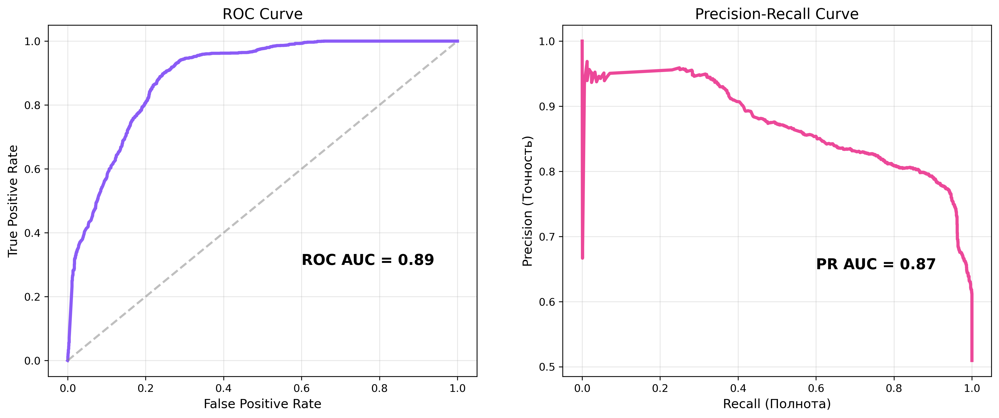

### Интерпретация результатов
Модель демонстрирует высокую способность различать клиентов с повышенным и пониженным риском деградации поведения.
Особенно важным является высокий Recall для churn-класса.
Модель корректно идентифицирует около 95% клиентов, которые в следующем периоде переходят в стадии At Risk или Churn.
Для задач retention это значительно важнее максимизации общей точности классификации, поскольку стоимость пропущенного риска обычно существенно выше стоимости ложного срабатывания.

### Бизнес-интерпретация
Полученные результаты показывают, что риск деградации клиента может быть выявлен до фактического прекращения покупок.
Модель фиксирует ранние признаки ухудшения поведения и позволяет перейти от реактивного управления churn к проактивному управлению клиентским портфелем.
Фактически система начинает отвечать на вопрос:
Какие клиенты находятся на траектории ухода уже сейчас, даже если они еще продолжают совершать покупки?
Именно этот тип сигналов обладает наибольшей ценностью для CRM и retention-команд.

## 8.6 SHAP Analysis
### Интерпретация драйверов оттока

Высокое качество модели само по себе недостаточно для принятия бизнес-решений.
Поэтому дополнительно был проведен SHAP-анализ, позволяющий определить факторы, оказывающие наибольшее влияние на прогнозируемый риск оттока.

#### Визуализация
Вставить здесь:
📊 SHAP Summary Plot
(глобальный SHAP-график из модели)

### Ключевые драйверы churn-risk
SHAP-анализ показал, что наибольшее влияние на вероятность оттока оказывают:
1. Frequency
2. Monetary Growth
3. Monetary Delta
4. Frequency Growth
5. Avg Days Between Purchases

### Главный инсайт
Наиболее важный вывод заключается в том, что модель реагирует не столько на текущий уровень активности клиента, сколько на изменение его поведения относительно собственной исторической нормы.
Другими словами:
Высокий риск возникает не потому, что клиент уже перестал покупать.
Высокий риск возникает потому, что клиент начинает покупать реже, тратить меньше и увеличивает интервалы между покупками.

### Поведенческая механика деградации
Результаты показывают, что churn представляет собой постепенный процесс ухудшения покупательского поведения.
		Типичная последовательность выглядит следующим образом:
		
		Снижение Frequency Growth
		          ↓
		Снижение Monetary Growth
		          ↓
		Увеличение интервалов между покупками
		          ↓
		Рост Churn Probability
		          ↓
			  At Risk
		          ↓
		        Churn

### Business Implication
Полученные результаты подтверждают одну из центральных гипотез проекта:
Риск оттока определяется не статическими RFM-характеристиками клиента, а динамикой изменения его поведения.  
Следовательно, наиболее ценной системой мониторинга являются не разовые snapshot-оценки клиентской базы, а непрерывное отслеживание:
- изменения частоты покупок;
- изменения выручки;
- изменения покупательского ритма;
- ухудшения transactional dynamics.

Именно эти показатели позволяют обнаруживать формирующийся churn задолго до того, как клиент перейдет в стадию фактической потери активности.

## 8.7 Risk Segmentation

### Business Question

После того как модель научилась прогнозировать вероятность оттока отдельных клиентов, возникает следующий вопрос:
Как распределяется риск оттока внутри клиентской базы и какие группы клиентов требуют различных retention-стратегий?
Важно не только предсказывать churn probability для каждого клиента, но и переводить прогнозы модели в понятные для бизнеса сегменты риска.
Для решения этой задачи клиенты были распределены по пяти risk-сегментам на основе предсказанной вероятности оттока:
- Very Low Risk 
- Low Risk 
- Medium Risk 
- High Risk 
- Critical Risk 

### Methodology

Для каждого клиента была рассчитана индивидуальная вероятность перехода в состояние At Risk или Churn на следующем временном горизонте.
Далее пользователи были сгруппированы по квинтилям распределения churn probability, что позволило сформировать пятиуровневую систему риск-сегментации.  
Для каждого сегмента дополнительно были рассчитаны:  
- количество клиентов; 
- средняя вероятность оттока; 
- средняя выручка; 
- средняя частота покупок; 
- средний чек. 
Это позволило оценить не только уровень риска, но и коммерческий профиль каждой группы клиентов. 

### Визуализация №1
Risk Segment Distribution
Столбчатая диаграмма:
X = Risk Segment
Y = Customers
________________________________________
### Визуализация №2
Risk Profile Comparison
Grouped Bar Chart:
	Avg Frequency 
	Avg Monetary 
	Avg Check 
по каждому risk-сегменту.

### Findings
Модель сформировала хорошо разделенную структуру клиентской базы.
По мере роста прогнозируемого риска наблюдается последовательное ухудшение ключевых поведенческих и финансовых показателей.  
Средняя частота покупок снижается:  
- с 6.99 транзакций в сегменте Very Low Risk   
- до 0.17 транзакций в сегменте Critical Risk. 
  
Средняя выручка сокращается более чем в 100 раз:  
- с 6 621  
- до 66 денежных единиц на клиента.

Такая монотонная деградация подтверждает высокую бизнес-интерпретируемость модели и показывает, что churn probability отражает общий процесс ухудшения customer engagement. 

### Business Implications
Результаты показывают, что вероятность оттока является не только индикатором будущего churn, но и ранним сигналом деградации клиентской ценности.  
Следовательно:  
- Very Low Risk и Low Risk должны становиться объектом программ развития клиентской ценности;   
- High Risk и Critical Risk требуют удерживающих коммуникаций;   
- динамика риск-сегментов может использоваться как регулярный KPI customer health monitoring.   

## 8.8 Customer Value & Risk Matrix
### Business Question
Высокий риск оттока сам по себе не означает высокий бизнес-риск.
Компания теряет деньги не тогда, когда уходит любой клиент, а тогда, когда уходит ценный клиент.  
Поэтому следующий вопрос выглядит так:  
Какие клиенты одновременно обладают высокой ценностью и высоким риском оттока?

### Methodology
Для решения этой задачи была построена двумерная система приоритизации.
Клиенты были сегментированы по двум измерениям:

- **Customer Value**  
На основе Monetary:  
	- Low Value 
	- Medium Value 
	- High Value 

- **Churn Risk**  
На основе модели:   
	- Very Low Risk   
	- Low Risk   
	- Medium Risk   
	- High Risk   
	- Critical Risk  
После объединения двух измерений была построена стратегическая матрица клиентских сегментов. 

### Визуализация №1
Customer Value × Risk Matrix
Тепловая карта.
Ось X:
	Low Value 
	Medium Value 
	High Value 
Ось Y:
	Very Low Risk 
	Low Risk 
	Medium Risk 
	High Risk 
	Critical Risk 
Размер клетки:
Количество клиентов.
Цвет:
Средняя выручка.
________________________________________
### Findings
Анализ показал, что риск распределен между клиентами с принципиально различной коммерческой ценностью.  
Наиболее крупным сегментом оказался   
**High Value | Very Low Risk**
- 727 клиентов; 
- средняя выручка 8 378.

Основная концентрация критического риска наблюдается в группе:  
**Low Value | Critical Risk**  
- 927 клиентов;   
- средняя выручка около 29.  
  
Однако наиболее интересным сегментом является:  
**High Value | High/Critical Risk**  
- 144 клиента; 
- средняя выручка более 2 500; 
- вероятность оттока выше 0.74. 

### Business Implications
Полученные результаты показывают, что стратегия «удерживать всех клиентов с высоким риском» является экономически неоптимальной.  
Наибольший ROI retention-инвестиций обеспечивают клиенты, которые одновременно обладают:  
- высокой ценностью;   
- высокой вероятностью оттока.
  
Именно эта группа должна становиться основным объектом CRM-интервенций. 

## 8.9 Recovery Modeling & Retention Prioritization

### Business Question
Даже среди клиентов с высоким риском оттока существуют принципиальные различия.
Некоторые пользователи практически потеряны для бизнеса.
Другие могут быть успешно возвращены при своевременном вмешательстве.
Поэтому возникает вопрос:
Какие клиенты одновременно обладают высоким риском оттока, высокой будущей ценностью и высокой вероятностью восстановления активности?

### Methodology
Для клиентов сегмента At Risk была построена отдельная recovery-модель.  
Целевая переменная:  
- Recovered = 1

если клиент в следующем периоде возвращается в:  
- Active   
- Loyal   
состояние. 

Для оценки вероятности восстановления использовались:
- Frequency; 
- Monetary; 
- Avg Check; 
- Frequency Delta; 
- Monetary Delta; 
- Frequency Growth; 
- Monetary Growth; 
- Purchase Cadence.
  
После расчета Recovery Probability была сформирована итоговая метрика:  
- *Retention Priority Score*
- *Retention Priority*  =  Churn Probability  ×  Expected Future Revenue×Recovery Probability

### Визуализация №1  
Recovery Probability Distribution  
Гистограмма Recovery Probability.  

### Визуализация №2  
Retention Priority Score Distribution  
Распределение итогового приоритетного балла.  

### Визуализация №3
Top Saveable Customers
Bubble Chart
X = Churn Probability
Y = Expected Future Revenue
Размер точки = Recovery Probability

### Findings
Интегральный показатель Retention Priority Score позволил выделить группу клиентов, которые одновременно обладают:
- высоким риском оттока; 
- значительным будущим revenue potential; 
- высокой вероятностью успешного восстановления. 
Анализ показал, что наиболее перспективными объектами для retention-инвестиций являются не только клиенты из At Risk сегмента, но и часть пользователей из Active и Loyal сегментов, демонстрирующих ранние признаки ухудшения поведения. 

### Business Implications
Главный вывод данного раздела состоит в том, что бизнесу необходимо управлять не churn probability, а объемом будущей выручки под риском.
Показатель  
		*Revenue-at-Risk = Expected Future Revenue × Churn Probability*  
позволяет перейти от классического churn management к системе экономически обоснованной retention-приоритизации.    
Интеграция:  
- Churn Prediction; 
- Customer Value; 
- Recovery Modeling;
   
формирует полноценную систему data-driven retention management, ориентированную на сохранение будущих денежных потоков, а не просто на снижение количества ушедших клиентов. 

## 8.10 Retention Prioritization Score
### Business Question
Если ресурсов на удержание ограниченное количество, каких клиентов необходимо спасать в первую очередь?
Высокий риск оттока сам по себе не означает высокий бизнес-приоритет. Аналогично, высокая ценность клиента не гарантирует, что его возможно вернуть.
Поэтому финальной целью predictive framework является не просто прогнозирование churn, а определение клиентов, для которых retention-инвестиции способны принести максимальный экономический эффект.

### Analytical Approach
Для решения данной задачи был разработан интегральный показатель Retention Priority Score.  
Метрика объединяет три независимых компонента:  
- вероятность оттока (Churn Probability);   
- ожидаемую будущую ценность клиента (Expected Future Revenue);   
- вероятность успешного восстановления активности (Recovery Probability).
  
### Формула
		Retention Priority Score =  Churn Probability  × Expected Future Revenue  × Recovery Probability  

Таким образом, высокий приоритет получают клиенты, которые одновременно:
- находятся под высоким риском потери; 
- обладают существенным future revenue potential; 
- сохраняют высокий потенциал восстановления.
  
Данный подход позволяет перейти от управления риском к управлению ожидаемой экономической отдачей от retention-интервенций. 

### Визуализация
Вставить:
Figure 31. Retention Priority Score Distribution
Варианты:
	Histogram Priority Score
или 
	Top 20 Customers by Priority Score 

### Key Findings
Интегральный показатель позволил выделить отдельную группу клиентов, сочетающих высокий churn-risk, значимый будущий revenue potential и высокую вероятность восстановления. Анализ показал, что наиболее приоритетными объектами удержания являются не только клиенты из сегмента At Risk, но и часть пользователей из Active и Loyal сегментов, демонстрирующих ранние признаки ухудшения поведения. 
Полученные результаты показывают, что риск оттока и экономическая значимость клиента не всегда совпадают. Значительная часть пользователей с высоким churn probability обладает ограниченной будущей ценностью, тогда как отдельные клиенты с умеренным риском формируют существенно больший объем потенциально сохраняемой выручки.

### Business Implications
Retention Prioritization Score переводит систему управления клиентской базой из режима:
«Кто может уйти?»
в режим:
«Кого выгоднее всего сохранить?»
Это позволяет существенно повысить эффективность CRM-бюджета за счет концентрации ресурсов на клиентах с максимальным ожидаемым возвратом инвестиций.

## 8.11 Saveability Matrix
### Business Question
Все ли клиенты с высоким риском оттока одинаково поддаются удержанию?
Или среди них существует отдельный сегмент пользователей, которых еще возможно эффективно вернуть?

### Analytical Approach
Для ответа на этот вопрос была построена Saveability Matrix.
По осям матрицы отображаются:
- Churn Probability; 
- Recovery Probability.

Каждый клиент позиционируется одновременно по двум измерениям:
- вероятность ухода; 
- вероятность успешного восстановления.
  
Такой подход позволяет разделить клиентскую базу на несколько стратегически различных групп.

### Визуализация
Вставить:
Figure 32. Customer Saveability Matrix
(Твой scatter plot)
Ось X:
Recovery Probability
Ось Y:
Churn Probability

### Интерпретация квадрантов
| Квадрант					| Интерпретация							|
|---------------------------|---------------------------------------|
|High Risk + High Recovery	|Главная retention-возможность			|
|High Risk + Low Recovery	|Ограниченная эффективность удержания	|
|Low Risk + High Recovery	|Потенциальный резерв развития			|
|Low Risk + Low Recovery	|Низкий приоритет						|

### Key Findings
Матрица Saveability показала наличие значительного числа клиентов с одновременно высокой вероятностью оттока (0.5–0.9+) и умеренно высокой вероятностью восстановления (0.5–0.7). При этом зависимость между churn-risk и recovery probability выражена слабо. Высокий риск ухода не означает автоматически низкую вероятность возврата клиента. 
Существенная часть клиентской базы остается потенциально управляемой даже после появления выраженных признаков деградации поведения. Это означает, что потеря клиента не является необратимым процессом, а эффективность CRM зависит от способности выявлять наиболее «спасаемых» пользователей. 

### Business Implications
Матрица показывает фундаментально важную вещь:
Высокий churn-risk не равен потерянному клиенту.
Часть наиболее рискованных клиентов сохраняет высокий потенциал восстановления и может приносить дополнительную выручку при своевременном вмешательстве. Поэтому приоритизация удержания должна учитывать не только риск ухода, но и вероятность успешного возврата клиента. 

## 8.12 Key Findings & Business Implications
### Executive Summary
Построенная predictive-система показала, что риск оттока формируется задолго до фактической потери клиента и может быть выявлен по изменениям поведенческих характеристик пользователей. Наиболее сильными индикаторами будущей деградации выступают динамика покупательской частоты, изменение выручки и увеличение интервалов между покупками. 
Дополнительный анализ показал, что экономический риск бизнеса определяется не количеством клиентов с высокой вероятностью ухода, а объемом будущей выручки, находящейся под угрозой потери. Это делает Revenue-at-Risk более полезным инструментом управления, чем традиционный churn monitoring. 
Интеграция Recovery Modeling позволила расширить predictive framework от прогнозирования оттока к прогнозированию эффективности удержания. В результате была сформирована система retention-prioritization, способная определять клиентов с максимальной ожидаемой отдачей от CRM-инвестиций. 

### Key Insights
**1. Поведенческие тренды важнее статических метрик**   
Наиболее значимыми факторами риска являются изменения покупательского поведения, а не только текущее состояние клиента.
Ухудшение Frequency Growth, Monetary Growth и Purchase Cadence выступает ранним сигналом будущего churn. 

**2. Revenue-at-Risk важнее количества рискованных клиентов**     
Не все клиенты с высоким churn probability одинаково опасны для бизнеса.
Основной риск создают пользователи, сочетающие высокий риск ухода и высокую будущую ценность. 

**3. Не каждый рискованный клиент требует удержания**      
Recovery Modeling показал, что вероятность возврата существенно различается между пользователями.
Часть клиентов остается экономически целесообразной целью для retention-инвестиций даже при высоком риске ухода. 

**4. Максимальную ценность создает сегмент High Value × High Risk × High Recovery**      
Именно эта группа обеспечивает наибольший потенциальный эффект от CRM-вмешательства и должна являться главным объектом персонализированных retention-кампаний. 

### Strategic Implications
Проведенный анализ показывает необходимость перехода от Mass CRM к Predictive Retention Management и далее от Risk-Based Retention к Value-Adjusted Retention, где решение об удержании принимается одновременно на основе:  
- риска потери клиента;   
- ожидаемой будущей выручки;   
- вероятности успешного восстановления.   

### Business Impact
Внедрение подобного подхода позволяет:
- повысить ROI retention-кампаний; 
- снизить неэффективные CRM-расходы; 
- сфокусировать бюджет на наиболее ценных клиентах; 
- увеличить объем сохраненной выручки; 
- перейти от churn management к Revenue-at-Risk management. 

### Финальный Executive Takeaway
Максимальную ценность для бизнеса представляет не выявление клиентов с высокой вероятностью ухода, а выявление клиентов, чья потеря создаёт наибольший финансовый ущерб и при этом остаётся предотвратимой. Объединение churn prediction, customer value и recovery modeling формирует основу для перехода от массовых CRM-коммуникаций к системе data-driven retention management. 

		Churn Prediction
		        ↓
		Revenue-at-Risk
		        ↓
		Recovery Modeling
		        ↓
		Retention Prioritization
		        ↓
		Data-Driven CRM Decision System

# 9. Layer 4. Lifecycle KPI Framework & Customer Health Monitoring

## 9.1 Business Objective

### Цель раздела 
Предыдущие разделы проекта позволили определить:  
- как клиенты перемещаются между lifecycle-состояниями;  
- где формируются основные потери выручки;  
- как развивается долгосрочная ценность клиента;  
- какие пользователи наиболее склонны к оттоку;  
- какие факторы формируют churn-risk.
  
Однако отдельные аналитические исследования сами по себе не обеспечивают операционное управление клиентской базой.
Для поддержки retention-стратегии компании необходим единый framework мониторинга, позволяющий регулярно отслеживать состояние клиентского портфеля, выявлять признаки ухудшения customer health и своевременно определять сегменты, требующие управленческого вмешательства.
Цель данного раздела — объединить результаты lifecycle analytics, cohort analytics и predictive modeling в единую систему Customer Health Monitoring, ориентированную на поддержку бизнес-решений.

### Бизнес-вопросы
Разработанный framework отвечает на следующие вопросы.  
**Customer Base Health**  
- Насколько устойчива клиентская база?
- Как меняется состояние клиентского портфеля во времени?
- Какие lifecycle-сегменты демонстрируют признаки деградации?
- Насколько стабильно клиенты сохраняют своё текущее состояние жизненного цикла?

**Revenue Health**
- Какие сегменты формируют основную часть выручки?
- Насколько концентрирована выручка внутри клиентского портфеля?
- Какие группы клиентов являются ключевыми драйверами бизнеса?

**Risk Monitoring**
- Где сосредоточен максимальный churn-risk?
- Какие сегменты формируют основной объём revenue-at-risk?
- Какие группы клиентов требуют приоритетного retention-вмешательства?

**Lifecycle Stability**
- Насколько стабильна структура жизненного цикла между периодами?
- Как меняется устойчивость здоровой части клиентской базы?
- Наблюдаются ли признаки ускоренной деградации customer health?

**Retention Prioritization**
- Куда следует направлять CRM-бюджет в первую очередь?
- Какие сегменты обладают наибольшим потенциалом возврата retention-инвестиций?
- Какие группы клиентов одновременно являются ценными и уязвимыми?

### Роль раздела в архитектуре проекта
Если предыдущие разделы проекта отвечают на вопросы:  
- Почему происходит отток клиентов?
- Какие факторы определяют долгосрочную ценность клиента?
- Какие пользователи обладают высоким риском ухода?

то данный раздел отвечает на принципиально иной вопрос: 
- Что необходимо постоянно мониторить для управления этими процессами?

Таким образом, Lifecycle KPI Framework выступает операционным уровнем всей аналитической системы и трансформирует результаты анализа в набор управляемых бизнес-индикаторов.

## 9.2 Framework Architecture
### Концепция Framework
Lifecycle KPI Framework представляет собой многоуровневую систему мониторинга клиентского здоровья, объединяющую структурные, поведенческие, финансовые и предиктивные показатели в единую модель оценки customer health.

		Архитектура framework состоит из семи взаимосвязанных уровней:
		
						Lifecycle Structure
								↓
						Behavioral Health
								↓
						Revenue Health
								↓
						Lifecycle Stability
								↓
						Churn Risk
								↓
						Revenue-at-Risk
								↓
						Retention Prioritization
Каждый последующий уровень добавляет новый слой информации о состоянии клиентского портфеля.

### Уровень 1. Lifecycle Structure Layer
Первый уровень описывает распределение клиентов между стадиями жизненного цикла.
По состоянию на последний snapshot структура клиентской базы выглядит следующим образом:
|Stage	|Customers	|Share|
|-------|-----------|-----|
|Active	|1612		|28.2%|
|At Risk|1458		|25.5%|
|Loyal	|904		|15.8%|
|New	|404		|7.1% |
|Churn	|1340		|23.4%|

Несмотря на относительно небольшой размер Loyal-сегмента, именно он формирует основу долгосрочной клиентской экономики компании.
### Визуализация
 📊 Lifecycle Distribution
Donut Chart или Stacked Bar Chart

### Уровень 2. Behavioral Health Layer
На втором уровне анализируются поведенческие характеристики сегментов.
|Stage	|Avg Frequency	|Avg Recency|
|-------|---------------|-----------|
|Loyal	|7.9			|26			|
|Active	|1.7			|47			|
|At Risk|1.5			|135		|
|New	|1.3			|12			|

Наблюдается последовательное ухудшение поведенческих метрик по мере движения клиентов от активных состояний к стадиям риска и оттока.
### Визуализация
📊 Behavioral Metrics Heatmap

### Уровень 3. Revenue Health Layer
Следующий уровень показывает экономическую значимость сегментов.
|Stage	|Revenue Share  |
|-------|---------------|
|Loyal	|55.4%			|	
|Active	|22.8%			|
|At Risk|17.0%			|
|New	|4.8%			|

Менее 16% клиентов формируют более половины всей выручки компании.
Это свидетельствует о высокой концентрации customer value внутри ограниченного сегмента лояльных покупателей.
### Визуализация
📊 Revenue Share by Lifecycle Stage
Bar Chart

### Уровень 4. Lifecycle Stability Layer
Для оценки устойчивости клиентской базы дополнительно рассчитываются две агрегированные метрики.
#### Lifecycle Stability Index
Показывает долю клиентов, сохранивших своё lifecycle-состояние между соседними периодами.
Метрика отражает общую устойчивость структуры клиентской базы и интенсивность миграции между сегментами.
#### Healthy Stability Index
Показывает долю клиентов из здоровых сегментов (Active и Loyal), сохранивших своё состояние между периодами.
Метрика используется как ранний индикатор ухудшения customer health и позволяет оценивать устойчивость наиболее ценной части клиентской базы.
Снижение данных показателей сигнализирует о росте деградации клиентского портфеля ещё до существенного ухудшения retention или revenue metrics.
### Визуализация
📊 Lifecycle Stability Trends
Line Chart:
	Lifecycle Stability Index
	Healthy Stability Index

### Уровень 5. Risk Layer
После интеграции результатов churn-модели становится возможным анализ распределения риска между сегментами.
|Stage	|Avg Churn Risk |
|-------|---------------|
|Loyal	|0.16			|
|New	|0.45			|
|Active	|0.52			|
|At Risk|0.68			|
|Churn	|0.95			|

Наиболее высокий риск сосредоточен внутри At Risk и Active сегментов.
### Визуализация
📊 Average Churn Probability by Lifecycle Stage
Bar Chart

### Уровень 6. Economic Risk Layer
Для оценки потенциальных финансовых потерь вероятность оттока объединяется с выручкой сегмента через показатель Revenue-at-Risk.  

		Revenue-at-Risk = Revenue × Churn Probability   
			
|Stage	|Revenue-at-Risk|
|-------|---------------|
|Active	|1.39M			|
|At Risk|1.35M			|
|Loyal	|1.02M			|
|New	|0.25M			|

Основная часть потенциальных потерь сосредоточена внутри Active и At Risk сегментов.
### Визуализация
📊 Revenue-at-Risk by Lifecycle Stage
Horizontal Bar Chart

### Уровень 7. Retention Prioritization Layer
Финальный уровень объединяет:  
- churn probability;  
- customer value;  
- потенциальный бизнес-эффект удержания.
  
Для оценки используется Priority Score.
|Stage	|Priority Score |
|-------|---------------|
|Active	|11.9		    |
|At Risk|11.5			|
|Loyal	|8.8			|
|New	|2.1			|

Полученные результаты показывают, что максимальный эффект retention-инвестиций ожидается внутри Active и At Risk сегментов.
### Визуализация
📊 Retention Priority Ranking
Horizontal Bar Chart

## 9.3 KPI Dashboard
### Lifecycle KPI Trends
Для оценки динамики клиентской базы был сформирован набор агрегированных lifecycle KPI.
|Период	|Retention	|Churn	|Reactivation	|Resurrection|
|-------|-----------|-------|---------------|------------|
|Dec → Jan|	59.9%	|5.4%	|7.5%			|0.0%		|
|Jan → Feb|	55.5%	|11.8%	|8.7%			|5.8%		|
|Feb → Mar|	51.3%	|17.5%	|11.8%			|3.0%		|
|Mar → Apr|	48.7%	|21.8%	|11.4%			|5.4%		|
|Apr → May|	47.3%	|25.2%	|11.2%			|3.8%		|

Наблюдается последовательное ухудшение состояния клиентской базы:     
- Retention снижается с 59.9% до 47.3%;    
- Churn увеличивается почти в пять раз;    
- Reactivation и Resurrection частично компенсируют потери, но не способны переломить негативный тренд.   

### Визуализация
📊 Customer Health Dynamics
Line Chart:  
- Retention Rate  
- Churn Rate  

📊 Recovery Dynamics
Line Chart:
	Reactivation Rate
	Resurrection Rate

### • Revenue Dynamics
Для оценки устойчивости выручки анализируется динамика revenue retention и баланс между расширением и сокращением потребления внутри удержанной клиентской базы.
|Период	|Revenue Retention|
|-------|-----------------|
|Dec → Jan|	86.8%|
|Jan → Feb|	83.4%|
|Feb → Mar|	83.2%|
|Mar → Apr|	79.4%|
|Apr → May|	79.0%|

Несмотря на ухудшение пользовательских метрик, компания сохраняет около 80% выручки между соседними периодами.
Это подтверждает вывод предыдущих разделов: удержанные клиенты обладают существенно большей ценностью, чем средний пользователь базы.

### Визуализация
📊 Revenue Retention Trend
Line Chart

### • Expansion vs Contraction Monitoring

Период	Expansion	Contraction
Dec → Jan	1.06M	0.58M
Jan → Feb	1.06M	0.84M
Feb → Mar	1.23M	1.15M
Mar → Apr	0.93M	1.34M
Apr → May	1.06M	1.49M
К концу периода contraction revenue начинает устойчиво превышать expansion revenue.
Это один из наиболее ранних сигналов ухудшения customer health, поскольку снижение потребления появляется раньше полного оттока клиентов.
________________________________________
Визуализация
📊 Expansion vs Contraction Trend
Line Chart
________________________________________
### • Lifecycle Stability Monitoring
Дополнительно framework отслеживает устойчивость жизненного цикла клиентов между соседними периодами.
Для этого используются:  
- *Lifecycle Stability Index;*  
- *Healthy Stability Index.*
  
Lifecycle Stability Index отражает общую стабильность структуры клиентской базы.  
Healthy Stability Index показывает устойчивость наиболее ценной части портфеля — клиентов сегментов Active и Loyal.  

Снижение данных показателей интерпретируется как ранний сигнал ухудшения customer health и роста вероятности будущей деградации retention и revenue metrics.

### Визуализация
📊 Lifecycle Stability Trends
Line Chart:
	Lifecycle Stability Index
	Healthy Stability Index

### Business Value
Разработанный KPI Dashboard позволяет перейти от ретроспективного анализа к непрерывному мониторингу состояния клиентского портфеля.  
Framework обеспечивает:   
- контроль структуры клиентской базы;  
- мониторинг customer health dynamics;  
- анализ эффективности восстановления клиентов;  
- оценку стабильности жизненного цикла;  
- выявление ухудшения revenue dynamics;  
- раннее обнаружение деградации клиентского здоровья.

Таким образом компания получает единую систему Customer Health Monitoring, объединяющую результаты всех предыдущих аналитических разделов в платформу поддержки retention-решений.

## 9.4 Lifecycle Stability Analysis
### Зачем нужен этот анализ
Retention, churn и revenue retention показывают результат происходящих процессов.   
Однако они не отвечают на вопрос:  
Насколько стабильна сама структура клиентской базы?  
Например:  
- retention может снижаться; 
- churn может расти; 
- но при этом большая часть клиентов может оставаться внутри своих lifecycle-сегментов.
  
И наоборот:  
- общий retention может выглядеть приемлемо; 
- но клиенты могут активно мигрировать между стадиями,

что указывает на скрытую нестабильность клиентского портфеля.   
Для оценки структурной устойчивости lifecycle-системы были дополнительно рассчитаны два интегральных показателя стабильности.

### Методология
#### • Lifecycle Stability Index
Показывает долю клиентов, сохранивших свою lifecycle-стадию между соседними snapshot-периодами.
Формула:
		Lifecycle Stability Index  =  Customers with unchanged stage  /  Total customers

Высокое значение индекса означает:    
- низкую турбулентность клиентской базы;   
- стабильность lifecycle-структуры;   
- предсказуемость поведения пользователей.   

#### • Healthy Stability Index
Дополнительно был рассчитан показатель устойчивости здоровой части клиентской базы.  
В расчет включаются только стадии:    
- Active   
- Loyal
  
Формула:  
		Healthy Stability Index  =  Healthy customers remaining healthy  /  Total healthy customers

Показатель позволяет оценить способность бизнеса удерживать наиболее ценных клиентов внутри активной части lifecycle.

### Результаты анализа
#### Общая стабильность клиентской базы
Анализ показал, что по мере развития жизненного цикла структура клиентской базы становится менее устойчивой.
Несмотря на наличие значительного сегмента клиентов, сохраняющих свою стадию между периодами, наблюдается постепенное увеличение миграции между lifecycle-состояниями.  
Это согласуется с результатами предыдущих разделов:   
- retention постепенно снижается;   
- churn растет;   
- увеличивается количество клиентов, переходящих в At Risk.

#### Устойчивость здоровой части базы
Особый интерес представляет динамика Healthy Stability Index.
Показатель отражает способность компании удерживать клиентов внутри наиболее ценных сегментов:  
- Active;   
- Loyal.
  
Снижение данного индекса означает, что даже сохраненные клиенты начинают постепенно деградировать внутри жизненного цикла и переходить в более рискованные состояния.
Это особенно важно с точки зрения долгосрочной экономики бизнеса, поскольку именно данные сегменты формируют основную часть будущей выручки.

### Бизнес-интерпретация
Lifecycle Stability Index выступает ранним индикатором ухудшения customer health.
В отличие от churn, который фиксирует уже состоявшуюся потерю клиента, снижение стабильности позволяет обнаруживать проблемы значительно раньше:
			Снижение стабильности
			          ↓
			Рост миграции между стадиями
			          ↓
			Рост At Risk сегмента
			          ↓
			Рост churn
			          ↓
			Потеря выручки
Поэтому стабильность lifecycle-структуры может использоваться как leading indicator будущих проблем удержания.

#### Визуализация
Вставить после раздела:
📊 Lifecycle Stability Trends
Линейный график:
	Lifecycle Stability Index 
	Healthy Stability Index 
По оси X:
	Dec→Jan 
	Jan→Feb 
	Feb→Mar 
	Mar→Apr 
	Apr→May 

## 9.5 Lifecycle KPI Trends
После добавления новых метрик я бы полностью переработал старый подраздел KPI Trends.
Теперь он должен состоять из трех самостоятельных блоков.
### 9.5.1 Customer Health Dynamics
### Цель
Оценить изменение состояния клиентской базы во времени.  
Для этого анализируются:   
- Retention Rate    
- Churn Rate   
- Reactivation Rate   
- Resurrection Rate   
- Lifecycle Stability Index   
- Healthy Stability Index   

### Ключевые наблюдения   
Периодический анализ показывает постепенное ухудшение customer health.
#### • Retention
Retention последовательно снижается:  
59.9% → 47.3%   
что свидетельствует об ослаблении способности системы удерживать существующих клиентов.  

#### • Churn
Одновременно наблюдается ускорение оттока:  
5.4% → 25.2%  
Рост churn существенно опережает темпы реактивации пользователей.  

#### • Reactivation
Reactivation остается относительно стабильным:  
7–12%  
что подтверждает наличие механизма возврата клиентов, однако его масштаб недостаточен для компенсации роста потерь.  

#### • Lifecycle Stability
Дополнительный анализ стабильности показывает постепенное увеличение структурной турбулентности клиентской базы.  
Все больше пользователей меняют lifecycle-состояния между периодами.  
Это означает, что ухудшение customer health происходит еще до появления финального churn.  

#### • Healthy Stability
Особое внимание заслуживает снижение устойчивости Active и Loyal клиентов.  
Данный сигнал указывает на постепенную деградацию наиболее ценной части клиентской базы и может рассматриваться как раннее предупреждение будущих потерь выручки.  

#### Визуализация
📊 Customer Health Dynamics
Линейный график:
	Retention Rate 
	Churn Rate 
	Reactivation Rate 
	Resurrection Rate 

📊 Lifecycle Stability Dynamics
Отдельный линейный график:
	Lifecycle Stability Index 
	Healthy Stability Index 

### 9.5.2 Recovery Dynamics
### Цель
Оценить способность системы компенсировать потерю клиентов за счет возврата ранее неактивных пользователей.

### Ключевые наблюдения
Несмотря на наличие реактивации клиентов, её масштаб остается существенно ниже темпов деградации клиентской базы.  
На протяжении периода:  
- churn ускоряется;   
- reactivation остается относительно стабильной;   
- resurrection носит эпизодический характер.   
Это означает, что текущая recovery-модель не компенсирует ухудшение customer health.  

### Бизнес-интерпретация
Компания постепенно переходит от режима Retention-driven growth к режиму Acquisition-dependent growth? где удержание уже не покрывает естественный отток пользователей.

#### Визуализация
📊 Recovery Dynamics
Линейный график:
	Reactivation Rate 
	Resurrection Rate 
	Churn Rate 

### 9.5.3 Revenue Dynamics
### Цель
Оценить устойчивость выручки и ранние признаки ухудшения клиентской экономики.

### Ключевые наблюдения  

#### • Revenue Retention
Несмотря на ухудшение пользовательских метрик, бизнес сохраняет около:  
79–87%  
выручки между соседними периодами.  
Это подтверждает выводы предыдущих разделов:  
основная выручка концентрируется среди наиболее лояльных клиентов.  

#### • Expansion vs Contraction
Наиболее важным наблюдением является изменение баланса между expansion и contraction revenue.  
В начале периода:  
Expansion > Contraction  
Однако затем происходит разворот тенденции.  
К последним периодам:  
Expansion Revenue ≈ 1.06M  
Contraction Revenue ≈ 1.49M  
То есть сокращение потребления внутри существующей базы начинает систематически превышать рост.  

### Бизнес-интерпретация
Данный сигнал особенно важен, поскольку возникает раньше полноценного churn.  
Последовательность выглядит следующим образом:  

			    Expansion ↓
			    Contraction ↑
			        ↓
			 Revenue Retention ↓
			        ↓
			      Churn ↑
			        ↓
			   Revenue Loss
			
Таким образом, Contraction Revenue выступает одним из наиболее ранних индикаторов ухудшения customer health.

### Визуализация
📊 Revenue Retention Trend
Линейный график:
	Revenue Retention 
________________________________________
📊 Expansion vs Contraction Dynamics
Линейный график:
	Expansion Revenue 
	Contraction Revenue 
с выделением точки пересечения кривых.

## 9.6 Revenue Concentration
### Цель анализа
После оценки состояния клиентской базы необходимо определить, как распределяется выручка между различными lifecycle-сегментами.
Для бизнеса важно понимать не только размер клиентских групп, но и их фактический вклад в финансовый результат компании.
Даже относительно небольшой сегмент клиентов может формировать непропорционально большую долю выручки и являться критически важным для устойчивости бизнеса.  
Цель данного анализа — выявить концентрацию выручки внутри клиентского портфеля и определить сегменты, от которых зависит долгосрочная финансовая стабильность компании.  

### Распределение выручки по lifecycle-стадиям
Последний lifecycle snapshot показывает крайне неравномерную структуру формирования выручки.

|Stage	|Customers	|Revenue Share|
|-------|-----------|-------------|
|Loyal	|904		|55.4%			|
|Active	|1612		|22.8%			|
|At Risk|1458		|17.0%			|
|New	|404		|4.8%			|
|Churn	|1340		|0.0%			|

Несмотря на то что сегмент Loyal составляет лишь около 16% клиентской базы, он генерирует более половины всей выручки компании.
Одновременно Active и At Risk формируют еще около 40% доходов бизнеса.  
Фактически более 95% всей выручки сосредоточено внутри трех сегментов:  
- Loyal;   
- Active;   
- At Risk.   

### Revenue Concentration Analysis
Для дополнительной оценки была рассчитана относительная экономическая значимость сегментов через Revenue Index.
Показатель отражает способность сегмента генерировать выручку относительно среднего клиента базы.  
|Stage	|Revenue Index|
|-------|-------------|
|Loyal	|3.51			|
|Active	|0.81			|
|At Risk|0.67			|
|New	|0.67			|
|Churn	|0.00			|

Полученные результаты показывают крайне высокую концентрацию customer value внутри Loyal-сегмента.
Средний Loyal-клиент приносит компании более чем в 3.5 раза больше выручки, чем средний клиент базы.
При этом Active, At Risk и New демонстрируют близкие уровни монетизации и существенно уступают лояльным клиентам по экономической ценности.

### Бизнес-интерпретация
Полученная структура характерна для зрелых retail-моделей.
Клиентская база состоит из двух принципиально разных частей:  
#### • Массовая база
- New 
- Active 
- At Risk
  
Обеспечивает масштаб клиентского портфеля, но генерирует относительно низкую выручку на пользователя.

#### • Высокоценное ядро
- Loyal

Формирует основную часть долгосрочной выручки компании.

Фактически устойчивость бизнеса определяется не количеством клиентов как таковым, а способностью удерживать и развивать сегмент Loyal.
Результаты полностью согласуются с выводами предыдущих разделов:  
- cohort analysis показал рост customer value среди retained users;   
- lifecycle analysis выявил высокую концентрацию выручки внутри стабильных клиентов;   
- predictive model показала минимальный churn-risk среди Loyal-клиентов.
  
Таким образом, Loyal-сегмент выступает главным экономическим активом клиентской базы.

#### Визуализации
📊 Revenue Share by Lifecycle Stage
Donut Chart
Показать долю общей выручки по lifecycle-сегментам.

📊 Revenue Concentration
Bar Chart
Ось X:
	New 
	Active 
	Loyal 
	At Risk 
	Churn 
Ось Y:
	Revenue Share % 

📊 Revenue Index by Lifecycle Stage
Bar Chart
Ось Y:
	Revenue Index 
Показать экономическую ценность сегментов относительно среднего клиента базы.

### Ключевой вывод
Бизнес обладает высокой концентрацией выручки внутри ограниченного сегмента лояльных клиентов.
Несмотря на то что Loyal-пользователи составляют лишь небольшую часть клиентского портфеля, именно они формируют большую часть финансового результата компании.
Это делает удержание и развитие данного сегмента стратегически важным направлением retention-стратегии.

## 9.7 Revenue-at-Risk
### Цель анализа
После определения сегментов, формирующих выручку, необходимо понять, какая часть этой выручки находится под угрозой потери.
Высокая выручка сама по себе не гарантирует устойчивость бизнеса.
Для принятия управленческих решений важно учитывать вероятность потери клиентов и потенциальные финансовые последствия такого оттока.
С этой целью была построена система оценки Revenue-at-Risk.

### Методология
Для каждого lifecycle-сегмента рассчитывается показатель:
		Revenue At Risk  =  Revenue  ×  Churn Probability
 
Метрика объединяет:  
- текущую экономическую ценность сегмента;   
- вероятность его потери;   
- потенциальный финансовый ущерб.
  
В отличие от обычного churn-risk данный показатель позволяет оценивать риск в денежном выражении.

### Результаты анализа
|Stage	|Revenue-at-Risk|
|-------|---------------|
|Active	|1.39M			|
|At Risk|1.35M			|
|Loyal	|1.02M			|
|New	|0.25M			|
|Churn	|0.00M			|

Полученные результаты приводят к неожиданному выводу.
Интуитивно можно было ожидать, что максимальный риск будет сосредоточен внутри сегмента At Risk.
Однако на практике наибольший объём потенциальных потерь формируется внутри Active-клиентов.

### Почему Active оказался опаснее At Risk
Причина заключается в сочетании трёх факторов:
#### • Active
- крупнейший сегмент базы; 
- значительный объём выручки; 
- уже заметный churn-risk. 

#### • At Risk
- более высокий риск; 
- меньшая выручка. 

В результате общий объём потенциальных потерь оказывается сопоставимым:
#### • Segment	Revenue-at-Risk
|Active	|1.39M|
|At Risk	|1.35M|

Это означает, что значительная часть будущего churn формируется ещё до того, как клиент официально попадает в At Risk.

### Loyal Segment Risk
Особенно важен результат для Loyal-сегмента.
Несмотря на минимальную вероятность оттока:  
Average Churn Risk = 0.16  
высокая концентрация выручки приводит к тому, что потенциальные потери достигают:  
1.02M  
Таким образом, даже небольшое ухудшение удержания наиболее ценных клиентов может иметь существенные финансовые последствия.  

### Бизнес-интерпретация
Анализ показывает существование трёх разных типов риска.
#### • Active Risk
Риск ранней деградации клиентской базы.
Клиенты ещё не выглядят проблемными, но уже формируют значительный объём будущих потерь.

#### • At Risk Risk
Риск непосредственного перехода в churn.
Наиболее очевидная зона удержания.

#### • Loyal Risk
Риск потери высокоценной выручки.
Даже небольшой churn внутри данного сегмента оказывает непропорционально сильное влияние на бизнес.

### Управленческие выводы
Большинство retention-стратегий концентрируются исключительно на At Risk клиентах.
Однако результаты показывают, что такая стратегия упускает значительную часть будущих потерь.
Наиболее эффективная модель удержания должна одновременно работать с тремя группами:
|Segment	|Основная задача|
|-----------|---------------|
|Active		|Предотвращение деградации|
|At Risk	|Реактивация				|
|Loyal		|Защита выручки				|

### Визуализации
📊 Revenue-at-Risk by Lifecycle Stage
Horizontal Bar Chart
Ось X:
Revenue-at-Risk
Ось Y:
	New 
	Active 
	Loyal 
	At Risk 
	Churn 

📊 Revenue vs Revenue-at-Risk
Grouped Bar Chart
Для каждого сегмента:
	Revenue 
	Revenue-at-Risk 
Позволяет увидеть, какая часть выручки потенциально находится под угрозой.

📊 Revenue-at-Risk Distribution
Treemap
Размер блока:
Revenue-at-Risk
Цвет:
Average Churn Risk
Очень сильная визуализация для senior-level проекта.

### Ключевой вывод
Основная зона потенциальных финансовых потерь сосредоточена не только среди At Risk клиентов, но и внутри Active-сегмента.
Это означает, что эффективная retention-стратегия должна начинаться значительно раньше момента появления явных признаков оттока.
Одновременно высокая концентрация выручки внутри Loyal-сегмента требует отдельной стратегии защиты наиболее ценных клиентов, поскольку даже небольшой рост churn в данной группе способен привести к существенным потерям будущей выручки.

## 9.8 Retention Prioritization
### Цель анализа
Предыдущие подразделы позволили определить:  
- какие сегменты формируют основную выручку;  
- где сосредоточен churn-risk;   
- какие группы клиентов создают наибольший объём revenue-at-risk.
  
Однако ограниченность CRM-ресурсов не позволяет одинаково активно работать со всеми клиентами одновременно.
Поэтому следующим шагом является определение приоритетности retention-инвестиций между lifecycle-сегментами.
Цель анализа — определить, какие группы клиентов способны обеспечить наибольший экономический эффект от удержания.

### Методология
Для ранжирования сегментов используется интегральный показатель Priority Score.
Показатель объединяет:  
- размер сегмента;  
- объём выручки;   
- churn-risk;   
- величину revenue-at-risk.
  
Чем выше значение Priority Score, тем выше ожидаемый бизнес-эффект от retention-интервенций.

### Результаты анализа
|Lifecycle Stage	|Priority Score|
|-------------------|--------------|
|Active				|11.9			|
|At Risk			|11.5			|
|Loyal				|8.8			|
|New				|2.1			|
|Churn				|0.0			|

Полученные результаты показывают, что наиболее приоритетным сегментом неожиданно оказывается не At Risk, а Active.

### Почему Active занимает первое место
На первый взгляд At Risk обладает более высоким риском потери.
Однако Priority Score учитывает не только вероятность оттока, но и потенциальный масштаб последствий.  
Active-клиенты одновременно характеризуются:  
- крупнейшим размером сегмента;   
- значительным объёмом выручки;   
- заметным уровнем churn-risk.  
  
Поэтому даже небольшое ухудшение удержания внутри Active-сегмента способно привести к существенным потерям будущей выручки.

### Роль Loyal-сегмента
Отдельного внимания заслуживает Loyal-сегмент.
Несмотря на низкий churn-risk, высокая концентрация выручки приводит к тому, что данный сегмент сохраняет высокий приоритет удержания.
Потеря одного Loyal-клиента обходится бизнесу существенно дороже, чем потеря среднего пользователя базы.
Поэтому задача удержания Loyal-клиентов заключается не в массовых реактивационных кампаниях, а в предотвращении деградации наиболее ценной части клиентского портфеля.

### Бизнес-интерпретация
Анализ показывает, что классическая модель:  
At Risk → CRM Action  
слишком упрощает реальную структуру риска.  
На практике наиболее эффективная стратегия должна охватывать три разные зоны:  
- Active  
Предотвращение будущей деградации.  
- At Risk  
Возврат клиентов до перехода в churn.
- Loyal  
Защита наиболее ценной части выручки.

Визуализация
📊 Priority Score by Lifecycle Stage
Horizontal Bar Chart
Показать ранжирование сегментов по Priority Score.

📊 Revenue-at-Risk vs Priority Score
Scatter Plot
X:
Revenue-at-Risk
Y:
Priority Score
Размер пузыря:
Customers
Цвет:
Lifecycle Stage
Очень сильная senior-level визуализация.

### Ключевой вывод
Максимальный ожидаемый эффект от retention-инвестиций сосредоточен внутри сегментов Active и At Risk.
При этом удержание Loyal-клиентов остаётся стратегически важной задачей из-за высокой концентрации выручки внутри данной группы.

## 9.9 Retention Strategy Matrix
### Цель анализа
После определения приоритетности сегментов необходимо преобразовать аналитические выводы в практические рекомендации по управлению клиентской базой.
Для этого строится Retention Strategy Matrix, связывающая lifecycle-сегменты с соответствующими стратегиями воздействия.

### Концепция матрицы
Каждый сегмент оценивается по двум измерениям:
- Business Value  
Экономическая ценность сегмента.  

- Churn Risk  
Вероятность потери клиентов.

В результате формируется стратегическая карта retention-действий.

### Retention Strategy Matrix
#### • Loyal
Высокая ценность + низкий риск  
Стратегия:  
Protect & Grow  
Основная задача:    
- предотвращение деградации;   
- развитие customer value;   
- программы лояльности;   
- персонализированные предложения.   

#### • Active
Высокая ценность + средний риск   
Стратегия:  
Monitor & Develop  
Основная задача:  
- раннее выявление признаков ухудшения поведения;   
- стимулирование повторных покупок;   
- ускорение перехода в Loyal.   

#### • At Risk
Средняя ценность + высокий риск  
Стратегия:  
Recover  
Основная задача:  
- реактивационные кампании;   
- персонализированные предложения;   
- специальные CRM-механики возврата.   

#### • New
Низкая ценность + умеренный риск  
Стратегия:  
Activate  
Основная задача:  
- формирование второй покупки;   
- развитие привычки использования;   
- onboarding-коммуникации.    

#### • Churn
Низкая ценность + максимальный риск  
Стратегия:  
Selective Win-back  
Основная задача:  
- выборочный возврат наиболее ценных клиентов;   
- контроль стоимости реактивации.   

#### Визуализация
📊 Retention Strategy Matrix
Квадрантная диаграмма.
Ось X:
Business Value
Ось Y:
Churn Risk
Точки:
	New 
	Active 
	Loyal 
	At Risk 
	Churn 
Для каждого сегмента указать стратегию:
	Activate 
	Monitor & Develop 
	Protect & Grow 
	Recover 
	Win-back 
Это, вероятно, самая сильная управленческая визуализация всего раздела.

### Business Value
Построенная матрица позволяет перевести результаты аналитики в систему принятия решений.  
Компания получает инструмент, позволяющий:  
- приоритизировать CRM-бюджет;   
- распределять retention-ресурсы;   
- управлять revenue-at-risk;   
- контролировать customer health;   
- защищать наиболее ценные сегменты клиентской базы.   
	
Фактически данный блок завершает переход от аналитики к практическому управлению жизненным циклом клиентов.

## 9.10 Key Findings & Business Implications
### Executive Summary
Разработанный Lifecycle KPI Framework показал, что клиентская база аптечной сети демонстрирует признаки постепенного ухудшения customer health по мере развития жизненного цикла.
Несмотря на наличие устойчивого сегмента лояльных покупателей, наблюдается последовательное снижение retention, рост churn и увеличение объема revenue-at-risk внутри активной части клиентской базы.
Одновременно анализ выявил высокую концентрацию выручки среди ограниченного числа наиболее ценных клиентов. Сегмент Loyal составляет менее 16% клиентской базы, однако генерирует более половины всей выручки компании.
Дополнительный анализ lifecycle stability показал снижение устойчивости структуры клиентского портфеля. Увеличение миграции между lifecycle-сегментами происходит раньше фактического churn и может рассматриваться как ранний индикатор ухудшения customer health.
В совокупности результаты показывают, что ключевой риск бизнеса связан не только с уже потерянными клиентами, но и с постепенной деградацией активной части клиентской базы, формирующей будущую выручку компании.

### Ключевые инсайты
**1. Клиентская база демонстрирует ухудшение customer health**   
Lifecycle KPI Trends показывают последовательное снижение удержания клиентов на протяжении периода наблюдения.  
- Retention Rate снижается: 59.9% → 47.3%  
- Одновременно Churn Rate возрастает: 5.4% → 25.2%
  
Несмотря на наличие реактивации пользователей, скорость возврата клиентов недостаточна для компенсации растущего оттока.
Это свидетельствует об ухудшении общего состояния клиентского портфеля.

**2. Структурная устойчивость клиентской базы снижается раньше фактического churn** 
Анализ Lifecycle Stability показал, что деградация клиентской базы начинается значительно раньше потери клиентов.
Рост количества переходов между lifecycle-сегментами сопровождается снижением доли клиентов, сохраняющих устойчивое поведение между периодами наблюдения.
Особенно важным является ухудшение Healthy Stability Index, отражающего устойчивость сегментов Active и Loyal.
Это означает, что ухудшение customer health происходит внутри активной клиентской базы задолго до появления явного churn.

**3. Выручка бизнеса крайне концентрирована** 
Распределение выручки между lifecycle-сегментами оказалось существенно более неравномерным, чем распределение клиентов.  
Сегмент Loyal:  
- 15.8% клиентов; 
- 55.4% общей выручки.
  
Средний Revenue Index для Loyal-клиентов достигает: 3.51  
что более чем в три раза превышает средний уровень по базе.  
Таким образом, устойчивость бизнеса критически зависит от сохранения ограниченного сегмента высокоценных покупателей.

**4. Основной финансовый риск сосредоточен внутри Active и At Risk сегментов**   
Расчет Revenue-at-Risk показал, что наибольший объем потенциальных потерь связан не только с клиентами, уже находящимися в стадии риска.   
Наиболее высокий уровень Revenue-at-Risk наблюдается для:  
|Stage	|Revenue-at-Risk|
|-------|---------------|
|Active	|1.39M			|
|At Risk|1.35M			|
|Loyal	|1.02M			|

Полученные результаты показывают, что значительная часть будущих потерь формируется еще до перехода клиента в стадию At Risk.
Это делает Active-сегмент критически важной зоной раннего retention-вмешательства.

**5. Contraction Revenue становится системной угрозой будущему росту**  
Анализ Revenue Dynamics показал постепенное ухудшение структуры удержанной выручки.
В начале периода Expansion Revenue превышает Contraction Revenue.  
Однако к концу периода ситуация меняется:  
|Metric	|Value|
|-------|-----|
|Expansion Revenue	|~1.06M|
|Contraction Revenue|~1.49M|

Рост сокращения потребления внутри существующей клиентской базы начинает превышать рост потребления.
Это указывает на накопление будущих потерь еще до появления полноценного churn.

**6. Приоритет удержания должен смещаться от реактивной к проактивной модели**   
Retention Prioritization Framework показал следующую структуру приоритетов:  
|Segment	|Priority Score|  
|-----------|---------------|
|Active		|11.9			|
|At Risk	|11.5			|
|Loyal		|8.8			|
|New		|2.1			|

Наиболее высокий ожидаемый эффект от retention-инвестиций сосредоточен внутри Active-сегмента.
Это означает, что эффективная стратегия удержания должна начинаться значительно раньше появления явных признаков оттока.

### Интегральная бизнес-интерпретация
Объединение результатов всех аналитических блоков позволяет описать текущее состояние клиентской базы следующим образом.
Компания обладает относительно небольшим, но экономически крайне ценным сегментом лояльных клиентов, который обеспечивает основную часть выручки бизнеса. 
Однако по мере развития жизненного цикла наблюдаются признаки постепенного ухудшения customer health:  
- снижается retention;   
- растет churn;   
- ухудшается lifecycle stability;   
- увеличивается contraction revenue;   
- растет объем revenue-at-risk.  
  
Наиболее важным выводом является то, что основная зона риска находится не среди уже уходящих клиентов, а внутри Active-сегмента, который формирует будущий Loyal-сегмент и будущую выручку компании.
Фактически бизнес сталкивается не столько с проблемой возврата потерянных клиентов, сколько с проблемой предотвращения деградации активной части клиентской базы.

### Business Impact
Полученные результаты показывают, что дальнейший рост бизнеса будет определяться способностью компании решать три ключевые задачи:
- Сохранение высокоценного Loyal-сегмента  
Минимизация потерь наиболее прибыльных клиентов.  

- Раннее выявление деградации Active-клиентов  
Предотвращение перехода пользователей в стадию риска.

- Снижение объема Revenue-at-Risk  
Управление будущими потерями до возникновения фактического churn.

В результате построенный Lifecycle KPI Framework формирует полноценную систему Customer Health Monitoring, объединяющую:
- lifecycle analytics;   
- cohort analytics;   
- predictive churn modeling;   
- revenue risk management;   
- retention prioritization.
  
Framework позволяет перейти от ретроспективного анализа клиентского поведения к системному управлению состоянием клиентского портфеля и может использоваться как основа для CRM-аналитики, retention reporting и стратегического управления жизненным циклом клиентов.

### Customer Health Monitoring Framework

				Lifecycle Structure
				        ↓
				Customer Health
				        ↓
				Revenue Concentration
				        ↓
				Revenue-at-Risk
				        ↓
				Retention Prioritization
				        ↓
				Retention Strategy
				        ↓
				Business Actions

## 10. Executive Metrics Overview
### Executive Snapshot
Данный раздел агрегирует ключевые результаты всего проекта в единую систему стратегических показателей, отражающих текущее состояние клиентской базы, качество удержания, устойчивость выручки и эффективность predictive analytics.  
Представленные метрики позволяют руководству компании быстро оценить:  
- состояние customer health;     
- устойчивость retention-модели;    
- концентрацию выручки;   
- масштаб потенциальных финансовых рисков;   
- эффективность системы прогнозирования оттока;   
- ключевые драйверы долгосрочного роста клиентской ценности.   

### 10.1 Lifecycle Health Snapshot
#### Состояние клиентской базы

KPI	Значение
Retention Rate	47.3%
Churn Rate	25.2%
Reactivation Rate	11.2%
Revenue Retention	79.0%
Lifecycle Stability Index	67.7%
Healthy Stability Index	71.0%

#### Интерпретация

Клиентская база сохраняет признаки относительной структурной устойчивости: около 68% клиентов остаются в своих lifecycle-состояниях между соседними периодами, а среди здоровых сегментов (Active и Loyal) стабильность превышает 71%.
Одновременно наблюдается постепенное ухудшение retention dynamics: churn достигает 25.2%, а retention снижается до 47.3%, что указывает на нарастающее давление на долгосрочное удержание клиентской базы.
Несмотря на ухудшение пользовательских метрик, компания удерживает 79% выручки между периодами, что подтверждает высокую ценность retained-аудитории.

#### Визуализация
📊 Executive KPI Cards
Разместить 6 KPI-карточек:
•	Retention Rate 
•	Churn Rate 
•	Revenue Retention 
•	Reactivation Rate 
•	Lifecycle Stability Index 
•	Healthy Stability Index 

### 10.2 Customer Economics Snapshot
Экономика жизненного цикла клиента
KPI	Значение
Early Retention (Month 1–2)	≈26%
Revenue Retention Plateau	20–45%
Revenue per Retained User Growth	до +43%
Mature Cohort LTV	6.3–6.8 тыс.

### Интерпретация
Главным ограничением экономики продукта является ранний churn.
После первой покупки около 74% клиентов покидают систему до формирования устойчивого покупательского поведения.  
При этом пользователи, остающиеся в продукте, демонстрируют рост customer value:   
•	Revenue per Retained User увеличивается до 43%;   
•	Revenue Retention существенно превышает User Retention;   
•	LTV продолжает накапливаться даже на поздних стадиях жизненного цикла.   
Это означает, что проблема бизнеса заключается не в монетизации удержанных клиентов, а в недостаточном количестве клиентов, достигающих стадии долгосрочного удержания.

#### Визуализация
📊 Customer Economics Scorecard
4 KPI-карточки:
•	Early Retention 
•	RPRU Growth 
•	Revenue Retention Plateau 
•	Mature Cohort LTV 

### 10.3 Revenue Risk Snapshot
Концентрация экономической ценности
KPI	Значение
Loyal Revenue Share	55.4%
Revenue-at-Risk (Active)	1.39 млн
Revenue-at-Risk (At Risk)	1.35 млн
Combined Revenue-at-Risk	2.73 млн

### Интерпретация
Несмотря на то что сегмент Loyal составляет лишь 15.8% клиентской базы, он формирует более половины всей выручки компании.
Одновременно основной объём потенциальных финансовых потерь сосредоточен не только среди At Risk клиентов, но и внутри Active-сегмента.
Это означает, что деградация поведения начинается значительно раньше момента формального перехода клиента в стадию риска.
Для бизнеса наиболее опасным является постепенное ухудшение customer health внутри активной аудитории.

#### Визуализация
📊 Revenue Risk Dashboard
Слева:
•	Loyal Revenue Share 
Справа:
•	Revenue-at-Risk Active 
•	Revenue-at-Risk At Risk 
•	Combined Revenue-at-Risk 

### 10.4 Predictive Analytics Snapshot
Качество модели прогнозирования оттока
KPI	Значение
ROC-AUC	0.89
Precision	0.76
Recall	0.95
F1 Score	0.84
Accuracy	0.82

### Интерпретация
Разработанная churn-модель демонстрирует высокую способность выявлять клиентов с повышенной вероятностью оттока.
Особенно важным является Recall на уровне 95%, что означает успешное обнаружение большинства будущих churn-клиентов.
Это делает модель пригодной для использования в CRM-процессах, системах раннего предупреждения и программах удержания клиентов.

#### Визуализация
📊 Predictive Model KPI Cards
5 карточек:
•	ROC-AUC 
•	Precision 
•	Recall 
•	F1 
•	Accuracy 

### 10.5 Executive Summary
Проведённый анализ показывает, что клиентская база аптечной сети проходит через выраженный процесс ранней селекции.
Основная часть клиентов покидает продукт в течение первых месяцев после первой покупки, однако пользователи, успешно преодолевающие данный этап, демонстрируют устойчивое удержание и рост экономической ценности.
Несмотря на снижение retention и рост churn, структура выручки остаётся относительно устойчивой благодаря высокой концентрации доходов внутри loyal-сегмента и постепенному увеличению монетизации удержанных клиентов.
При этом значительная часть revenue-at-risk сосредоточена в сегментах Active и At Risk, что делает раннее выявление деградации клиентского поведения критически важным фактором сохранения будущей выручки.
Разработанная predictive-модель позволяет своевременно обнаруживать клиентов с повышенной вероятностью оттока, а Lifecycle KPI Framework обеспечивает системный мониторинг customer health, retention dynamics и концентрации финансовых рисков.

## 11. Integrated Business Insights
### 11.1 Synthesis of Findings

### Интеграция результатов проекта
Проведённый анализ позволил исследовать клиентскую базу аптечной сети с четырёх взаимодополняющих точек зрения:  
1.	*Lifecycle Analytics* — динамика переходов между состояниями жизненного цикла. 
2.	*Cohort Analytics* — долгосрочное удержание и накопление клиентской ценности. 
3.	*Predictive Analytics* — раннее выявление риска оттока. 
4.	*KPI Framework* — мониторинг состояния клиентского портфеля и концентрации финансовых рисков.
   
Несмотря на различие аналитических подходов, все разделы приводят к одному и тому же системному выводу:
Основной риск бизнеса связан не с монетизацией существующих клиентов, а с неспособностью переводить новых покупателей в сегмент долгосрочно удерживаемой аудитории.

#### Инсайт 1. Основная потеря клиентов происходит сразу после первой покупки
Результаты cohort-анализа показали, что уже в первые месяцы жизненного цикла происходит наиболее интенсивный отток пользователей.
Средний User Retention снижается примерно до 26% уже после первых месяцев взаимодействия с компанией.    
Lifecycle-анализ подтверждает данный вывод:  
- большинство клиентов начинают деградировать ещё до перехода в формальный churn;  
- поток клиентов из Active в At Risk стабильно превышает обратные переходы;   
- churn является следствием более ранних процессов ухудшения customer health.   

Таким образом, ключевая проблема бизнеса находится не в удержании лояльных клиентов, а значительно раньше — на этапе формирования повторной покупки.

#### Инсайт 2. После прохождения раннего периода формируется устойчивое ядро клиентов
Несмотря на высокий initial churn, retention-кривые демонстрируют выраженное плато после первых месяцев жизненного цикла.
Retention decay существенно замедляется, а большая часть оставшихся пользователей сохраняет стабильную активность на протяжении длительного периода времени.  
Дополнительно это подтверждается результатами lifecycle stability analysis:   
- Lifecycle Stability Index достигает 67.7%;  
- Healthy Stability Index составляет 71.0%.
  
Это означает, что после прохождения критической стадии ранней селекции клиентская база становится существенно более устойчивой.
Для бизнеса это особенно важно:
каждый дополнительный клиент, удержанный в первые месяцы после первой покупки, получает значительно более высокую вероятность долгосрочного сохранения.

#### Инсайт 3. Выручка удерживается лучше, чем пользователи
Практически во всех когортах Revenue Retention систематически превышает User Retention.
Даже при сокращении клиентской базы компания сохраняет около 79% выручки между соседними периодами.  
Это свидетельствует о наличии механизма естественной селекции:  
- менее вовлечённые клиенты покидают продукт быстрее;    
- наиболее ценные пользователи остаются значительно дольше;   
- концентрация выручки постепенно возрастает внутри удержанной аудитории.   

Фактически система теряет клиентов быстрее, чем теряет деньги.  

#### Инсайт 4. Customer Value растёт по мере развития жизненного цикла
Анализ Revenue per Retained User показал устойчивый рост монетизации удержанных пользователей.
В наиболее зрелых когортах средняя выручка на одного retained customer превышает стартовый уровень на 43%.
Одновременно накопленный LTV продолжает увеличиваться на протяжении всего наблюдаемого горизонта и достигает 6.3–6.8 тыс. денежных единиц.
Это означает, что долгосрочная ценность клиента формируется не в момент первой покупки, а в процессе его постепенного развития внутри системы.
Каждый пользователь, успешно прошедший ранний этап жизненного цикла, становится всё более экономически значимым для бизнеса.

#### Инсайт 5. Основной финансовый риск сосредоточен внутри Active-сегмента
Predictive Analytics и Revenue-at-Risk анализ выявили важный управленческий вывод.
Наиболее крупный объём потенциальных потерь формируется не среди уже проблемных клиентов, а среди пользователей, которые ещё остаются активными.  
Revenue-at-Risk:  
- Active — 1.39 млн; 
- At Risk — 1.35 млн.
  
Это означает, что деградация клиентского поведения начинается значительно раньше момента явного ухода клиента.
Следовательно, эффективная retention-стратегия должна работать проактивно, а не реактивно.

#### Инсайт 6. Бизнес становится зависимым от ограниченного числа лояльных клиентов
Несмотря на то что сегмент Loyal составляет лишь около 16% клиентской базы, он генерирует 55.4% всей выручки компании.  
Это создаёт одновременно два эффекта:  

Позитивный:  
- высокая устойчивость денежного потока;   
- сильная монетизация удержанных клиентов.     

Негативный:  
- возрастающая концентрация бизнеса вокруг ограниченного числа покупателей;  
- риск ускоренного ухудшения выручки при деградации loyal-сегмента.
  
Именно поэтому сохранение здоровья данной группы становится критически важным элементом долгосрочной стратегии роста.

### Главный вывод проекта
Все выполненные анализы указывают на один и тот же системный механизм:
Компания уже умеет эффективно монетизировать удержанных клиентов, но теряет слишком большую часть будущей ценной аудитории до момента формирования устойчивой покупательской привычки.  
Следовательно:  
- проблема бизнеса — не monetization; 
- проблема бизнеса — early retention.

Именно раннее удержание является главным рычагом роста LTV, Revenue Retention и общей эффективности клиентской экономики.

#### Integrated Insights Framework

			High Early Churn
			        ↓
			Smaller Retained Base
			        ↓
			Formation of Loyal Core
			        ↓
			Growth of Customer Value
			        ↓
			Revenue Concentration
			        ↓
			Revenue-at-Risk
			        ↓
			Business Growth Potential

### 11.2 Unified Customer Lifecycle Model
Единая модель формирования клиентской ценности
На основании результатов всех разделов была сформирована интегрированная модель жизненного цикла клиента, отражающая полный путь создания экономической ценности внутри клиентской базы.
Модель показывает, каким образом отдельные этапы клиентского поведения формируют долгосрочные бизнес-результаты компании.

### • Этап 1. Acquisition
Жизненный цикл начинается с привлечения нового клиента.
На данном этапе пользователь совершает первую покупку и попадает в сегмент New.
Однако первая транзакция сама по себе практически не создаёт долгосрочной ценности.
Основной вопрос этого этапа:
*Сможет ли клиент совершить повторную покупку?*

### • Этап 2. Early Retention
Следующий этап является наиболее критичным для всей системы.
Именно здесь происходит основной объём потерь клиентской базы.
Большинство пользователей не переходят к регулярному взаимодействию и постепенно покидают продукт.   
Данный этап определяет:  
- будущий retention; 
- будущий revenue retention; 
- будущий LTV. 

Именно здесь сосредоточен основной резерв роста бизнеса.

### • Этап 3. Behavioral Selection
Пользователи, успешно преодолевшие ранний период, начинают демонстрировать более устойчивое поведение.  
Происходит естественная селекция клиентской базы:  
- случайные покупатели уходят;  
- остаются более вовлечённые пользователи.
  
На этом этапе начинают формироваться будущие loyal customers.

### • Этап 4. Loyalty Formation
После прохождения стадии селекции клиент переходит в фазу устойчивого потребления.  
Характерные признаки этапа:  
- высокая частота покупок;   
- низкий churn-risk;   
- высокая вероятность сохранения активности.   

Именно здесь начинает концентрироваться большая часть выручки бизнеса.

#### • Этап 5. Customer Value Expansion
По мере развития жизненного цикла удержанные клиенты постепенно увеличивают свою экономическую ценность.  
Наблюдается:  
- рост RPRU;  
- рост cumulative revenue; 
- накопление LTV. 

На данном этапе каждый дополнительный месяц удержания приносит всё больший экономический эффект.

### • Этап 6. Revenue Concentration
В результате долгосрочного удержания происходит концентрация бизнеса вокруг наиболее ценных клиентов.
Сегмент Loyal становится главным источником выручки компании.
Формируется устойчивая monetization engine всего бизнеса.

### • Этап 7. Customer Health Management
Заключительный этап представляет собой постоянный мониторинг состояния клиентского портфеля.
Для управления системой используются:  
- Lifecycle KPI Framework;   
- Predictive Churn Model;   
- Revenue-at-Risk Monitoring;  
- Retention Prioritization Framework. 

Именно здесь аналитика превращается в инструмент принятия решений.

#### *Unified Customer Lifecycle Model*
			Customer Acquisition
			          ↓
			Early Retention
			          ↓
			Behavioral Selection
			          ↓
			Loyalty Formation
			          ↓
			Customer Value Expansion
			          ↓
			Revenue Concentration
			          ↓
			Customer Health Monitoring
			          ↓
			Retention Interventions
			          ↓
			Long-Term Revenue Growth

### 11.3 Strategic Priorities
От аналитических выводов к бизнес-действиям
Проведенный анализ показал, что ключевые ограничения роста аптечной сети связаны не с привлечением новых клиентов и не с монетизацией удержанной аудитории, а с высокой потерей пользователей на ранних этапах жизненного цикла.
Несмотря на наличие устойчивого сегмента лояльных клиентов, формирующего более половины выручки компании, значительная часть покупателей не переходит к повторному потреблению после первой покупки. В результате бизнес вынужден постоянно компенсировать потери клиентской базы за счет новых привлечений, что повышает зависимость от маркетинговых инвестиций и ограничивает долгосрочный рост клиентской ценности.
Полученные результаты позволяют сформулировать четыре ключевых стратегических приоритета развития retention-системы.

#### Приоритет 1. Снижение раннего оттока после первой покупки
Наиболее критическим ограничением текущей lifecycle-модели является резкий churn в первые месяцы после привлечения клиента.
Когортный анализ показал, что уже ко второму месяцу жизненного цикла удержание снижается примерно до 26%, после чего скорость оттока существенно замедляется и формируется стабильное ядро постоянных покупателей.
Это означает, что основная часть будущих потерь LTV возникает еще до формирования регулярного покупательского поведения.   
Основными направлениями развития должны стать:  
- стимулирование второй покупки;  
- персонализированные post-purchase коммуникации;   
- механики раннего вовлечения клиентов;   
- программы ускоренного формирования покупательской привычки.   

Даже умеренное улучшение раннего retention способно оказать непропорционально сильное влияние на долгосрочную выручку за счет увеличения числа клиентов, достигающих стадии высокой монетизации.

#### Приоритет 2. Защита ядра высокоценных клиентов
Lifecycle-анализ показал высокую концентрацию выручки внутри сегмента Loyal.
Несмотря на относительно небольшой размер сегмента, лояльные клиенты формируют около 55% общей выручки компании и демонстрируют наиболее высокий уровень покупательской активности.
Дополнительный риск заключается в том, что значительная часть долгосрочного LTV бизнеса зависит именно от сохранения данной аудитории.  
Для повышения устойчивости выручки необходимо:  
- внедрять программы лояльности;  
- использовать персонализированные CRM-сценарии; 
- развивать механики удержания high-value клиентов;   
- регулярно мониторить показатели customer health и churn risk внутри Loyal-сегмента.  

Сохранение ядра лояльных покупателей обеспечивает максимальную защиту будущих денежных потоков компании.

#### Приоритет 3. Проактивное управление Revenue-at-Risk
Интеграция predictive analytics показала, что наибольший объем потенциальных потерь сосредоточен не среди уже ушедших клиентов, а среди сегментов Active и At Risk.
Совокупный объем Revenue-at-Risk внутри этих групп превышает 2.7 млн денежных единиц и существенно превосходит аналогичные показатели остальных lifecycle-сегментов.
Данный результат указывает на необходимость перехода от реактивной модели удержания к проактивному управлению риском.  
Приоритетными направлениями являются:
- регулярное обновление churn-scoring модели; 
- мониторинг динамики вероятности оттока; 
- раннее выявление признаков деградации поведения; 
- автоматизация retention-интервенций для клиентов с повышенным риском ухода. 

Такой подход позволяет предотвращать потери до фактического прекращения активности пользователя.

#### Приоритет 4. Развитие системы Customer Health Monitoring
Отдельные аналитические исследования дают понимание причин потерь клиентской базы, однако для практического управления retention необходим постоянный мониторинг состояния клиентского портфеля.  
Разработанный Lifecycle KPI Framework создает основу для построения полноценной системы Customer Health Monitoring, объединяющей:  
- lifecycle metrics; 
- retention metrics; 
- revenue metrics; 
- churn-risk indicators; 
- revenue-at-risk indicators; 
- retention prioritization metrics. 

Особую ценность представляет возможность отслеживания изменений клиентского здоровья во времени через показатели:
- Retention Rate;  
- Revenue Retention; 
- Lifecycle Stability Index; 
- Healthy Stability Index; 
- Revenue-at-Risk; 
- Priority Score. 

Это позволяет превратить результаты анализа в постоянно действующую систему поддержки управленческих решений.

#### Strategic Priorities Roadmap (Стратегическая карта):
			Early Retention
			        ↓
			Loyal Customer Protection
			        ↓
			Revenue-at-Risk Management
			        ↓
			Customer Health Monitoring
			        ↓
			Sustainable Revenue Growth

## 11.4 Final Executive Conclusion
### Итоговое заключение проекта
Проведенное исследование позволило комплексно проанализировать жизненный цикл клиентов аптечной сети, объединяя методы lifecycle analytics, cohort analysis, predictive modeling и customer health monitoring в единую аналитическую систему.
Полученные результаты показывают, что клиентская база характеризуется выраженной двухфазной структурой жизненного цикла.
На первом этапе происходит интенсивный отток пользователей после первой покупки. Большая часть клиентов не формирует устойчивого покупательского поведения и прекращает взаимодействие с компанией в течение первых месяцев после привлечения.
На втором этапе формируется относительно небольшое, но стабильное ядро лояльных покупателей, которое обеспечивает основную часть долгосрочной выручки бизнеса.
Когортный анализ подтвердил, что именно раннее удержание является главным фактором формирования долгосрочного LTV. Несмотря на существенное сокращение клиентской базы, удержанные пользователи демонстрируют устойчивый рост экономической ценности, что проявляется в более высокой динамике Revenue Retention по сравнению с User Retention и росте Revenue per Retained User на поздних этапах жизненного цикла.
Дополнительный анализ переходов между lifecycle-сегментами показал постепенное ухудшение customer health по мере старения клиентской базы. Снижение retention, рост churn и превышение contraction revenue над expansion revenue свидетельствуют о накоплении будущих потерь внутри существующего клиентского портфеля.
Разработанная predictive churn-модель продемонстрировала высокое качество прогнозирования и позволила перейти от ретроспективного анализа к раннему выявлению клиентов с повышенной вероятностью ухода. Интеграция прогнозного риска с показателями клиентской ценности позволила сформировать систему приоритизации retention-инвестиций и количественно оценить объем потенциальных финансовых потерь.
На основе результатов проекта был построен Lifecycle KPI Framework, объединяющий показатели удержания, монетизации, клиентского здоровья и прогнозного риска в единую систему мониторинга. Такой подход позволяет не только объяснять происходящие изменения клиентской базы, но и управлять ими в режиме непрерывного наблюдения.
В целом результаты исследования показывают, что основной потенциал роста бизнеса находится не в расширении объема привлечения клиентов и не в дополнительной монетизации существующей лояльной аудитории. Наибольший экономический эффект может быть достигнут за счет улучшения раннего удержания, увеличения доли клиентов, переходящих в сегмент регулярных покупателей, и более эффективного управления Revenue-at-Risk.
Именно развитие retention-системы, основанной на данных и прогнозной аналитике, представляет собой наиболее перспективное направление повышения долгосрочной клиентской ценности, устойчивости выручки и эффективности инвестиций в развитие клиентской базы.

####  End-to-End Customer Lifecycle Intelligence Framework
			Customer Acquisition
			          ↓
			Lifecycle Segmentation
			          ↓
			Transition Analytics
			          ↓
			Cohort Retention Analysis
			          ↓
			Predictive Churn Modeling
			          ↓
			Revenue-at-Risk Assessment
			          ↓
			Customer Health Monitoring
			          ↓
			Retention Prioritization
			          ↓
			Business Decision Making

# Технические навыки / «Technical skills»:

#### Excel: 
Управление опциями и настройками рабочей книги, импорт данных из различных источников, форматирование данных, формулы (базовые и сложные), построение таблиц, сводные таблицы, работа с массивами, построение диаграмм и графиков, VBA и макросы, Power Query

#### SQL (PostgreSQL):
* Простые выборки: SELECT, DISTINCT, COUNT, WHERE, AND / OR, BETWEEN, IN, ORDER BY, MIN/MAX/AVG, LIKE, LIMIT, GROUP BY, HAVING, UNION/INTERSECT/EXCEPT, проверки на NULL
* Соединения: INNER, LEFT, RIGHT, SELF, USING и NATURAL JOIN
* Подзапросы, Представления (Views), Обобщенные табличные выражения (CTE)
* Логика с CASE WHEN, COALESCE и NULLIF
* DDL, управление ключами (PK, FK), ограничения, DML (INSERT, UPDATE, DELETE) 
* Оконные функции
Проектирование Баз Данных: основы, нормальные формы (НФ), реляционная модель, ER-диаграммы, создание БД, таблиц, виды отношений, типы данных

#### Python:
Базовые операции, типы данных, условные операторы, циклы for и while, итераторы, генераторы, генераторы списков, функции, поиск ошибок в коде и обработка исключений, рекурсия, импорт данных из различных источников, основы ООП, регулярные выражения, работа с базами данных через Python, сбор данных: работа с сервисами через API, модули и библиотеки (NumPy, Pandas, Matplotlib, Seaborn, Plotly, BeautifulSoup, Requests, Selenium )

#### Data Visualization
построение дашбордов и визуализаций в Power BI, Tableau, DataLens, Redash, QlickView, MetaBase, Google Data Studio и др.

# Сертификаты
## SQL:
1. [Analyzing Business Data in SQL](https://www.datacamp.com/statement-of-accomplishment/course/90ebe676494ca2890eee42d053e5b2d7b4208ce2?raw=1).
2. [PostgreSQL Summary Stats and Window Functions](https://www.datacamp.com/statement-of-accomplishment/course/5c132721c65aba99c18bc6fb76bbe4a2bada0b80?raw=1)
3. [Exploratory Data Analysis in SQL](https://www.datacamp.com/statement-of-accomplishment/course/2cc32e0877b279643fe73c09f44ae2a90fe5b298?raw=1)
4. [Joining Data in SQL](https://www.datacamp.com/statement-of-accomplishment/course/477c0c737576a48fbbff1941be469ba5f8dd2529?raw=1)
5. [Creating PostgreSQL Databases](https://www.datacamp.com/statement-of-accomplishment/course/344ab5ef1affe4d3ccf6fddfa159759f710d97c1?raw=1)
6. [Database Design](https://www.datacamp.com/statement-of-accomplishment/course/483009d1a08c4fe162ca0a18e48ad01de65290c5?raw=1)
7. [Improving Query Performance in PostgreSQL](https://www.datacamp.com/statement-of-accomplishment/course/fefa46dc61bb14718ce0834da30e058cba953d87?raw=1)
8. [Cleaning Data in PostgreSQL Databases](https://www.datacamp.com/statement-of-accomplishment/course/24be7ec1000ae5af45848b3256cbd14bdb02010f?raw=1)
9. [Reporting in SQL](https://www.datacamp.com/statement-of-accomplishment/course/9274d9f95f175758cc7dfc1c24ecb526501374de?raw=1)
10. [Intermediate SQL](https://www.datacamp.com/statement-of-accomplishment/course/b5ddefc9272a07be5a33dfa3e1563a2ff4622509?raw=1)
11. [Introduction to SQL](https://www.datacamp.com/statement-of-accomplishment/course/d2f2f3823b3185d0e49b3d66c3f6fbba4d9c12f7?raw=1)
12. [Data Manipulation in SQL](https://www.datacamp.com/statement-of-accomplishment/course/874de13acbd910c8c9205ee4ee1464bc9b610367?raw=1)
13. [Functions for Manipulating Data in PostgreSQL](https://www.datacamp.com/statement-of-accomplishment/course/c20138b897662085287c0f4f8b00ffde0d04f306?raw=1)
14. [Data-Driven Decision Making in SQL](https://www.datacamp.com/statement-of-accomplishment/course/30f4aca0694c0a77e5bd65a9d5926435ec15454f?raw=1)
15. [Applying SQL to Real-World Problems](https://www.datacamp.com/statement-of-accomplishment/course/1fd66f19b0220dc7dbda92f271a2c93931879676?raw=1)
16. [Introduction to Relational Databases in SQL](https://www.datacamp.com/statement-of-accomplishment/course/28585cdb4bc7f9cf854a5ff30422d0679212935b?raw=1)
* [SQL Fundamentals - 22 hours](https://www.datacamp.com/statement-of-accomplishment/track/a8f5b712bda1d1345f04c6d4adff249e1ac66918?raw=1)
## Python
17. [Introduction to Python](https://www.datacamp.com/statement-of-accomplishment/course/7ea2db496d581cba90eaaae867f1166a3e49dc45?raw=1)
18. [Introduction to Importing Data in Python](https://www.datacamp.com/statement-of-accomplishment/course/76a032981867971550ae51b83fc17d3a0ffa941c?raw=1)
19. [ETL and ELT in Python](https://www.datacamp.com/statement-of-accomplishment/course/2c272c2043cf62fd90892f63a343197cb30f91f6?raw=1)
20. [Customer Segmentation in Python](https://www.datacamp.com/statement-of-accomplishment/course/9e53a888f26a165b248f570f6116be352d324462?raw=1)
21. [Streamlined Data Ingestion with pandas](https://www.datacamp.com/statement-of-accomplishment/course/9d30b8dbe2225992cc58a1a6f0111d5b7e57867f?raw=1)
22. [Data Manipulation with pandas](https://www.datacamp.com/statement-of-accomplishment/course/09f6da7f2dc3513a5e122ff1ae95e4be5bdbba0d?raw=1)
23. [Working with Dates and Times in Python](https://www.datacamp.com/statement-of-accomplishment/course/b1fdc6108d76622a5c1a1abf5f4d7e3f37afe088?raw=1)
24. [Writing Efficient Python Code](https://www.datacamp.com/statement-of-accomplishment/course/0b79cfba87fcec173b30e6355301575302e9ea1f?raw=1)
25. [Exploratory Data Analysis in Python](https://www.datacamp.com/statement-of-accomplishment/course/349f2d519f38bb7364ad7ad93a45b954005bd305?raw=1)
26. [Writing Efficient Code with pandas](https://www.datacamp.com/statement-of-accomplishment/course/be5376090cc5bfebe5034683aacddccad4e05ff0?raw=1)
27. [Cleaning Data in Python](https://www.datacamp.com/statement-of-accomplishment/course/c3943c6eebc9becdd8fa3bc549fe3f3774e6c04f?raw=1)
28. [Data Types in Python](https://www.datacamp.com/statement-of-accomplishment/course/6781f7fdd1441ec590b40519ea81d3ae20d8d47e?raw=1)
29. [Introduction to NumPy](https://www.datacamp.com/statement-of-accomplishment/course/015fbc2afffe9336f6eab59d5770be2198d8ddd9?raw=1)
30. [Intermediate Python](https://www.datacamp.com/statement-of-accomplishment/course/0230497b4fb2d5688fb9c870bb5bcfb357b98359?raw=1)
31. [Joining Data with pandas](https://www.datacamp.com/statement-of-accomplishment/course/b0bc2bd43772131258516340166d8d0b7f19a607?raw=1)
32. [Reshaping Data with pandas](https://www.datacamp.com/statement-of-accomplishment/course/11509450f3ea73eb719c6c388ea330cb2bd56f4e?raw=1)
33. [Introduction to Data Visualization with Matplotlib](https://www.datacamp.com/statement-of-accomplishment/course/81d0a4767f0d659fcf5a7eed1b91c0bd194391ff?raw=1)
34. [Object-Oriented Programming in Python](https://www.datacamp.com/statement-of-accomplishment/course/4205fb646149ee7f9c0c8178d17556ac8c9e01e0?raw=1)
35. [Introduction to Data Visualization with Seaborn](https://www.datacamp.com/statement-of-accomplishment/course/bb15b893bd9031328768bf1b4ae18db8b661791c?raw=1)
36. [Intermediate Data Visualization with Seaborn](https://www.datacamp.com/statement-of-accomplishment/course/bb3da69f67eadbd0b13d8d2ca99e85e584ab00ab?raw=1)
37. [Introduction to Functions in Python](https://www.datacamp.com/statement-of-accomplishment/course/b192cb3c0f9a8883ee31f367f725e7cd35c45c36?raw=1)
38. [Introduction to Object-Oriented Programming in Python](https://www.datacamp.com/statement-of-accomplishment/course/fc40a055368f4e46d2cb824dc5bb69305809fd1f?raw=1)
39. [Introduction to Data Visualization with Plotly in Python](https://www.datacamp.com/statement-of-accomplishment/course/717475ba29124a7e6325f8f8b95c08a2fad74809?raw=1)
40. [Writing Functions in Python](https://www.datacamp.com/statement-of-accomplishment/course/c6c1c45518b38937aa463543690c5be9705466d0?raw=1)
41. [Manipulating Time Series Data in Python](https://www.datacamp.com/statement-of-accomplishment/course/95b2fbd9c6407080cb8db2b478ca8ed219c9f332?raw=1)
## Theory
42. [Introduction to Data](https://www.datacamp.com/statement-of-accomplishment/course/f31c51cc233e3f3f6a3372661096227a2ebcc0a6?raw=1)
43. [Forming Analytical Questions](https://www.datacamp.com/statement-of-accomplishment/course/327ff2d1b4e3c0b8aa65fe690e9b2f38b26e11ed?raw=1)
44. [Data-Driven Decision Making for Business](https://www.datacamp.com/statement-of-accomplishment/course/52efbd7650665b6f60f8ca7e0320060c7d685844?raw=1)
45. [Understanding Data Visualization](https://www.datacamp.com/statement-of-accomplishment/course/b562d257ad4ae8ca06d38b1a50e6977115e57b09?raw=1)
## Git
46. [Introduction to Git](https://www.datacamp.com/statement-of-accomplishment/course/ab4797bae546080c86d1c9db78b645b94092ccc5?raw=1)
47. [Intermediate Git](https://www.datacamp.com/statement-of-accomplishment/course/d588d7061778f394caf9d4133fde7fc85c9c7eb9?raw=1)
48. [Introduction to GitHub Concepts](https://www.datacamp.com/statement-of-accomplishment/course/8faa441d450d9af6643ca08baad9069840190972?raw=1)
## Statistict 
49. [Introduction to Statistics](https://www.datacamp.com/statement-of-accomplishment/course/9483e88fcb1b68d9231e9e229b8b1a33b8009352?raw=1)
50. [Introduction to Statistics in Python](https://www.datacamp.com/statement-of-accomplishment/course/c69e327d09be87f8ebbcd3d7a4f697b3172aded1?raw=1)
    
