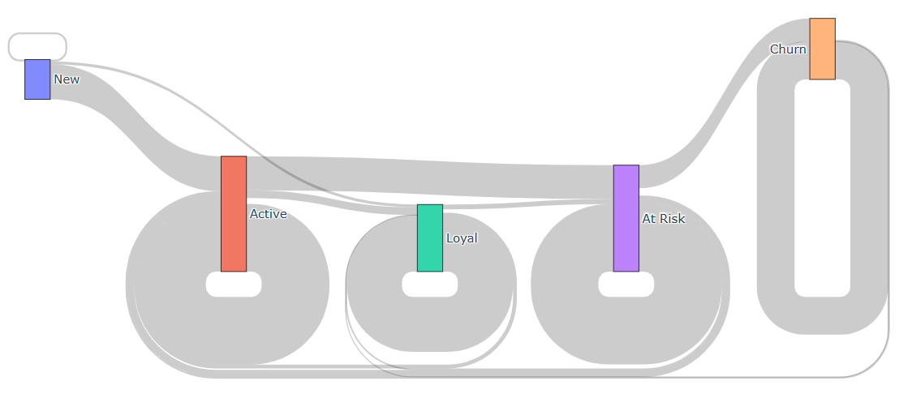

# Contents

- [1. Executive Summary](#1-executive-summary)
- [2. Project Architecture](#2-project-architecture)
- [3. Business Objectives](#3-business-objectives)
- [4. Dataset Overview](#4-dataset-overview)
- [5. Analytical Framework](#5-analytical-framework)
  - [6. Layer 1. Lifecycle Transition Analytics](#6-layer-1-lifecycle-transition-analytics)
	  - [6.1 Business Objective](#6-1-business-objective)
  - [7. Layer 2. Cohort Retention & Customer Value Dynamics](#7-layer-2-cohort-retention--customer-value-dynamics)
  - [8. Layer 3. Predictive Customer Analytics](#8-layer-3-predictive-customer-analytics)
  - [9. Layer 4. Lifecycle KPI Framework](#9-layer-4-lifecycle-kpi-framework)
- [10. Integrated Business Insights](#10-integrated-business-insights)
- [11. Strategic Recommendations](#11-strategic-recommendations)
- [12. Limitations & Future Work](#12-limitations--future-work)
- [13. Technical Stack](#13-technical-stack)

  
<b>[6. Layer 1. Lifecycle Transition Analytics](#6-layer-1-lifecycle-transition-analytics)</b>

  - Data Preparation & Segmentation Logic
  - Transition Matrix Construction
  - Key Insights: Churn vs. Retention Drivers

  
<b>Layer 2. Cohort Retention & Value Dynamics</b>

  - Retention Curve Analysis
  - Monetization Trends (RPRU)
  - Inter-cohort Comparison

---

# 1. Executive Summary

Текст раздела...

# 2. Project Architecture

Текст раздела...

# 6. Layer 1. Lifecycle Transition Analytics

# 6.1 Business Objective

### Бизнес-контекст

Статический анализ клиентской базы позволяет понять текущее распределение пользователей по сегментам, однако практически не отвечает на вопрос о том, как именно формируется рост или снижение бизнеса во времени.  
Для аптечной сети критически важно понимать не только текущее состояние клиентского портфеля, но и механизмы его изменения:
-	каким образом клиенты переходят между стадиями жизненного цикла; 
-	какие сегменты демонстрируют наиболее устойчивое поведение; 
-	где возникают основные потери клиентов; 
-	какие изменения пользовательского поведения приводят к росту или снижению выручки. 
Особую важность представляет анализ переходов между lifecycle-состояниями, поскольку именно они позволяют выявлять ранние признаки деградации клиентской базы задолго до фактического оттока.

### Цель анализа

Цель данного раздела — построить систему Lifecycle Transition Analytics, позволяющую количественно оценить динамику клиентской базы и связанные с ней денежные потоки.  
В рамках анализа необходимо:
-	исследовать миграцию клиентов между lifecycle-сегментами; 
-	оценить устойчивость различных состояний жизненного цикла; 
-	выявить основные сценарии деградации и удержания клиентов; 
-	определить ключевые источники роста и потери выручки; 
-	проанализировать вклад retention, reactivation, expansion, contraction и churn в изменение финансовых результатов бизнеса. 

### Ключевые бизнес-вопросы

Анализ направлен на получение ответов на следующие вопросы:  
-	Насколько устойчивы различные lifecycle-состояния? 
-	Какие переходы между сегментами происходят наиболее часто? 
-	Какие стадии жизненного цикла обладают наибольшим риском деградации? 
-	Через какие механизмы формируется churn? 
-	Какие клиентские переходы генерируют наибольший рост выручки? 
-	Какие сегменты являются основными источниками revenue loss? 
-	Что оказывает большее влияние на финансовую динамику бизнеса: привлечение новых клиентов или развитие существующей клиентской базы? 

## 6.2 Analytical Approach

Для анализа был разработан snapshot-based lifecycle framework, позволяющий отслеживать эволюцию клиентской базы во времени.  
Для каждого клиента рассчитывались поведенческие характеристики на основе транзакционной истории:  
*-	Recency;*   
*-	Frequency;*   
*-	Monetary;*   
*-	Customer Tenure.*  

На основе этих показателей пользователи классифицировались по пяти стадиям жизненного цикла:  
*-	New*  
*-	Active*  
*-	Loyal*  
*-	At Risk*  
*-	Churn*  

Для оценки динамики клиентского поведения были сформированы шесть последовательных lifecycle snapshots, каждый из которых отражал состояние клиентской базы на соответствующий момент времени.
Далее для каждой пары последовательных snapshots строились transition matrices, описывающие перемещение клиентов между lifecycle-состояниями.  
На основе полученных матриц была сформирована агрегированная модель переходов, позволяющая анализировать:
-	устойчивость сегментов; 
-	миграцию клиентов; 
-	сценарии деградации; 
-	churn dynamics; 
-	процессы формирования и потери клиентской ценности. 
Дополнительно для каждого перехода рассчитывались связанные изменения выручки, что позволило объединить behavioral analytics и revenue analytics в рамках единой lifecycle-модели.

## 6.3 Lifecycle Transition Framework
### Цель анализа

Первым этапом исследования является анализ переходов между lifecycle-состояниями.
В отличие от классической сегментации клиентов, рассматривающей сегменты как статические группы пользователей, данный подход позволяет исследовать клиентскую базу как динамическую систему, внутри которой пользователи постоянно изменяют свое поведение и перемещаются между различными стадиями жизненного цикла.
Основная задача данного этапа — определить, насколько устойчивы различные lifecycle-сегменты и какие сценарии миграции формируют долгосрочную структуру клиентской базы.

### Построение Transition Framework

Для анализа динамики клиентского поведения были сформированы шесть последовательных lifecycle snapshots.  
На основе последовательных пар snapshots были построены пять transition matrices:

    Snapshot 1 → Snapshot 2
    Snapshot 2 → Snapshot 3
    Snapshot 3 → Snapshot 4
    Snapshot 4 → Snapshot 5
    Snapshot 5 → Snapshot 6

Каждая матрица отражает вероятность перехода клиентов между lifecycle-состояниями в течение наблюдаемого периода.
Для получения устойчивой оценки поведенческих закономерностей все матрицы были агрегированы в единую Lifecycle Transition Matrix.

#### Визуализация 1. Evolution of Lifecycle Transition Matrices
[Вставить рисунок 1]
Коллаж из пяти transition matrices.
Подпись:
Матрицы переходов между lifecycle-состояниями для последовательных временных периодов.

#### Агрегированная матрица переходов между lifecycle-состояниями за весь период наблюдения.

### Ключевые результаты

Анализ агрегированной матрицы переходов выявил существенные различия в устойчивости различных lifecycle-сегментов.
Наиболее стабильным состоянием среди активной клиентской базы оказался сегмент Loyal. Большинство клиентов, достигших данной стадии, сохраняют высокий уровень вовлеченности и продолжают совершать покупки в последующих периодах.
Сегмент Churn также характеризуется высокой стабильностью, однако уже в негативном смысле: подавляющее большинство клиентов, перешедших в состояние оттока, не возвращаются к активному потреблению.
Сегмент Active выступает ключевой точкой формирования будущей динамики клиентской базы. Несмотря на высокую долю клиентов, сохраняющих статус Active, вероятность перехода в состояние At Risk существенно превышает вероятность перехода в сегмент Loyal.
Сегмент At Risk выполняет роль промежуточного состояния между активным потреблением и окончательным оттоком. Для клиентов данной группы вероятность дальнейшей деградации оказывается выше вероятности возврата к стабильной активности.
Для новых клиентов наблюдается высокий уровень первичной активации: большинство пользователей успешно переходят в сегмент Active после первой покупки. Однако лишь небольшая часть сразу формирует устойчивое лояльное поведение.

### Бизнес-интерпретация

Полученные результаты показывают, что отток клиентов является не разовым событием, а постепенным процессом поведенческой деградации.

    Наиболее типичный сценарий развития негативной динамики выглядит следующим образом:
    Active  →  At Risk  →  Churn

Таким образом, признаки будущего оттока начинают проявляться задолго до того момента, когда клиент фактически прекращает взаимодействие с компанией.
Одновременно анализ показывает, что сегмент Loyal является основным источником долгосрочной устойчивости клиентской базы. После формирования регулярного покупательского поведения вероятность дальнейшего удержания клиента существенно возрастает.
Это позволяет рассматривать lifecycle transitions как ранние индикаторы будущего состояния клиентского портфеля.

### Стратегические выводы

С точки зрения управления удержанием особое внимание следует уделять трем переходам:

    • Active → At Risk  
    Основной источник формирования будущего оттока.

    • At Risk → Churn  
    Критический этап окончательной потери клиента.

    • Active → Loyal  
    Наиболее важный путь формирования долгосрочной клиентской ценности.

Полученные результаты указывают на необходимость смещения retention-активностей в более ранние стадии жизненного цикла, когда изменения поведения еще являются обратимыми.

### Вывод по разделу

Переходы между lifecycle-состояниями формируют устойчивую и предсказуемую структуру поведения клиентской базы.
Большая часть клиентов перемещается между ограниченным набором типовых состояний, причем основные потери клиентов происходят через постепенную деградацию в сегменте At Risk, а основная клиентская ценность концентрируется в сегменте Loyal.
Следовательно, мониторинг lifecycle transitions может использоваться как инструмент раннего выявления рисков и как основа для построения проактивной retention-стратегии.

## 6.4 Customer Migration Dynamics

### Цель анализа

После оценки вероятностей переходов между lifecycle-состояниями необходимо понять не только вероятность миграции клиентов, но и масштаб этих перемещений.
Если Transition Matrix отвечает на вопрос:
Насколько вероятен тот или иной переход?
то анализ клиентских потоков отвечает на вопрос:
Какое количество клиентов реально перемещается между состояниями жизненного цикла?
Это позволяет выявить наиболее значимые маршруты миграции внутри клиентской базы и определить сегменты, формирующие основные потоки удержания и потери клиентов.

### Методология
Для каждой пары последовательных snapshots были рассчитаны фактические переходы клиентов между lifecycle-состояниями.
Полученные переходы были агрегированы за весь период наблюдения и визуализированы с помощью Sankey Diagram, отражающей движение клиентов между состояниями жизненного цикла.

#### Агрегированные потоки клиентов между lifecycle-состояниями за весь период наблюдения.  

### Ключевые результаты
Анализ клиентских потоков показал, что большая часть пользователей перемещается между ограниченным набором состояний жизненного цикла.

    Наиболее крупные потоки формируются внутри сегментов:
    • Active → Active
    • Loyal → Loyal
    • At Risk → At Risk

что подтверждает наличие устойчивых поведенческих режимов внутри клиентской базы.

    Среди межсегментных переходов наибольший объем клиентов приходится на:
    • New → Active
    • Active → At Risk
    • At Risk → Churn

что отражает типичный жизненный цикл клиента после первой покупки.

### Бизнес-интерпретация

Клиентская база развивается по достаточно предсказуемой траектории.

    Основной сценарий роста выглядит следующим образом:
    New  →  Active  →  Loyal

    Основной сценарий деградации:
    Active  →  At Risk  →  Churn

Это свидетельствует о том, что формирование оттока происходит постепенно и может быть обнаружено на ранних этапах ухудшения поведения.

### Стратегические выводы

Сегмент At Risk выступает ключевой зоной формирования будущего churn.
Одновременно переход Active → Loyal является основным механизмом формирования долгосрочной клиентской ценности.
Следовательно, управление миграцией клиентов между lifecycle-состояниями должно стать одним из центральных элементов retention-стратегии компании.

## 6.5 Revenue Transition Analysis
### Цель анализа

После анализа клиентских потоков возникает следующий вопрос:
Как перемещение клиентов между lifecycle-состояниями влияет на выручку компании?
Даже одинаковые по количеству клиентские переходы могут иметь принципиально разное финансовое значение.
Поэтому следующим этапом проводится анализ денежных потоков между lifecycle-состояниями.

### Методология
Для каждого перехода между lifecycle-состояниями была рассчитана совокупная выручка клиентов и изменение выручки относительно предыдущего периода.
На основе этих данных построены:  
-	Revenue Transition Matrix;   
-	Revenue Transition Heatmap;   
-	Top Positive Revenue Drivers;   
-	Top Negative Revenue Drivers.   

#### Визуализация 4. Revenue Transition Matrix
[Вставить Revenue Transition Matrix]
Подпись:
Совокупная выручка, связанная с переходами между lifecycle-состояниями.

#### Визуализация 5. Revenue Transition Heatmap
[Вставить Revenue Transition Heatmap]
Подпись:
Изменение выручки для различных lifecycle transitions.

#### Визуализация 6. Top Revenue Drivers
[Вставить Top Positive / Negative Revenue Drivers]
Подпись:
Наиболее значимые источники роста и потери выручки.

### Ключевые результаты
Анализ показал, что основная часть выручки концентрируется внутри удержанной клиентской базы.

    Наиболее значимый положительный вклад формируют переходы:
    • Loyal → Loyal
    • Active → Active
    • Active → Loyal

    Наиболее существенные потери выручки связаны с переходами:
    • At Risk → Churn
    • Loyal → At Risk
    • Active → At Risk
    
Полученные результаты показывают, что деградация поведения клиентов оказывает значительное влияние на финансовые результаты компании еще до фактического оттока.

### Бизнес-интерпретация
Потери бизнеса формируются не только за счет churn.
Значительная часть revenue loss возникает на промежуточных стадиях ухудшения клиентского поведения.
Таким образом, снижение активности существующих клиентов представляет не меньшую угрозу, чем непосредственная потеря пользователей.

### Стратегические выводы
Наиболее эффективными точками воздействия являются переходы, сопровождающиеся ранними признаками деградации покупательского поведения.
Предотвращение переходов в сегмент At Risk потенциально позволяет сохранить значительно больший объем выручки, чем реакция на уже состоявшийся churn.

## 6.6 Revenue Driver Framework
### Цель анализа
После анализа revenue transitions возникает необходимость определить механизмы, через которые формируется изменение общей выручки бизнеса.
Для этого была построена модель классификации revenue drivers, позволяющая разделить рост и снижение выручки на отдельные поведенческие компоненты.

### Driver Classification Model

Все изменения выручки были распределены по пяти категориям:  
*Acquisition* - Выручка от новых клиентов.   
*Reactivation* - Выручка от ранее потерянных клиентов, вернувшихся к покупкам.  
*Expansion* - Рост выручки внутри существующей клиентской базы.  
*Contraction* - Снижение выручки среди удержанных клиентов.  
*Churn* - Потери выручки вследствие прекращения активности клиентов.  

#### Визуализация 7. Revenue Driver Classification
[Вставить Driver Classification Chart]
Подпись:
Структура изменения выручки по поведенческим драйверам.

### Revenue Growth Decomposition

После классификации драйверов была выполнена количественная декомпозиция изменения выручки.
Это позволило определить фактический вклад каждого механизма в итоговую динамику бизнеса.

#### Визуализация 8. Revenue Decomposition Waterfall
[Вставить Waterfall Chart]
Подпись:
Декомпозиция изменения выручки по основным поведенческим драйверам.

### Ключевые результаты

Анализ показал, что изменение выручки формируется одновременно несколькими механизмами.
Рост бизнеса обеспечивается за счет:
-	привлечения новых клиентов; 
-	реактивации ранее потерянных пользователей; 
-	расширения потребления существующей клиентской базы.

Одновременно существенное влияние оказывают:
-	снижение активности удержанных клиентов; 
-	прямые потери вследствие churn.

Особенно важно, что значительная часть финансовой динамики формируется внутри уже существующей клиентской базы, а не исключительно за счет привлечения новых пользователей.

### Бизнес-интерпретация

Полученные результаты показывают, что долгосрочный рост бизнеса зависит не только от acquisition, но и от способности компании увеличивать ценность существующих клиентов.
Фактически retention и customer development оказываются не менее важными драйверами роста, чем привлечение новой аудитории.

### Стратегические выводы
Revenue Driver Framework позволяет перейти от анализа отдельных lifecycle-переходов к пониманию фундаментальных механизмов формирования финансового результата.
С точки зрения управления ростом бизнеса особое внимание следует уделять:
-	развитию существующей клиентской базы; 
-	снижению contraction среди удержанных клиентов; 
-	реактивации клиентов с высоким потенциалом возврата; 
-	предотвращению переходов в churn. 

### Вывод по разделу

Проведенный анализ показал, что динамика выручки является прямым следствием изменений клиентского поведения.
Рост бизнеса формируется через acquisition, reactivation и expansion, тогда как основные потери возникают вследствие contraction и churn.
Построенный Revenue Driver Framework обеспечивает прозрачную связь между изменением поведения клиентов и финансовыми результатами компании, создавая основу для принятия retention-ориентированных управленческих решений.

## 6.7 Retained Customer Economics
### Цель анализа

Предыдущие этапы исследования показали, каким образом клиенты перемещаются между lifecycle-состояниями и как эти переходы влияют на общую динамику выручки.
Однако изменение финансовых результатов бизнеса определяется не только удержанием клиентов как таковым.
Даже среди клиентов, которые остаются активными, могут происходить существенные изменения покупательского поведения:
-	часть пользователей увеличивает объем потребления; 
-	часть пользователей снижает интенсивность покупок; 
-	часть клиентов сохраняет относительно стабильный уровень потребления. 

Поэтому следующим этапом анализа проводится исследование экономики удержанной клиентской базы.
Основная задача данного этапа — определить, формируют ли удержанные клиенты дополнительный рост выручки или, наоборот, становятся источником постепенной деградации бизнеса.

### Методология

Для клиентов, сохранивших активность между последовательными периодами наблюдения, были рассчитаны изменения выручки относительно предыдущего периода.
Все удержанные клиенты были классифицированы по трем типам поведения:  
*Expansion* - Рост выручки относительно предыдущего периода.  
*Stable* - Сохранение сопоставимого уровня потребления.  
*Contraction* - Снижение выручки относительно предыдущего периода.  
Такой подход позволяет оценить качество удержания клиентской базы, а не только факт ее сохранения.

Визуализация 9. Retained Customer Revenue Dynamics
[Вставить график Expansion / Stable / Contraction]
Подпись:
Изменение потребления среди удержанных клиентов.

Визуализация 10. Retained Customer Revenue Contribution
[Вставить диаграмму вкладов Expansion и Contraction]
Подпись:
Вклад изменений поведения удержанных клиентов в общую динамику выручки.

### Ключевые результаты

Анализ показал, что удержание клиентов не является однородным процессом.
Даже внутри сохраненной клиентской базы наблюдаются существенные различия в динамике потребления.
Часть удержанных пользователей демонстрирует устойчивый рост покупательской активности и формирует положительный вклад в изменение выручки компании.
Одновременно значительная доля клиентов остается активной формально, однако постепенно сокращает объем потребления, генерируя скрытые потери выручки.
Таким образом, удержание клиента само по себе не гарантирует сохранение его экономической ценности.

### Бизнес-интерпретация

Полученные результаты показывают, что традиционные показатели retention отражают лишь количественную сторону удержания.
Фактическая экономическая эффективность retention зависит от качества удержанной клиентской базы.
Компания может демонстрировать высокие показатели удержания пользователей и одновременно сталкиваться с ухудшением финансовых результатов вследствие постепенного снижения активности существующих клиентов.
Поэтому анализ retained customer economics позволяет выявлять риски, которые остаются незаметными при использовании только классических retention-метрик.

### Стратегические выводы

Наибольшую ценность для бизнеса представляет не просто удержание клиентов, а увеличение их долгосрочной потребительской активности.
С точки зрения управления клиентской базой особое внимание следует уделять:
-	стимулированию expansion среди активных клиентов; 
-	раннему выявлению contraction-поведения; 
-	разработке программ развития клиентской ценности; 
-	контролю скрытых потерь выручки внутри удержанной базы. 

### Вывод по разделу
Анализ retained customer economics показал, что значительная часть финансовой динамики бизнеса формируется внутри уже удержанной клиентской базы.
Следовательно, управление ростом бизнеса требует не только предотвращения churn, но и систематического развития покупательской активности существующих клиентов.

## 6.8 Key Findings & Business Implications
### Executive Summary of Findings

Проведенный анализ показал, что динамика клиентской базы формируется через ограниченное количество устойчивых поведенческих сценариев.
Lifecycle-переходы демонстрируют высокую степень предсказуемости, что позволяет использовать их в качестве ранних индикаторов будущих изменений retention и revenue dynamics.

**Finding 1. Customer Churn Is a Gradual Process**  
Основная часть клиентских потерь формируется не одномоментно, а через последовательную деградацию поведения.
Наиболее характерный сценарий выглядит следующим образом:

    Active 
      ↓
    At Risk
      ↓
    Churn
    
Это означает, что признаки будущего оттока возникают значительно раньше фактической потери клиента.

**Finding 2. Loyal Customers Form the Core of Business Stability**  
Сегмент Loyal демонстрирует максимальную устойчивость среди активных lifecycle-состояний.
Клиенты, достигшие данной стадии, обладают значительно более высокой вероятностью дальнейшего удержания и формируют основу долгосрочной клиентской ценности.

**Finding 3. Revenue Loss Emerges Before Churn**  
Финансовые потери начинают формироваться задолго до окончательного ухода клиента.
Переходы в сегмент At Risk сопровождаются заметным ухудшением потребительского поведения и снижением объема покупок.
В результате существенная часть revenue loss возникает еще до фактического перехода клиентов в состояние Churn.

**Finding 4. Existing Customers Drive a Significant Share of Revenue Dynamics**  
Изменение выручки определяется не только привлечением новых пользователей.
Существенную роль играют процессы expansion и contraction внутри существующей клиентской базы.
Это означает, что развитие отношений с текущими клиентами оказывает не меньшее влияние на финансовые результаты, чем acquisition.

**Finding 5. Lifecycle Transitions Can Be Used as Leading Indicators**  
Высокая устойчивость transition patterns позволяет использовать lifecycle-переходы в качестве инструмента раннего прогнозирования изменений клиентской базы.
Мониторинг переходов между lifecycle-состояниями способен выявлять ухудшение customer health существенно раньше традиционных показателей churn.

### Business Implications

Полученные результаты формируют несколько важных управленческих выводов.

**Retention Strategy**  
Фокус удержания должен смещаться в сторону раннего выявления клиентов, демонстрирующих признаки перехода из Active в At Risk.

**Revenue Protection**  
Для минимизации потерь выручки необходимо контролировать не только churn, но и процессы постепенной деградации покупательской активности внутри удержанной базы.

**Customer Development**  
Рост бизнеса зависит не только от acquisition, но и от способности компании развивать существующих клиентов и стимулировать expansion-поведение.

**CRM Prioritization**  
Lifecycle-состояния могут использоваться как основа для приоритизации CRM-активностей и персонализированных retention-механик.

## Итог раздела

В рамках данного этапа была построена система Lifecycle Transition Analytics, объединяющая анализ клиентской миграции, денежных потоков и драйверов изменения выручки.
Проведенное исследование показало, что изменение финансовых результатов бизнеса является прямым следствием изменений клиентского поведения и может быть объяснено через ограниченный набор lifecycle-переходов и revenue drivers.
Полученные результаты формируют основу для следующего этапа исследования — анализа долгосрочного удержания и формирования customer value на уровне когорт пользователей.
**

# 7. Layer 2. Cohort Retention & Customer Value Dynamics

## 7.1 Business Objective

### Бизнес-контекст

Для большинства компаний привлечение новых клиентов является дорогостоящим процессом, поэтому долгосрочная устойчивость бизнеса во многом определяется способностью удерживать существующую клиентскую базу и увеличивать ценность клиентов после первой покупки. Однако традиционные показатели продаж позволяют оценить лишь текущие финансовые результаты и практически не отвечают на вопрос о том, как развивается поведение клиентов после привлечения.  

Для аптечной сети особенно важно понимать:  
-	насколько быстро пользователи прекращают совершать повторные покупки;   
-	существуют ли устойчивые модели долгосрочного потребления;   
-	как меняется покупательская активность по мере взросления клиентов;   
-	каким образом формируется долгосрочная клиентская ценность;   
-	какие когорты демонстрируют наиболее устойчивое поведение.

Для решения этих задач необходим переход от анализа отдельных транзакций к когортному подходу, позволяющему отслеживать жизненный цикл клиентов с момента первой покупки и анализировать их поведение во времени.  
  
### Цель анализа

Цель данного раздела — исследовать долгосрочную динамику удержания клиентов и формирования customer value на уровне когорт пользователей.   
В рамках анализа необходимо:  
-	оценить скорость снижения клиентской активности после первой покупки;  
-	определить критические этапы жизненного цикла, на которых происходит максимальный отток;   
-	исследовать устойчивость удержания различных когорт;   
-	проанализировать изменение выручки удержанных клиентов во времени;   
-	оценить динамику customer value после привлечения;   
-	определить степень различий между когортами и устойчивость выявленных закономерностей.   

### Ключевые бизнес-вопросы

Анализ направлен на получение ответов на следующие вопросы:  
-	Как быстро снижается активность клиентов после первой покупки?   
-	На каких этапах жизненного цикла происходит основной отток?   
-	Формируется ли устойчивое повторное покупательское поведение?   
-	Насколько отличаются показатели удержания между различными когортами?   
-	Как изменяется выручка удержанных клиентов во времени?    
-	Растет или снижается ценность клиента по мере увеличения его жизненного цикла?  
-	Насколько стабильны наблюдаемые закономерности между различными поколениями клиентов?   

### Бизнес-ценность  

В отличие от классического retention-анализа данный подход позволяет исследовать не только факт удержания клиентов, но и процесс формирования долгосрочной клиентской ценности.   
Полученные результаты создают основу для:  
-	оценки качества привлечения клиентов;   
-	понимания экономики жизненного цикла пользователя;   
-	разработки retention-стратегий;   
-	оптимизации CRM-коммуникаций;   
-	повышения эффективности маркетинговых инвестиций;   
-	последующего построения прогнозных моделей customer lifetime value и churn.   

## 7.2 Analytical Approach

### Общая концепция анализа

Для исследования долгосрочной динамики клиентского поведения был реализован cohort-based analytical framework, позволяющий отслеживать эволюцию клиентской базы с момента первой покупки. В отличие от lifecycle-анализа предыдущего раздела, где основным объектом исследования являлись переходы между состояниями жизненного цикла, данный раздел фокусируется на поведении клиентских когорт и изменении их ценности во времени. Каждая когорта представляет собой группу пользователей, совершивших первую покупку в одном и том же календарном периоде. Такой подход позволяет сравнивать клиентов на одинаковых стадиях жизненного цикла независимо от даты их привлечения.  

### Формирование когорт

Для каждого клиента были определены:  
-	дата первой покупки;   
-	месяц привлечения;   
-	номер периода относительно первой покупки (cohort age).

На основе этих признаков пользователи были объединены в когорты по месяцу первого взаимодействия с компанией. Для каждого последующего месяца жизненного цикла рассчитывались показатели активности и монетизации пользователей.  

### Аналитический Framework

Исследование построено вокруг пяти взаимосвязанных аналитических блоков.

**1. Cohort Retention Analysis**  

На первом этапе анализируется динамика удержания клиентов. Для каждой когорты рассчитывается доля пользователей, сохранивших активность через определенное количество месяцев после первой покупки.  
Данный блок позволяет определить:  
-	скорость первоначального оттока;   
-	устойчивость удержания;   
-	точки стабилизации поведения клиентов;  
-	различия между когортами.   

**2. Retention Decay Analysis**  

Следующим этапом исследуется скорость ухудшения удержания во времени. Помимо абсолютных значений retention дополнительно рассчитывается динамика изменения показателей между соседними периодами жизненного цикла.  
Это позволяет определить:    
-	когда происходит наиболее интенсивная потеря клиентов;   
-	насколько быстро замедляется отток;   
-	существует ли стабильное ядро удержанных пользователей.   

**3. Revenue Retention Dynamics**   

После анализа удержания пользователей исследуется динамика выручки. Для каждой когорты рассчитывается уровень revenue retention относительно периода первой покупки.   
Это позволяет определить:  
-	как изменяется финансовая ценность удержанной базы;   
-	совпадают ли динамика пользователей и динамика выручки;   
-	сохраняется ли экономическая ценность клиентов по мере старения когорт.   

**4. Customer Value Evolution** 

Финальным этапом является исследование изменения customer value среди удержанных клиентов. Для этого рассчитывается показатель *Revenue per Retained User (RPRU)*, отражающий среднюю выручку на одного удержанного пользователя.    
Данный показатель позволяет оценить:  
-	качество удержания клиентской базы;   
-	изменение покупательской активности;   
-	долгосрочную динамику клиентской ценности;   
-	потенциал формирования устойчивой пользовательской экономики.   

**5. Cohort Variability Analysis**

После анализа удержания и монетизации необходимо оценить устойчивость выявленных закономерностей между различными когортами пользователей.  
Даже если средние показатели retention и revenue демонстрируют определенную тенденцию, важно понять:    
-	насколько различаются отдельные когорты;   
-	являются ли наблюдаемые закономерности стабильными;   
-	не обусловлены ли результаты поведением нескольких крупных когорт.  

Для этого дополнительно анализируются:  
-	cohort dispersion;   
-	confidence bands;   
-	behavioral heterogeneity.

Данный этап позволяет отделить структурные закономерности клиентского поведения от случайных колебаний отдельных когорт.

### Проверка устойчивости результатов

Для минимизации влияния статистического шума и эффекта незрелых когорт дополнительно применялись процедуры контроля надежности результатов.
В частности использовались:
-	mature cohort filtering; 
-	cohort variability analysis; 
-	стандартное отклонение; 
-	доверительные интервалы.

Данные подходы позволяют убедиться, что выявленные закономерности отражают устойчивые особенности клиентского поведения, а не случайные колебания отдельных когорт.

### Логика исследования

Исследование построено как последовательный анализ жизненного цикла клиента — от удержания пользователей после первой покупки до формирования долгосрочной клиентской ценности.

      Cohort Formation
              ↓
      Retention Analysis
              ↓
      Retention Decay Analysis
              ↓
      Revenue Retention Analysis
              ↓
      Customer Value Evolution
              ↓
      Cohort Variability Assessment
              ↓
      Long-Term Customer Value Framework

Такой подход позволяет последовательно перейти от оценки удержания клиентов к пониманию механизмов формирования долгосрочной ценности клиентской базы и устойчивости выявленных закономерностей между когортами.

## 7.3 Cohort Retention Analysis
### Business Question

Как изменяется удержание клиентов после первой покупки и существует ли устойчивая база пользователей, формирующая долгосрочную ценность бизнеса?

### Methodology 

Для каждого клиента был определен месяц первой покупки (cohort month), после чего пользователи были объединены в месячные когорты. Для каждой когорты рассчитывалась доля клиентов, совершивших хотя бы одну покупку в последующие месяцы жизненного цикла.  
Анализ выполнялся на двух уровнях:  
-	по отдельным когортам;   
-	в агрегированном виде по всем когортам.
 
Это позволило оценить как общую retention-модель бизнеса, так и различия между поколениями клиентов.

#### User Retention Dynamics

Визуализация
[ВСТАВИТЬ User Retention Curves]
График должен показывать retention-кривые по всем когортам.

**Findings**

Анализ retention-кривых выявил выраженный ранний отток клиентов практически во всех когортах. Средний User Retention снижается со 100% до примерно 19–34% уже после первого месяца жизненного цикла. После первоначального падения скорость оттока существенно замедляется, а уровень удержания стабилизируется в диапазоне 15–30% на горизонте 6–10 месяцев. Несмотря на различия между отдельными когортами, форма retention-кривых остается стабильной:

    Резкий ранний churn  →  Замедление оттока  →  Формирование устойчивого ядра клиентов

Это указывает на наличие типичной lifecycle-модели поведения покупателей внутри аптечной сети.

**Business Interpretation**

Основная потеря клиентской базы происходит практически сразу после первой покупки. Значительная часть пользователей остается в категории transactional customers и не переходит к регулярному потреблению. При этом пользователи, сохранившие активность после первых месяцев жизненного цикла, демонстрируют существенно более высокий уровень долгосрочного удержания. Фактически именно прохождение раннего post-acquisition периода определяет вероятность формирования долгосрочной клиентской ценности.

#### Cohort Retention Heatmap
Визуализация
[ВСТАВИТЬ Cohort Retention Heatmap]

**Findings**

Retention Heatmap подтверждает результаты агрегированного анализа.  
Практически все когорты демонстрируют схожий паттерн поведения:  
-	максимальный churn происходит в первые месяцы жизни;   
-	затем retention выходит на устойчивое плато;   
-	существенных структурных изменений между когортами не наблюдается.

При этом отдельные периоды привлечения демонстрируют более сильное удержание, что может свидетельствовать о различиях в качестве acquisition-трафика либо сезонных особенностях клиентского поведения.

**Key Insight**

Ключевой проблемой retention-модели является не долгосрочное удержание клиентов, а низкая конверсия новых покупателей в repeat customers.

#### Cohort Retention Curves
Визуализация
[ВСТАВИТЬ Average Cohort Retention Curve]
(здесь уже агрегированная средняя retention-кривая)

**Findings**

Средняя retention-кривая позволяет более наглядно увидеть структуру жизненного цикла клиента.  
Фактически жизненный цикл разделяется на две отдельные фазы:  

    • Phase 1: Early Churn   
    Month 0 → Month 1–2   
    Основная потеря пользователей  

    • Phase 2: Retention Core
    Month 2+  
    Относительно стабильное удержание  

После прохождения критического периода вероятность дальнейшего удержания существенно возрастает.

### Business Implications
Полученные результаты показывают, что основной потенциал роста клиентской базы находится в улучшении раннего удержания. Даже небольшое увеличение вероятности второй покупки способно существенно увеличить размер долгосрочного активного сегмента клиентов.

## 7.4 Retention Decay Analysis
### Business Question

В какие моменты жизненного цикла компания теряет наибольшую долю клиентов и насколько быстро замедляется процесс оттока?

### Methodology

Для оценки скорости ухудшения удержания были рассчитаны две взаимодополняющие метрики:  

*- Absolute Retention Decay*    
Абсолютное изменение retention между соседними месяцами жизненного цикла.  

*- Relative Retention Decay*  
Относительное изменение retention относительно предыдущего периода.  

Использование обеих метрик позволяет оценить не только величину потерь клиентов, но и скорость деградации retention-модели.

#### Absolute Retention Decay
Визуализация
[ВСТАВИТЬ Absolute Retention Decay Plot]

**Findings**

Наиболее существенное снижение retention наблюдается между первым и вторым месяцем жизни клиента.  
Средняя потеря составляет:  
-	около 74 процентных пунктов по User Retention;    
-	около 71 процентного пункта по Revenue Retention.

После данного периода абсолютные изменения резко сокращаются и в большинстве случаев составляют лишь несколько процентных пунктов.

**Interpretation**

Практически весь будущий объем клиентской базы определяется в течение первых недель после первой покупки.
После прохождения этого этапа система теряет клиентов значительно медленнее.

#### Relative Retention Decay
Визуализация
[ВСТАВИТЬ Relative Retention Decay Plot]

**Findings**   

Относительная скорость снижения retention также демонстрирует выраженное замедление после первых месяцев жизненного цикла. После периода интенсивного churn обе метрики начинают приближаться к стабильным значениям. Это свидетельствует о переходе клиентской базы из режима активной деградации в режим относительно устойчивого поведения.

#### Lifecycle Stabilization Point

Для выявления момента формирования устойчивого клиентского ядра дополнительно была рассчитана точка стабилизации жизненного цикла (Lifecycle Stabilization Point). В рамках данного исследования точкой стабилизации считается первый месяц, после которого абсолютное снижение User Retention остается ниже 5 процентных пунктов на протяжении как минимум двух последовательных периодов. Такой критерий позволяет отделить фазу быстрого первоначального оттока от этапа относительно стабильного поведения удержанных клиентов и определить момент перехода к более устойчивой структуре клиентской базы.

Визуализация
📊 Lifecycle Stabilization Point: Retention and Decay Dynamics
Комбинированная визуализация объединяет:
•	User Retention;   
•	Revenue Retention;   
•	Absolute User Retention Drop;   
•	Absolute Revenue Retention Drop;   
•	точку стабилизации жизненного цикла.   
[ВСТАВИТЬ Lifecycle Stabilization Point Chart]

Полученная визуализация позволяет одновременно оценить как уровень удержания клиентов и выручки, так и скорость их изменения на различных этапах жизненного цикла. Для более детального анализа динамики стабилизации ниже представлены агрегированные значения retention и показателей снижения retention по месяцам жизненного цикла.

#### Stabilization Summary
[ВСТАВИТЬ TABLE Stabilization Summary]

**Findings**   
Сопоставление абсолютного и относительного retention decay показывает наличие четкой точки стабилизации после первых месяцев жизненного цикла.
После этой точки:  
-	скорость оттока резко падает;   
-	размер клиентской базы становится более предсказуемым;   
-	начинают формироваться долгосрочные repeat customers.   

**Core Finding**

Retention-модель бизнеса имеет ярко выраженную двухфазную структуру:

    Acquisition  →  Aggressive Early Churn  →  Retention Stabilization  →  Long-Term Customer Base

Большая часть будущего LTV определяется не качеством удержания зрелых клиентов, а способностью провести пользователя через фазу раннего churn.

**Business Implications**

Результаты показывают, что наиболее существенная потеря клиентов происходит в первые месяцы после первой покупки, когда скорость снижения User Retention достигает максимальных значений. По мере развития жизненного цикла величина ежемесячных потерь постепенно уменьшается, что свидетельствует о формировании более устойчивой клиентской базы. После прохождения точки стабилизации дальнейшее снижение retention становится значительно менее выраженным, а поведение оставшихся клиентов приобретает более предсказуемый характер. При этом Revenue Retention стабилизируется на более высоком уровне, чем User Retention, что указывает на сохранение экономически наиболее ценной части клиентской базы. Данный результат подтверждает, что долгосрочная выручка компании формируется преимущественно за счет относительно небольшого ядра наиболее лояльных и регулярно покупающих клиентов. Выявленная точка стабилизации выступает важным элементом customer lifecycle model и служит естественным связующим звеном к дальнейшему анализу монетизации удержанных клиентов, динамики RPRU и формирования долгосрочного Customer Lifetime Value.

**Strategic Implications**

Наибольший потенциальный эффект для бизнеса способны обеспечить инициативы, направленные на:  
-	увеличение вероятности второй покупки;   
-	ускорение формирования покупательской привычки;   
-	персонализированное сопровождение новых клиентов;   
-	CRM-механики в первые 30–60 дней после привлечения.  

Даже небольшое снижение churn на данном этапе способно оказать непропорционально сильное влияние на:  
-	размер активной клиентской базы;   
-	cumulative revenue;   
-	customer lifetime value;   
-	окупаемость привлечения клиентов.  

## 7.5 Revenue Retention Analysis
### Business Question

Сохраняется ли выручка клиентских когорт с той же скоростью, что и пользовательская база, или удержанные клиенты со временем концентрируют все большую долю дохода компании?

### Methodology

После анализа пользовательского удержания была исследована динамика выручки когорт. Для каждой acquisition-когорты рассчитывался показатель Revenue Retention, отражающий долю выручки относительно первого месяца жизненного цикла клиента. Метрика позволяет оценить не просто сохранение пользователей, а сохранение экономической ценности клиентской базы во времени.  
Анализ выполнялся:    
-	на уровне отдельных когорт;   
-	на уровне агрегированной динамики;    
-	в сравнении с User Retention.   

#### Revenue Retention Dynamics Across Cohorts
Визуализация
[ВСТАВИТЬ Revenue Retention Curves]
График динамики Revenue Retention по всем когортам.

**Findings** 

Анализ показал, что выручка снижается существенно медленнее, чем количество клиентов. Несмотря на выраженный churn в первые месяцы жизненного цикла, большинство когорт сохраняют от 20% до 45% первоначальной выручки даже на поздних этапах наблюдения.

Форма кривых Revenue Retention во многом повторяет User Retention:

      Резкое снижение  →  Замедление падения  →  Стабилизация

Однако уровень удержания выручки остается заметно выше уровня удержания пользователей практически на всем горизонте анализа.

**Business Interpretation**

Полученные результаты показывают, что продукт теряет пользователей быстрее, чем экономическую ценность клиентской базы.
По мере развития жизненного цикла в системе остается все более концентрированная группа клиентов, формирующая непропорционально большую долю выручки.

Иными словами:
бизнес теряет количество клиентов быстрее, чем качество оставшейся аудитории.

#### Revenue Retention Matrix
Визуализация
[ВСТАВИТЬ Revenue Retention Heatmap]

**Findings**

Тепловая карта Revenue Retention подтверждает наличие устойчивого паттерна практически во всех когортах. Даже после значительного сокращения пользовательской базы зрелые когорты продолжают удерживать существенную часть первоначальной выручки. При этом различия между когортами постепенно увеличиваются по мере роста cohort age, что указывает на возрастающую роль качества привлеченных клиентов в формировании долгосрочной выручки.

**Key Insight**

Revenue Retention систематически превосходит User Retention. Это означает, что удержанные пользователи обладают более высокой экономической ценностью по сравнению со средним клиентом исходной когорты.

#### Revenue Retention vs User Retention
Визуализация
[ВСТАВИТЬ Combined User Retention vs Revenue Retention Chart]
Один из самых сильных графиков всего раздела.

**Findings**

Сравнение двух retention-кривых выявило устойчивое расхождение между динамикой пользователей и динамикой выручки. К моменту, когда значительная часть клиентской базы уже покидает продукт, удержанная аудитория продолжает генерировать непропорционально высокую долю первоначальной выручки. Наблюдаемая дивергенция становится особенно заметной после прохождения периода интенсивного раннего churn.

**Core Finding**

Ключевое ограничение бизнеса находится не в способности монетизировать удержанных пользователей. Ключевое ограничение находится в количестве клиентов, которым удается дойти до стадии долгосрочного удержания.

**Business Implications**

Результаты показывают, что внутри клиентской базы уже существует устойчивое ядро пользователей с высокой экономической ценностью. Следовательно, основной резерв роста заключается не в дополнительной оптимизации монетизации существующих loyal customers, а в увеличении числа клиентов, которые достигают стадии повторного потребления.

### Transition to Next Analysis
На данном этапе возникает следующий вопрос. Если выручка удерживается лучше, чем пользователи, то за счет какого механизма это происходит? Для ответа необходимо исследовать изменение средней ценности удержанного клиента во времени.

## 7.6 Customer Value Evolution (RPRU)
### Business Question

Как изменяется экономическая ценность удержанных клиентов по мере развития их жизненного цикла и происходит ли рост customer value среди пользователей, остающихся в системе?

### Methodology

Для оценки качества удержанной аудитории рассчитывался показатель *Revenue per Retained User (RPRU)*. Метрика отражает среднюю выручку на одного активного пользователя внутри каждой когорты на каждом этапе жизненного цикла. Использование RPRU позволяет отделить изменения количества пользователей от изменений их экономической ценности.

#### Revenue per Retained User Dynamics
Визуализация
[ВСТАВИТЬ RPRU Curves by Cohort]

**Findings**

В отличие от retention-показателей, средняя выручка на удержанного пользователя не демонстрирует снижения. Для большинства когорт RPRU остается стабильным либо постепенно увеличивается на протяжении жизненного цикла. Наиболее зрелые когорты достигают значений, превышающих уровень первого месяца на 20–40%. В отдельных случаях рост превышает 40%.

**Business Interpretation**

Retention decay сопровождается естественной селекцией клиентской базы. Продукт постепенно теряет низкововлеченных пользователей и сохраняет клиентов с более высокой покупательской активностью. В результате средняя ценность одного retained customer со временем увеличивается.

#### Relative Growth of Customer Value
Визуализация
[ВСТАВИТЬ Normalized RPRU Growth Chart]
(индекс относительно Month 0 = 100%)

**Findings**

Нормализованный анализ показывает устойчивый рост customer value практически во всех зрелых когортах. После прохождения периода интенсивного churn средний retained user начинает приносить существенно больше выручки по сравнению с моментом первоначального привлечения. Для ряда когорт рост достигает 20–65%.

**Interpretation**

Долгосрочное удержание связано не только с сохранением клиентов. Оно связано с ростом качества оставшейся аудитории. По мере развития жизненного цикла в продукте концентрируются пользователи с более высокой частотой покупок, большим средним чеком и более устойчивыми потребительскими привычками.

#### Average Monetization Growth
Визуализация
[ВСТАВИТЬ Average RPRU Growth Curve]

**Findings**

В среднем по всем когортам RPRU начинает превышать уровень первого месяца уже после раннего периода жизненного цикла. Рост монетизации сохраняется на протяжении всего наблюдаемого горизонта. Даже после значительного сокращения клиентской базы средняя выручка на одного retained customer продолжает демонстрировать положительную динамику.

### Core Finding

Продукт уже умеет эффективно монетизировать удержанных пользователей. Основная проблема заключается не в низкой ценности retained customers. Основная проблема заключается в том, что до стадии высокой customer value доходит слишком небольшая доля первоначально привлеченных клиентов.

### Business Implications

Полученные результаты указывают на наличие сформированного сегмента клиентов, обладающих высокой долгосрочной ценностью. Именно эта группа становится основным источником Revenue Retention и будущего LTV. Следовательно, наиболее перспективным направлением развития является увеличение доли пользователей, переходящих в данный сегмент.

## 7.7 Retention vs Monetization Dynamics
### Business Question

Что оказывает большее влияние на долгосрочную ценность клиента и рост выручки компании:
-	удержание пользователей; 
-	рост монетизации удержанной аудитории? 

### Methodology

Для ответа на данный вопрос были объединены результаты предыдущих этапов анализа:
-	User Retention;   
-	Revenue Retention;   
-	Revenue per Retained User (RPRU).  
 
Сопоставление этих метрик позволяет разделить два независимых механизма формирования выручки:

Retention Effect
Изменение количества активных пользователей.

Monetization Effect
Изменение средней выручки на одного удержанного клиента.

Такой подход позволяет определить, какой из факторов оказывает наибольшее влияние на долгосрочную экономику клиентской базы.

#### Retention vs Revenue Dynamics

Визуализация
[ВСТАВИТЬ COMBINED CHART]
На одном графике:
-	User Retention; 
-	Revenue Retention. 
Это тот график, который уже использовался в разделе 7.5.
Повторять его отдельной картинкой не нужно.
В разделе 7.7 можно просто сослаться на него.

**Findings**

Сравнение retention и revenue retention выявило устойчивое расхождение между динамикой клиентской базы и динамикой выручки. После первого месяца жизненного цикла пользовательская база сокращается примерно до 26% первоначального размера, тогда как Revenue Retention остается существенно выше и сохраняет значительную часть исходной выручки. Это означает, что потери пользователей не приводят к пропорциональному снижению финансовой ценности клиентской базы. По мере развития жизненного цикла происходит концентрация выручки среди меньшего количества клиентов.

#### Retention vs Customer Value
Визуализация
Здесь я бы рекомендовал построить дополнительный график, которого у тебя пока нет.
________________________________________
[ВСТАВИТЬ Average User Retention vs Average RPRU Growth]
На графике:
X = Cohort Age

Линия 1 = User Retention %

Линия 2 = RPRU Index
(Month 0 = 100%)
________________________________________
Это очень сильный график для README.
Он показывает:
Retention ↓↓↓

RPRU ↑↑↑
одновременно.

**Findings**

Анализ показывает, что по мере сокращения клиентской базы средняя ценность удержанных пользователей систематически растет.
После прохождения периода интенсивного churn Revenue per Retained User превышает уровень первого месяца и продолжает увеличиваться на протяжении жизненного цикла. Для зрелых когорт рост RPRU достигает 20–40%, а в отдельных случаях превышает 40%.  
Таким образом, система одновременно демонстрирует:  
-	сокращение количества клиентов;   
-	рост ценности оставшейся аудитории.  

**Interpretation**

Наблюдаемая динамика свидетельствует о механизме естественной селекции клиентской базы. Низкововлеченные пользователи покидают продукт на ранних стадиях жизненного цикла, тогда как наиболее активные покупатели продолжают взаимодействовать с компанией и увеличивают свой вклад в выручку. В результате продукт постепенно концентрирует все большую долю дохода внутри сегмента лояльных клиентов.

#### Growth Constraint Analysis
**Findings**

Несмотря на устойчивый рост RPRU, увеличение ценности удержанных клиентов не компенсирует масштаб первоначального churn. Средний рост монетизации на одного retained user составляет порядка 15–40%. Одновременно клиентская база сокращается более чем на 70% уже в первые месяцы жизненного цикла.
Это означает, что потери клиентов значительно превосходят выигрыш от роста монетизации удержанной аудитории.

**Core Insight**

Главным ограничителем роста бизнеса является не монетизация удержанных клиентов. Главным ограничителем роста является способность компании переводить новых покупателей в сегмент повторного потребления.

**Business Implications**

Полученные результаты показывают, что продукт уже обладает эффективной моделью монетизации удержанных пользователей. Основной резерв роста находится в расширении сегмента клиентов, достигающих стадии высокой customer value.  
Следовательно, наиболее перспективными направлениями развития являются:  
-	улучшение раннего retention;   
-	увеличение вероятности второй покупки;   
-	ускорение формирования покупательской привычки;   
-	развитие программ повторного вовлечения новых клиентов.   

## 7.8 Cohort LTV Dynamics
### Business Question

Как совокупное влияние удержания и монетизации формирует долгосрочную ценность клиента и каким образом развивается LTV различных когорт во времени?

### Methodology
Для каждой acquisition-когорты был рассчитан накопленный Customer Lifetime Value (LTV). Метрика отражает совокупную выручку, генерируемую клиентом с момента первой покупки на протяжении жизненного цикла.  
Дополнительно анализировались:
-	темпы накопления LTV; 
-	различия между когортами; 
-	точки замедления роста ценности клиента. 

#### Cohort LTV Matrix
Визуализация
[ВСТАВИТЬ Cohort LTV Heatmap]

**Findings**

Когортный анализ показывает устойчивый рост накопленной ценности клиента практически во всех когортах. Наиболее зрелые когорты достигают LTV на уровне 6.3–6.8 тыс. денежных единиц к 10–11 месяцу жизненного цикла. Несмотря на существенный churn, накопленная выручка продолжает увеличиваться на протяжении всего наблюдаемого горизонта.

#### Cohort LTV Curves
Визуализация
Если у тебя пока нет такого графика — его стоит построить.

[ВСТАВИТЬ Cohort LTV Curves]
По оси X:
Cohort Age
По оси Y:
Cumulative LTV
________________________________________
Это намного нагляднее матрицы.
________________________________________

**Findings**

LTV-кривые демонстрируют две характерные фазы. Первая фаза характеризуется быстрым накоплением клиентской ценности.
Наиболее интенсивный рост LTV происходит в первые 3–5 месяцев после первой покупки. После этого рост сохраняется, однако его скорость постепенно снижается.

**Interpretation**

Полученные результаты показывают, что большая часть долгосрочной ценности клиента формируется в раннем lifecycle-периоде.  
Именно в этот момент одновременно происходят два ключевых процесса:  
-	основной churn; 
-	формирование будущих лояльных клиентов.

Поэтому любые изменения поведения пользователей в первые месяцы жизненного цикла оказывают непропорционально сильное влияние на итоговый LTV.

#### LTV Accumulation Analysis
Визуализация
Я бы рекомендовал добавить еще один график.

[ВСТАВИТЬ Average Cumulative LTV Curve]
Одна агрегированная средняя кривая.
________________________________________
Этот график очень любят работодатели.
Потому что он отвечает на вопрос:
Где именно создается ценность?
________________________________________

**Findings**

Средняя LTV-кривая показывает, что основная часть накопленной ценности формируется в течение первых месяцев жизненного цикла клиента. После шестого месяца каждая дополнительная единица времени приносит все меньший прирост совокупной выручки. Это свидетельствует о постепенном насыщении экономического потенциала большинства клиентов.

**Core Insight**

Даже при относительно низком уровне удержания продукт способен генерировать значительную долгосрочную ценность благодаря устойчивой монетизации retained-аудитории. Однако итоговый LTV определяется прежде всего тем, сколько пользователей смогут пройти через ранний период интенсивного churn.

**Business Implications**

Полученные результаты позволяют сделать стратегически важный вывод. Рост долгосрочной выручки компании зависит не столько от дальнейшего повышения spending intensity существующих loyal customers, сколько от увеличения числа клиентов, достигающих стадий жизненного цикла с высокой customer value.
Каждый дополнительный процент retention в первые месяцы жизненного цикла оказывает существенно большее влияние на итоговый LTV, чем аналогичное улучшение удержания на поздних этапах.

## 7.9 Cohort Variability Analysis
### Business Question

Насколько выявленные закономерности retention и монетизации являются устойчивыми для всей клиентской базы, а не результатом поведения отдельных когорт?

### Почему этот анализ важен

До этого момента мы анализировали средние retention-кривые, revenue retention и динамику customer value. Однако средние значения могут скрывать существенные различия между когортами.  
Для принятия бизнес-решений важно понимать:  
-	являются ли выявленные закономерности структурными;   
-	насколько различаются отдельные acquisition cohorts;   
-	сохраняются ли выводы при анализе разных периодов привлечения клиентов;  
-	не формируется ли средний результат за счет нескольких крупных когорт.  

### Analytical Approach

Для оценки устойчивости результатов дополнительно исследуется межкогортная вариативность поведения.
Анализ включает три уровня проверки:

#### Cohort Dispersion  
Оценка разброса retention между когортами на различных стадиях жизненного цикла.  
Позволяет определить:
-	насколько похожи разные когорты; 
-	увеличивается ли неоднородность поведения со временем; 
-	существуют ли когорты с аномально высоким или низким удержанием. 

#### Confidence Bands  
Для средних retention curves рассчитываются доверительные интервалы.  
Это позволяет оценить:  
-	статистическую устойчивость наблюдаемых закономерностей;   
-	степень неопределенности на поздних lifecycle-этапах;   
-	надежность интерпретации retention plateau.   

#### Behavioral Heterogeneity  
Дополнительно анализируется изменение вариативности:
-	User Retention;    
-	Revenue Retention;   
-	Revenue per Retained User.
  
Цель анализа — определить, становится ли клиентская база более или менее однородной по мере развития жизненного цикла.

ВИЗУАЛИЗАЦИЯ №1
Cohort Retention Variability
Построить дополнительно.
Линейный график:
•	X = cohort age 
•	Y = retention 
•	средняя retention curve 
•	верхняя и нижняя границы confidence bands 
Это одна из самых "senior-looking" визуализаций во всем разделе.
________________________________________
ВИЗУАЛИЗАЦИЯ №2
Cohort Dispersion by Lifecycle Stage
Построить дополнительно.
Линейный график:
•	X = cohort age 
•	Y = standard deviation retention 
Показывает рост неопределенности между когортами.

**Findings**

Анализ показал, что на ранних стадиях жизненного цикла поведение когорт остается относительно однородным.  
Практически все acquisition cohorts демонстрируют схожий паттерн:  
-	резкое снижение retention после первой покупки;   
-	быстрое замедление скорости оттока;   
-	последующую стабилизацию поведения удержанных пользователей.

Однако по мере увеличения cohort age вариативность постепенно возрастает. Доверительные интервалы становятся шире, а различия между отдельными когортами усиливаются. Наиболее выраженная неоднородность наблюдается в метриках монетизации и Revenue per Retained User. Это свидетельствует о том, что долгосрочное поведение клиентов становится менее предсказуемым и все сильнее зависит от качества отдельных сегментов удержанной аудитории.

### Business Interpretation

Полученные результаты подтверждают, что ключевые выводы раздела обладают высокой устойчивостью.  
Во всех когортах наблюдаются одинаковые фундаментальные закономерности:  
-	высокий ранний churn; 
-	формирование retention plateau; 
-	рост customer value среди retained users.

При этом поздние lifecycle-периоды характеризуются существенно большей неоднородностью поведения.
По мере сокращения клиентской базы возрастает влияние отдельных сегментов high-value customers, что приводит к увеличению разброса показателей между когортами.

### Strategic Implications

Для бизнеса это означает, что:  
-	ранний churn является структурной проблемой всей системы; 
-	рост customer value среди retained users воспроизводится практически во всех когортах; 
-	долгосрочная выручка становится все более зависимой от качества удержания наиболее ценных клиентов; 
-	поздние lifecycle-метрики требуют более осторожной интерпретации из-за возрастающей вариативности. 

## 7.10 Key Findings & Business Implications
### Executive Summary

Когортный анализ показал, что долгосрочная экономика клиентской базы определяется не столько масштабом привлечения пользователей, сколько способностью компании переводить новых покупателей в сегмент повторных клиентов. Несмотря на значительный ранний churn, удержанные пользователи демонстрируют устойчивый рост customer value и формируют непропорционально большую долю долгосрочной выручки. Таким образом, основным ограничением роста бизнеса является не монетизация существующих клиентов, а эффективность раннего удержания после первой покупки.

### Key Findings

**1. Основной churn происходит сразу после первой покупки**   
User Retention снижается примерно до 26% уже в течение первых месяцев жизненного цикла.
Именно этот период формирует основную потерю будущего LTV.

**2. После initial churn формируется стабильное ядро клиентов**   
После первых месяцев скорость оттока резко снижается.
Оставшиеся пользователи демонстрируют признаки устойчивого повторного покупательского поведения.

**3. Revenue Retention устойчивее User Retention**  
Выручка сокращается медленнее, чем клиентская база.
Это означает, что удержанные пользователи обладают более высокой экономической ценностью.

**4. Customer Value растет по мере развития жизненного цикла**  
Revenue per Retained User систематически увеличивается относительно acquisition period.
На поздних этапах жизненного цикла retained customers генерируют значительно больший revenue contribution.

**5. LTV формируется преимущественно в первые месяцы жизненного цикла**    
Наиболее значимая часть будущей ценности клиента определяется в период максимального churn.
Каждое улучшение раннего retention оказывает накопительный эффект на долгосрочную выручку.

### Business Implications
Полученные результаты свидетельствуют о наличии двухфазной структуры жизненного цикла клиентов. Первая фаза характеризуется интенсивным оттоком новых покупателей и определяет размер будущей клиентской базы. Вторая фаза связана с развитием удержанных пользователей, которые постепенно увеличивают свою ценность для бизнеса. В результате долгосрочный рост выручки определяется не столько способностью компании привлекать новых клиентов, сколько эффективностью перевода новых покупателей в сегмент регулярных пользователей.

### Strategic Recommendations

**Приоритет 1. Оптимизация Early Retention**  
Максимальный бизнес-эффект ожидается от снижения churn в первые 30–60 дней после первой покупки.

**Приоритет 2. Ускорение повторных покупок**   
Необходимо развивать механики, ускоряющие вторую и третью покупку клиента.

**Приоритет 3. Развитие ценных клиентов**   
Следует выявить факторы, связанные с ростом RPRU и долгосрочного LTV.

**Приоритет 4. Мониторинг качества когорт**  
Рекомендуется регулярно отслеживать качество новых когорт через retention, revenue retention и cohort LTV.

## Section Conclusion

Когортный анализ показал, что клиентская база обладает выраженной асимметрией жизненного цикла: большая часть пользователей прекращает активность после первой покупки, тогда как относительно небольшое ядро удержанных клиентов формирует основную часть долгосрочной выручки.
Следовательно, ключевой резерв роста находится не в увеличении монетизации существующей лояльной аудитории, а в повышении вероятности перехода новых клиентов в сегмент долгосрочно удерживаемых пользователей. Данный вывод формирует основу для следующего раздела проекта — Predictive Customer Analytics, где задача анализа смещается от описания жизненного цикла к прогнозированию будущего поведения клиентов, оценке риска оттока и приоритизации retention-инвестиций.

# 8. Layer 3 — Predictive Customer Analytics
## 8.1 Business Objective
### Цель раздела

Первые два раздела проекта позволили понять, каким образом формируется жизненный цикл клиента, какие сегменты наиболее подвержены деградации и где возникают основные потери выручки.

Однако описательный анализ отвечает преимущественно на вопрос:
Что произошло?

Для построения полноценной retention-стратегии необходимо перейти к следующему уровню аналитики и ответить на вопрос:
Что произойдет дальше и на каких клиентах необходимо концентрировать усилия по удержанию?

Цель данного раздела заключается в построении системы прогнозирования клиентского поведения, позволяющей заранее выявлять пользователей с повышенным риском оттока, оценивать потенциальные финансовые последствия потери клиентов и определять наиболее приоритетные объекты для retention-инвестиций.

### Ключевые бизнес-вопросы

В рамках данного раздела исследуются следующие вопросы:
-	Какие поведенческие факторы наиболее сильно связаны с будущим оттоком клиентов? 
-	Можно ли выявлять риск ухода до фактического снижения активности? 
-	Насколько точно модель способна прогнозировать churn? 
-	Какие признаки являются ранними индикаторами деградации клиентского поведения? 
-	Какие клиенты одновременно обладают: 
  -	высоким риском ухода; 
  -	высокой экономической ценностью; 
  -	потенциалом успешной реактивации? 
-	Как приоритизировать retention-инвестиции с точки зрения ожидаемого бизнес-эффекта? 

### Бизнес-значимость

Практическая ценность данного раздела состоит в переходе от реактивного управления клиентской базой к проактивной retention-модели.
Вместо работы с уже потерянными клиентами компания получает возможность:
-	заранее обнаруживать формирующийся churn-risk; 
-	оценивать объём потенциально теряемой выручки; 
-	концентрировать CRM-ресурсы на наиболее ценных клиентах; 
-	снижать объём revenue-at-risk; 
-	повышать эффективность retention-бюджета. 

## 8.2 Analytical Approach

### Общая концепция анализа

В предыдущих разделах было показано, что переход клиентов в стадии At Risk и Churn сопровождается постепенным ухудшением покупательского поведения.
На основании этих наблюдений была построена система predictive customer analytics, ориентированная на раннее выявление пользователей с высокой вероятностью будущего оттока.
В отличие от традиционного RFM-подхода, модель учитывает не только текущее состояние клиента, но и динамику изменения его поведения во времени. 

### Логика исследования
Анализ построен как последовательность четырех взаимосвязанных этапов.

      Behavioral Signals
              ↓
      Churn Prediction
              ↓
      Business Risk Assessment
              ↓
      Retention Prioritization

### Analytical Framework
#### 1. Churn Prediction Modeling  
На первом этапе строится модель прогнозирования вероятности оттока.  
Цель этапа — определить, способен ли набор поведенческих признаков заранее идентифицировать клиентов, которые в следующем периоде перейдут в стадии:
-	At Risk 
-	Churn

Для прогнозирования используется Random Forest Classifier.

#### 2. Churn Driver Analysis  
После построения модели анализируются факторы, формирующие прогноз.  
Для интерпретации результатов используются:
-	Feature Importance; 
-	SHAP Analysis.

Данный этап позволяет понять:  
-	какие признаки наиболее влияют на churn probability; 
-	какие поведенческие изменения являются ранними сигналами риска; 
-	как именно модель принимает решения. 

#### 3. Revenue-at-Risk Framework  
Высокая вероятность ухода не всегда означает высокий финансовый риск.
Поэтому следующим этапом является интеграция churn probability с показателями клиентской ценности.  
Цель этапа:  
-	определить объём потенциально теряемой выручки;  
-	выявить клиентов с максимальным business impact;  
-	перейти от churn management к revenue-at-risk management.  

#### 4. Retention Prioritization Framework    
Финальный этап объединяет:   
-	churn probability; 
-	customer value; 
-	recovery probability.

Это позволяет определить клиентов, для которых удержание обладает максимальным ожидаемым экономическим эффектом.
Именно данный слой превращает predictive model в практический инструмент CRM-принятия решений. 

### Почему выбран Random Forest
Для решения задачи прогнозирования был выбран алгоритм Random Forest.
Причины выбора:
	хорошо работает на нелинейных зависимостях; 
	устойчив к шуму; 
	автоматически учитывает взаимодействия признаков; 
	не требует сложной подготовки данных; 
	обеспечивает высокую интерпретируемость через Feature Importance и SHAP. 
Дополнительным преимуществом является устойчивость модели к мультиколлинеарности и выбросам, что особенно важно для клиентских поведенческих данных. 
________________________________________
Почему используется Time-Based Validation
Для оценки качества модели использован временной train-test split.
Обучение выполнялось на snapshot-периодах до февраля 2022 года, а тестирование — на следующем временном срезе. 
Такой подход максимально приближен к реальному production-сценарию.
Модель всегда обучается на прошлом и прогнозирует будущее.

### Защита от Data Leakage
Отдельное внимание уделено предотвращению temporal leakage.
При построении признаков используются только данные, доступные на момент соответствующего snapshot.
Будущая информация не участвует в расчёте признаков и не влияет на обучение модели.
Это позволяет рассматривать полученные результаты как реалистичную оценку качества прогнозирования в реальном бизнес-процессе. 
________________________________________
#### Визуализация для раздела 8.2
После блока "Analytical Framework" рекомендую вставить архитектурную схему:
      Snapshot Features
              ↓
      Feature Engineering
              ↓
      Random Forest
              ↓
      Churn Probability
              ↓
      Revenue-at-Risk
              ↓
      Recovery Probability
              ↓
      Retention Priority Score
Это одна из самых сильных схем для senior-проекта, потому что показывает не модель, а бизнес-логику принятия решений.

## 8.3 Feature Engineering
Формирование признакового пространства
Для прогнозирования оттока был сформирован набор признаков, отражающих текущее состояние клиента, историю его взаимодействия с компанией и динамику изменения покупательского поведения. 
Все признаки рассчитываются на уровне snapshot и отражают информацию, доступную на момент прогнозирования.
________________________________________
Блок 1. Current Behavioral State
Характеризует текущее состояние клиента.
Используемые признаки:
Признак	Описание
Recency	Давность последней покупки
Frequency	Количество покупок
Monetary	Суммарная выручка
Avg Check	Средний чек
Эти метрики отражают текущий уровень активности и коммерческой ценности клиента. 
________________________________________
Блок 2. Purchase Cadence
Описывает покупательский ритм пользователя.
Признак	Описание
Avg Days Between Purchases	Средний интервал между покупками
Данный показатель позволяет фиксировать замедление покупательской активности ещё до полного прекращения транзакций. 
________________________________________
Блок 3. Behavioral Trend Features
Отражает изменение клиентского поведения относительно предыдущего периода.
Признак	Описание
Frequency Delta	Изменение частоты покупок
Monetary Delta	Изменение выручки
Данные признаки позволяют выявлять ухудшение активности до наступления фактического churn.
________________________________________
Блок 4. Growth Features
Наиболее важный блок признаков.
Используемые показатели:
Признак	Описание
Frequency Growth	Темп изменения частоты покупок
Monetary Growth	Темп изменения выручки
Именно данные признаки впоследствии оказываются среди наиболее сильных драйверов модели и позволяют фиксировать ранние признаки деградации клиентского поведения. 
________________________________________
Структура признакового пространства
Визуализация
Вставить диаграмму:
Current State
(Recency, Frequency, Monetary)
                +
Purchase Cadence
(Avg Days Between Purchases)
                +
Behavior Trends
(Frequency Delta, Monetary Delta)
                +
Growth Metrics
(Frequency Growth, Monetary Growth)
                ↓
        Churn Prediction

8.4 Model Development
Постановка задачи прогнозирования
После анализа lifecycle-переходов и когортного поведения следующим шагом стало построение модели раннего выявления клиентов, находящихся на траектории деградации покупательской активности.
Цель модели — прогнозировать вероятность ухудшения состояния клиента до фактического перехода в стадию оттока и предоставить основу для проактивного управления retention.
В качестве целевого события был выбран переход клиента в одну из следующих lifecycle-стадий на следующем snapshot:
	At Risk
	Churn
Таким образом, задача моделирования была сформулирована как задача бинарной классификации:
Останется ли клиент в устойчивом состоянии или перейдет в зону риска в следующем периоде наблюдения?
________________________________________
Архитектура обучающей выборки
Для каждого snapshot формировался набор поведенческих признаков клиента.
Модель обучалась на исторических snapshot-данных и прогнозировала состояние клиента в следующем временном периоде.
Схема формирования данных:
Snapshot T
    ↓
Customer Features
    ↓
Customer State at T+1
    ↓
Target Variable
Такой подход позволяет воспроизвести реальный production-сценарий использования модели, когда решение принимается исключительно на основе доступной исторической информации.
________________________________________
Предотвращение Temporal Leakage
Одним из ключевых требований являлось исключение temporal leakage.
Для этого использовался time-based split:
Dataset	Период
Train	до 2022-02-28
Test	2022-03-31
Модель обучалась только на исторических snapshots и тестировалась на более позднем временном периоде. Это обеспечивает корректную оценку способности модели обобщать знания на будущие данные.
________________________________________
Выбор алгоритма
В качестве базового алгоритма был выбран Random Forest Classifier.
Причины выбора:
	способность моделировать нелинейные зависимости;
	устойчивость к выбросам;
	отсутствие требований к нормализации признаков;
	хорошая интерпретируемость через Feature Importance и SHAP;
	высокая устойчивость при работе с поведенческими признаками и ограниченным количеством snapshot-периодов.
Параметры модели:
	n_estimators = 500
	max_depth = 6
	min_samples_leaf = 30
	class_weight = balanced
________________________________________
8.5 Model Performance
Оценка качества модели
После обучения модель была протестирована на полностью отложенном временном периоде.
Результаты
Метрика	Значение
ROC-AUC	0.89
Accuracy	82%
Recall (Churn Class)	95%
________________________________________
Визуализация
Вставить здесь:
📊 ROC Curve
________________________________________
Интерпретация результатов
Модель демонстрирует высокую способность различать клиентов с повышенным и пониженным риском деградации поведения.
Особенно важным является высокий Recall для churn-класса.
Модель корректно идентифицирует около 95% клиентов, которые в следующем периоде переходят в стадии At Risk или Churn.
Для задач retention это значительно важнее максимизации общей точности классификации, поскольку стоимость пропущенного риска обычно существенно выше стоимости ложного срабатывания.
________________________________________
Бизнес-интерпретация
Полученные результаты показывают, что риск деградации клиента может быть выявлен до фактического прекращения покупок.
Модель фиксирует ранние признаки ухудшения поведения и позволяет перейти от реактивного управления churn к проактивному управлению клиентским портфелем.
Фактически система начинает отвечать на вопрос:
Какие клиенты находятся на траектории ухода уже сейчас, даже если они еще продолжают совершать покупки?
Именно этот тип сигналов обладает наибольшей ценностью для CRM и retention-команд.
________________________________________
8.6 SHAP Analysis
Интерпретация драйверов оттока
Высокое качество модели само по себе недостаточно для принятия бизнес-решений.
Поэтому дополнительно был проведен SHAP-анализ, позволяющий определить факторы, оказывающие наибольшее влияние на прогнозируемый риск оттока.
________________________________________
Визуализация
Вставить здесь:
📊 SHAP Summary Plot
(глобальный SHAP-график из модели)
________________________________________
Ключевые драйверы churn-risk
SHAP-анализ показал, что наибольшее влияние на вероятность оттока оказывают:
	Frequency
	Monetary Growth
	Monetary Delta
	Frequency Growth
	Avg Days Between Purchases
________________________________________
Главный инсайт
Наиболее важный вывод заключается в том, что модель реагирует не столько на текущий уровень активности клиента, сколько на изменение его поведения относительно собственной исторической нормы.
Другими словами:
Высокий риск возникает не потому, что клиент уже перестал покупать.
Высокий риск возникает потому, что клиент начинает покупать реже, тратить меньше и увеличивает интервалы между покупками.
________________________________________
Поведенческая механика деградации
Результаты показывают, что churn представляет собой постепенный процесс ухудшения покупательского поведения.
Типичная последовательность выглядит следующим образом:
Снижение Frequency Growth
          ↓
Снижение Monetary Growth
          ↓
Увеличение интервалов между покупками
          ↓
Рост Churn Probability
          ↓
At Risk
          ↓
Churn
________________________________________
Business Implication
Полученные результаты подтверждают одну из центральных гипотез проекта:
Риск оттока определяется не статическими RFM-характеристиками клиента, а динамикой изменения его поведения.
Следовательно, наиболее ценной системой мониторинга являются не разовые snapshot-оценки клиентской базы, а непрерывное отслеживание:
	изменения частоты покупок;
	изменения выручки;
	изменения покупательского ритма;
	ухудшения transactional dynamics.
Именно эти показатели позволяют обнаруживать формирующийся churn задолго до того, как клиент перейдет в стадию фактической потери активности.
________________________________________

8.7 Risk Segmentation
Business Question
После того как модель научилась прогнозировать вероятность оттока отдельных клиентов, возникает следующий вопрос:
Как распределяется риск оттока внутри клиентской базы и какие группы клиентов требуют различных retention-стратегий?
Важно не только предсказывать churn probability для каждого клиента, но и переводить прогнозы модели в понятные для бизнеса сегменты риска.
Для решения этой задачи клиенты были распределены по пяти risk-сегментам на основе предсказанной вероятности оттока:
	Very Low Risk 
	Low Risk 
	Medium Risk 
	High Risk 
	Critical Risk 
________________________________________
Methodology
Для каждого клиента была рассчитана индивидуальная вероятность перехода в состояние At Risk или Churn на следующем временном горизонте.
Далее пользователи были сгруппированы по квинтилям распределения churn probability, что позволило сформировать пятиуровневую систему риск-сегментации.
Для каждого сегмента дополнительно были рассчитаны:
	количество клиентов; 
	средняя вероятность оттока; 
	средняя выручка; 
	средняя частота покупок; 
	средний чек. 
Это позволило оценить не только уровень риска, но и коммерческий профиль каждой группы клиентов. 
________________________________________
Визуализация №1
Risk Segment Distribution
Столбчатая диаграмма:
X = Risk Segment
Y = Customers
________________________________________
Визуализация №2
Risk Profile Comparison
Grouped Bar Chart:
	Avg Frequency 
	Avg Monetary 
	Avg Check 
по каждому risk-сегменту.
________________________________________
Findings
Модель сформировала хорошо разделенную структуру клиентской базы.
По мере роста прогнозируемого риска наблюдается последовательное ухудшение ключевых поведенческих и финансовых показателей.
Средняя частота покупок снижается:
	с 6.99 транзакций в сегменте Very Low Risk 
	до 0.17 транзакций в сегменте Critical Risk. 
Средняя выручка сокращается более чем в 100 раз:
	с 6 621 
	до 66 денежных единиц на клиента. 
Такая монотонная деградация подтверждает высокую бизнес-интерпретируемость модели и показывает, что churn probability отражает общий процесс ухудшения customer engagement. 
________________________________________
Business Implications
Результаты показывают, что вероятность оттока является не только индикатором будущего churn, но и ранним сигналом деградации клиентской ценности.
Следовательно:
	Very Low Risk и Low Risk должны становиться объектом программ развития клиентской ценности; 
	High Risk и Critical Risk требуют удерживающих коммуникаций; 
	динамика риск-сегментов может использоваться как регулярный KPI customer health monitoring. 
________________________________________
8.8 Customer Value & Risk Matrix
Business Question
Высокий риск оттока сам по себе не означает высокий бизнес-риск.
Компания теряет деньги не тогда, когда уходит любой клиент, а тогда, когда уходит ценный клиент.
Поэтому следующий вопрос выглядит так:
Какие клиенты одновременно обладают высокой ценностью и высоким риском оттока?
________________________________________
Methodology
Для решения этой задачи была построена двумерная система приоритизации.
Клиенты были сегментированы по двум измерениям:
Customer Value
На основе Monetary:
	Low Value 
	Medium Value 
	High Value 
Churn Risk
На основе модели:
	Very Low Risk 
	Low Risk 
	Medium Risk 
	High Risk 
	Critical Risk 
После объединения двух измерений была построена стратегическая матрица клиентских сегментов. 
________________________________________
Визуализация №1
Customer Value × Risk Matrix
Тепловая карта.
Ось X:
	Low Value 
	Medium Value 
	High Value 
Ось Y:
	Very Low Risk 
	Low Risk 
	Medium Risk 
	High Risk 
	Critical Risk 
Размер клетки:
Количество клиентов.
Цвет:
Средняя выручка.
________________________________________
Findings
Анализ показал, что риск распределен между клиентами с принципиально различной коммерческой ценностью.
Наиболее крупным сегментом оказался:
High Value | Very Low Risk
	727 клиентов; 
	средняя выручка 8 378. 
Основная концентрация критического риска наблюдается в группе:
Low Value | Critical Risk
	927 клиентов; 
	средняя выручка около 29. 
Однако наиболее интересным сегментом является:
High Value | High/Critical Risk
	144 клиента; 
	средняя выручка более 2 500; 
	вероятность оттока выше 0.74. 
________________________________________
Business Implications
Полученные результаты показывают, что стратегия:
«удерживать всех клиентов с высоким риском»
является экономически неоптимальной.
Наибольший ROI retention-инвестиций обеспечивают клиенты, которые одновременно обладают:
	высокой ценностью; 
	высокой вероятностью оттока. 
Именно эта группа должна становиться основным объектом CRM-интервенций. 
________________________________________
8.9 Recovery Modeling & Retention Prioritization
________________________________________
Business Question
Даже среди клиентов с высоким риском оттока существуют принципиальные различия.
Некоторые пользователи практически потеряны для бизнеса.
Другие могут быть успешно возвращены при своевременном вмешательстве.
Поэтому возникает вопрос:
Какие клиенты одновременно обладают высоким риском оттока, высокой будущей ценностью и высокой вероятностью восстановления активности?
________________________________________
Methodology
Для клиентов сегмента At Risk была построена отдельная recovery-модель.
Целевая переменная:
Recovered = 1
если клиент в следующем периоде возвращается в:
	Active 
	Loyal 
состояние. 
Для оценки вероятности восстановления использовались:
	Frequency; 
	Monetary; 
	Avg Check; 
	Frequency Delta; 
	Monetary Delta; 
	Frequency Growth; 
	Monetary Growth; 
	Purchase Cadence. 
После расчета Recovery Probability была сформирована итоговая метрика:
Retention Priority Score
Retention Priority=Churn Probability×Expected Future Revenue×Recovery Probability

________________________________________
Визуализация №1
Recovery Probability Distribution
Гистограмма Recovery Probability.
________________________________________
Визуализация №2
Retention Priority Score Distribution
Распределение итогового приоритетного балла.
________________________________________
Визуализация №3
Top Saveable Customers
Bubble Chart
X = Churn Probability
Y = Expected Future Revenue
Размер точки = Recovery Probability
________________________________________
Findings
Интегральный показатель Retention Priority Score позволил выделить группу клиентов, которые одновременно обладают:
	высоким риском оттока; 
	значительным будущим revenue potential; 
	высокой вероятностью успешного восстановления. 
Анализ показал, что наиболее перспективными объектами для retention-инвестиций являются не только клиенты из At Risk сегмента, но и часть пользователей из Active и Loyal сегментов, демонстрирующих ранние признаки ухудшения поведения. 
________________________________________
Business Implications
Главный вывод данного раздела состоит в том, что бизнесу необходимо управлять не churn probability, а объемом будущей выручки под риском.
Показатель
Revenue-at-Risk = Expected Future Revenue × Churn Probability
позволяет перейти от классического churn management к системе экономически обоснованной retention-приоритизации. 
Интеграция:
	Churn Prediction; 
	Customer Value; 
	Recovery Modeling; 
формирует полноценную систему data-driven retention management, ориентированную на сохранение будущих денежных потоков, а не просто на снижение количества ушедших клиентов. 

8.10 Retention Prioritization Score
Business Question
Если ресурсов на удержание ограниченное количество, каких клиентов необходимо спасать в первую очередь?
Высокий риск оттока сам по себе не означает высокий бизнес-приоритет. Аналогично, высокая ценность клиента не гарантирует, что его возможно вернуть.
Поэтому финальной целью predictive framework является не просто прогнозирование churn, а определение клиентов, для которых retention-инвестиции способны принести максимальный экономический эффект.
________________________________________
Analytical Approach
Для решения данной задачи был разработан интегральный показатель Retention Priority Score.
Метрика объединяет три независимых компонента:
	вероятность оттока (Churn Probability); 
	ожидаемую будущую ценность клиента (Expected Future Revenue); 
	вероятность успешного восстановления активности (Recovery Probability). 
Формула
Retention Priority Score =
Churn Probability
× Expected Future Revenue
× Recovery Probability
Таким образом, высокий приоритет получают клиенты, которые одновременно:
	находятся под высоким риском потери; 
	обладают существенным future revenue potential; 
	сохраняют высокий потенциал восстановления. 
Данный подход позволяет перейти от управления риском к управлению ожидаемой экономической отдачей от retention-интервенций. 
________________________________________
Визуализация
Вставить:
Figure 31. Retention Priority Score Distribution
Варианты:
	Histogram Priority Score
или 
	Top 20 Customers by Priority Score 
________________________________________
Key Findings
Интегральный показатель позволил выделить отдельную группу клиентов, сочетающих высокий churn-risk, значимый будущий revenue potential и высокую вероятность восстановления. Анализ показал, что наиболее приоритетными объектами удержания являются не только клиенты из сегмента At Risk, но и часть пользователей из Active и Loyal сегментов, демонстрирующих ранние признаки ухудшения поведения. 
Полученные результаты показывают, что риск оттока и экономическая значимость клиента не всегда совпадают. Значительная часть пользователей с высоким churn probability обладает ограниченной будущей ценностью, тогда как отдельные клиенты с умеренным риском формируют существенно больший объем потенциально сохраняемой выручки.
________________________________________
Business Implications
Retention Prioritization Score переводит систему управления клиентской базой из режима:
«Кто может уйти?»
в режим:
«Кого выгоднее всего сохранить?»
Это позволяет существенно повысить эффективность CRM-бюджета за счет концентрации ресурсов на клиентах с максимальным ожидаемым возвратом инвестиций.
________________________________________
8.11 Saveability Matrix
Business Question
Все ли клиенты с высоким риском оттока одинаково поддаются удержанию?
Или среди них существует отдельный сегмент пользователей, которых еще возможно эффективно вернуть?
________________________________________
Analytical Approach
Для ответа на этот вопрос была построена Saveability Matrix.
По осям матрицы отображаются:
	Churn Probability; 
	Recovery Probability. 
Каждый клиент позиционируется одновременно по двум измерениям:
	вероятность ухода; 
	вероятность успешного восстановления. 
Такой подход позволяет разделить клиентскую базу на несколько стратегически различных групп.
________________________________________
Визуализация
Вставить:
Figure 32. Customer Saveability Matrix
(Твой scatter plot)
Ось X:
Recovery Probability
Ось Y:
Churn Probability
________________________________________
Интерпретация квадрантов
Квадрант	Интерпретация
High Risk + High Recovery	Главная retention-возможность
High Risk + Low Recovery	Ограниченная эффективность удержания
Low Risk + High Recovery	Потенциальный резерв развития
Low Risk + Low Recovery	Низкий приоритет
________________________________________
Key Findings
Матрица Saveability показала наличие значительного числа клиентов с одновременно высокой вероятностью оттока (0.5–0.9+) и умеренно высокой вероятностью восстановления (0.5–0.7). При этом зависимость между churn-risk и recovery probability выражена слабо. Высокий риск ухода не означает автоматически низкую вероятность возврата клиента. 
Существенная часть клиентской базы остается потенциально управляемой даже после появления выраженных признаков деградации поведения. Это означает, что потеря клиента не является необратимым процессом, а эффективность CRM зависит от способности выявлять наиболее «спасаемых» пользователей. 
________________________________________
Business Implications
Матрица показывает фундаментально важную вещь:
Высокий churn-risk не равен потерянному клиенту.
Часть наиболее рискованных клиентов сохраняет высокий потенциал восстановления и может приносить дополнительную выручку при своевременном вмешательстве. Поэтому приоритизация удержания должна учитывать не только риск ухода, но и вероятность успешного возврата клиента. 
________________________________________
8.12 Key Findings & Business Implications
Это главный раздел всей секции.
Именно его обычно читает hiring manager.
________________________________________
Executive Summary
Построенная predictive-система показала, что риск оттока формируется задолго до фактической потери клиента и может быть выявлен по изменениям поведенческих характеристик пользователей. Наиболее сильными индикаторами будущей деградации выступают динамика покупательской частоты, изменение выручки и увеличение интервалов между покупками. 
Дополнительный анализ показал, что экономический риск бизнеса определяется не количеством клиентов с высокой вероятностью ухода, а объемом будущей выручки, находящейся под угрозой потери. Это делает Revenue-at-Risk более полезным инструментом управления, чем традиционный churn monitoring. 
Интеграция Recovery Modeling позволила расширить predictive framework от прогнозирования оттока к прогнозированию эффективности удержания. В результате была сформирована система retention-prioritization, способная определять клиентов с максимальной ожидаемой отдачей от CRM-инвестиций. 
________________________________________
Key Insights
1. Поведенческие тренды важнее статических метрик
Наиболее значимыми факторами риска являются изменения покупательского поведения, а не только текущее состояние клиента.
Ухудшение Frequency Growth, Monetary Growth и Purchase Cadence выступает ранним сигналом будущего churn. 
________________________________________
2. Revenue-at-Risk важнее количества рискованных клиентов
Не все клиенты с высоким churn probability одинаково опасны для бизнеса.
Основной риск создают пользователи, сочетающие высокий риск ухода и высокую будущую ценность. 
________________________________________
3. Не каждый рискованный клиент требует удержания
Recovery Modeling показал, что вероятность возврата существенно различается между пользователями.
Часть клиентов остается экономически целесообразной целью для retention-инвестиций даже при высоком риске ухода. 
________________________________________
4. Максимальную ценность создает сегмент High Value × High Risk × High Recovery
Именно эта группа обеспечивает наибольший потенциальный эффект от CRM-вмешательства и должна являться главным объектом персонализированных retention-кампаний. 
________________________________________
Strategic Implications
Проведенный анализ показывает необходимость перехода:
От:
Mass CRM

К:

Predictive Retention Management
и далее:
От:
Risk-Based Retention

К:

Value-Adjusted Retention
где решение об удержании принимается одновременно на основе:
	риска потери клиента; 
	ожидаемой будущей выручки; 
	вероятности успешного восстановления. 
________________________________________
Business Impact
Внедрение подобного подхода позволяет:
	повысить ROI retention-кампаний; 
	снизить неэффективные CRM-расходы; 
	сфокусировать бюджет на наиболее ценных клиентах; 
	увеличить объем сохраненной выручки; 
	перейти от churn management к Revenue-at-Risk management. 
________________________________________
Финальный Executive Takeaway
Максимальную ценность для бизнеса представляет не выявление клиентов с высокой вероятностью ухода, а выявление клиентов, чья потеря создаёт наибольший финансовый ущерб и при этом остаётся предотвратимой. Объединение churn prediction, customer value и recovery modeling формирует основу для перехода от массовых CRM-коммуникаций к системе data-driven retention management. 
Это очень сильное завершение всей третьей секции, потому что оно показывает эволюцию аналитики:
Churn Prediction
        ↓
Revenue-at-Risk
        ↓
Recovery Modeling
        ↓
Retention Prioritization
        ↓
Data-Driven CRM Decision System
Именно такой уровень обычно выглядит как senior-track кейс, а не как просто ML-модель для прогнозирования оттока.

# Технические навыки / «Technical skills»:

#### Excel: 
Управление опциями и настройками рабочей книги, импорт данных из различных источников, форматирование данных, формулы (базовые и сложные), построение таблиц, сводные таблицы, работа с массивами, построение диаграмм и графиков, VBA и макросы, Power Query

#### SQL (PostgreSQL):
* Простые выборки: SELECT, DISTINCT, COUNT, WHERE, AND / OR, BETWEEN, IN, ORDER BY, MIN/MAX/AVG, LIKE, LIMIT, GROUP BY, HAVING, UNION/INTERSECT/EXCEPT, проверки на NULL
* Соединения: INNER, LEFT, RIGHT, SELF, USING и NATURAL JOIN
* Подзапросы, Представления (Views), Обобщенные табличные выражения (CTE)
* Логика с CASE WHEN, COALESCE и NULLIF
* DDL, управление ключами (PK, FK), ограничения, DML (INSERT, UPDATE, DELETE) 
* Оконные функции
Проектирование Баз Данных: основы, нормальные формы (НФ), реляционная модель, ER-диаграммы, создание БД, таблиц, виды отношений, типы данных

#### Python:
Базовые операции, типы данных, условные операторы, циклы for и while, итераторы, генераторы, генераторы списков, функции, поиск ошибок в коде и обработка исключений, рекурсия, импорт данных из различных источников, основы ООП, регулярные выражения, работа с базами данных через Python, сбор данных: работа с сервисами через API, модули и библиотеки (NumPy, Pandas, Matplotlib, Seaborn, Plotly, BeautifulSoup, Requests, Selenium )

#### Data Visualization
построение дашбордов и визуализаций в Power BI, Tableau, DataLens, Redash, QlickView, MetaBase, Google Data Studio и др.

# Сертификаты
## SQL:
1. [Analyzing Business Data in SQL](https://www.datacamp.com/statement-of-accomplishment/course/90ebe676494ca2890eee42d053e5b2d7b4208ce2?raw=1).
2. [PostgreSQL Summary Stats and Window Functions](https://www.datacamp.com/statement-of-accomplishment/course/5c132721c65aba99c18bc6fb76bbe4a2bada0b80?raw=1)
3. [Exploratory Data Analysis in SQL](https://www.datacamp.com/statement-of-accomplishment/course/2cc32e0877b279643fe73c09f44ae2a90fe5b298?raw=1)
4. [Joining Data in SQL](https://www.datacamp.com/statement-of-accomplishment/course/477c0c737576a48fbbff1941be469ba5f8dd2529?raw=1)
5. [Creating PostgreSQL Databases](https://www.datacamp.com/statement-of-accomplishment/course/344ab5ef1affe4d3ccf6fddfa159759f710d97c1?raw=1)
6. [Database Design](https://www.datacamp.com/statement-of-accomplishment/course/483009d1a08c4fe162ca0a18e48ad01de65290c5?raw=1)
7. [Improving Query Performance in PostgreSQL](https://www.datacamp.com/statement-of-accomplishment/course/fefa46dc61bb14718ce0834da30e058cba953d87?raw=1)
8. [Cleaning Data in PostgreSQL Databases](https://www.datacamp.com/statement-of-accomplishment/course/24be7ec1000ae5af45848b3256cbd14bdb02010f?raw=1)
9. [Reporting in SQL](https://www.datacamp.com/statement-of-accomplishment/course/9274d9f95f175758cc7dfc1c24ecb526501374de?raw=1)
10. [Intermediate SQL](https://www.datacamp.com/statement-of-accomplishment/course/b5ddefc9272a07be5a33dfa3e1563a2ff4622509?raw=1)
11. [Introduction to SQL](https://www.datacamp.com/statement-of-accomplishment/course/d2f2f3823b3185d0e49b3d66c3f6fbba4d9c12f7?raw=1)
12. [Data Manipulation in SQL](https://www.datacamp.com/statement-of-accomplishment/course/874de13acbd910c8c9205ee4ee1464bc9b610367?raw=1)
13. [Functions for Manipulating Data in PostgreSQL](https://www.datacamp.com/statement-of-accomplishment/course/c20138b897662085287c0f4f8b00ffde0d04f306?raw=1)
14. [Data-Driven Decision Making in SQL](https://www.datacamp.com/statement-of-accomplishment/course/30f4aca0694c0a77e5bd65a9d5926435ec15454f?raw=1)
15. [Applying SQL to Real-World Problems](https://www.datacamp.com/statement-of-accomplishment/course/1fd66f19b0220dc7dbda92f271a2c93931879676?raw=1)
16. [Introduction to Relational Databases in SQL](https://www.datacamp.com/statement-of-accomplishment/course/28585cdb4bc7f9cf854a5ff30422d0679212935b?raw=1)
* [SQL Fundamentals - 22 hours](https://www.datacamp.com/statement-of-accomplishment/track/a8f5b712bda1d1345f04c6d4adff249e1ac66918?raw=1)
## Python
17. [Introduction to Python](https://www.datacamp.com/statement-of-accomplishment/course/7ea2db496d581cba90eaaae867f1166a3e49dc45?raw=1)
18. [Introduction to Importing Data in Python](https://www.datacamp.com/statement-of-accomplishment/course/76a032981867971550ae51b83fc17d3a0ffa941c?raw=1)
19. [ETL and ELT in Python](https://www.datacamp.com/statement-of-accomplishment/course/2c272c2043cf62fd90892f63a343197cb30f91f6?raw=1)
20. [Customer Segmentation in Python](https://www.datacamp.com/statement-of-accomplishment/course/9e53a888f26a165b248f570f6116be352d324462?raw=1)
21. [Streamlined Data Ingestion with pandas](https://www.datacamp.com/statement-of-accomplishment/course/9d30b8dbe2225992cc58a1a6f0111d5b7e57867f?raw=1)
22. [Data Manipulation with pandas](https://www.datacamp.com/statement-of-accomplishment/course/09f6da7f2dc3513a5e122ff1ae95e4be5bdbba0d?raw=1)
23. [Working with Dates and Times in Python](https://www.datacamp.com/statement-of-accomplishment/course/b1fdc6108d76622a5c1a1abf5f4d7e3f37afe088?raw=1)
24. [Writing Efficient Python Code](https://www.datacamp.com/statement-of-accomplishment/course/0b79cfba87fcec173b30e6355301575302e9ea1f?raw=1)
25. [Exploratory Data Analysis in Python](https://www.datacamp.com/statement-of-accomplishment/course/349f2d519f38bb7364ad7ad93a45b954005bd305?raw=1)
26. [Writing Efficient Code with pandas](https://www.datacamp.com/statement-of-accomplishment/course/be5376090cc5bfebe5034683aacddccad4e05ff0?raw=1)
27. [Cleaning Data in Python](https://www.datacamp.com/statement-of-accomplishment/course/c3943c6eebc9becdd8fa3bc549fe3f3774e6c04f?raw=1)
28. [Data Types in Python](https://www.datacamp.com/statement-of-accomplishment/course/6781f7fdd1441ec590b40519ea81d3ae20d8d47e?raw=1)
29. [Introduction to NumPy](https://www.datacamp.com/statement-of-accomplishment/course/015fbc2afffe9336f6eab59d5770be2198d8ddd9?raw=1)
30. [Intermediate Python](https://www.datacamp.com/statement-of-accomplishment/course/0230497b4fb2d5688fb9c870bb5bcfb357b98359?raw=1)
31. [Joining Data with pandas](https://www.datacamp.com/statement-of-accomplishment/course/b0bc2bd43772131258516340166d8d0b7f19a607?raw=1)
32. [Reshaping Data with pandas](https://www.datacamp.com/statement-of-accomplishment/course/11509450f3ea73eb719c6c388ea330cb2bd56f4e?raw=1)
33. [Introduction to Data Visualization with Matplotlib](https://www.datacamp.com/statement-of-accomplishment/course/81d0a4767f0d659fcf5a7eed1b91c0bd194391ff?raw=1)
34. [Object-Oriented Programming in Python](https://www.datacamp.com/statement-of-accomplishment/course/4205fb646149ee7f9c0c8178d17556ac8c9e01e0?raw=1)
35. [Introduction to Data Visualization with Seaborn](https://www.datacamp.com/statement-of-accomplishment/course/bb15b893bd9031328768bf1b4ae18db8b661791c?raw=1)
36. [Intermediate Data Visualization with Seaborn](https://www.datacamp.com/statement-of-accomplishment/course/bb3da69f67eadbd0b13d8d2ca99e85e584ab00ab?raw=1)
37. [Introduction to Functions in Python](https://www.datacamp.com/statement-of-accomplishment/course/b192cb3c0f9a8883ee31f367f725e7cd35c45c36?raw=1)
38. [Introduction to Object-Oriented Programming in Python](https://www.datacamp.com/statement-of-accomplishment/course/fc40a055368f4e46d2cb824dc5bb69305809fd1f?raw=1)
39. [Introduction to Data Visualization with Plotly in Python](https://www.datacamp.com/statement-of-accomplishment/course/717475ba29124a7e6325f8f8b95c08a2fad74809?raw=1)
40. [Writing Functions in Python](https://www.datacamp.com/statement-of-accomplishment/course/c6c1c45518b38937aa463543690c5be9705466d0?raw=1)
41. [Manipulating Time Series Data in Python](https://www.datacamp.com/statement-of-accomplishment/course/95b2fbd9c6407080cb8db2b478ca8ed219c9f332?raw=1)
## Theory
42. [Introduction to Data](https://www.datacamp.com/statement-of-accomplishment/course/f31c51cc233e3f3f6a3372661096227a2ebcc0a6?raw=1)
43. [Forming Analytical Questions](https://www.datacamp.com/statement-of-accomplishment/course/327ff2d1b4e3c0b8aa65fe690e9b2f38b26e11ed?raw=1)
44. [Data-Driven Decision Making for Business](https://www.datacamp.com/statement-of-accomplishment/course/52efbd7650665b6f60f8ca7e0320060c7d685844?raw=1)
45. [Understanding Data Visualization](https://www.datacamp.com/statement-of-accomplishment/course/b562d257ad4ae8ca06d38b1a50e6977115e57b09?raw=1)
## Git
46. [Introduction to Git](https://www.datacamp.com/statement-of-accomplishment/course/ab4797bae546080c86d1c9db78b645b94092ccc5?raw=1)
47. [Intermediate Git](https://www.datacamp.com/statement-of-accomplishment/course/d588d7061778f394caf9d4133fde7fc85c9c7eb9?raw=1)
48. [Introduction to GitHub Concepts](https://www.datacamp.com/statement-of-accomplishment/course/8faa441d450d9af6643ca08baad9069840190972?raw=1)
## Statistict 
49. [Introduction to Statistics](https://www.datacamp.com/statement-of-accomplishment/course/9483e88fcb1b68d9231e9e229b8b1a33b8009352?raw=1)
50. [Introduction to Statistics in Python](https://www.datacamp.com/statement-of-accomplishment/course/c69e327d09be87f8ebbcd3d7a4f697b3172aded1?raw=1)
    
